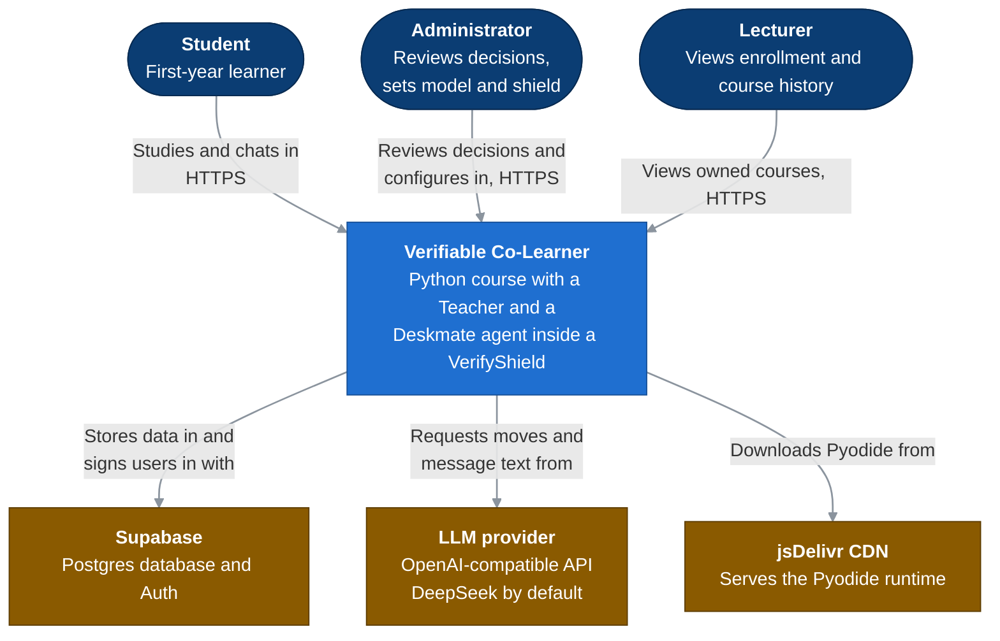

# C4 Level 1: System Context

> [C4 index](README.md) / Level 1: Context

The Verifiable Co-Learner is a web application in which first-year students learn Python
with two LLM agents (a Teacher and a Deskmate). A deterministic VerifyShield rules on every move
the agents propose before the student sees any text.

Terms follow `CONTEXT.md` (Student, Administrator, VerifyShield, Move, Decision log).

How to read the diagrams in `docs/c4/`: blue is code in this repo, grey is another part of this
repo, brown is an external system, teal is a database. Box colours are fixed so they stay readable
in light and dark themes; arrow labels follow the theme.

## Elements

| Element | Type | Notes |
|---|---|---|
| Student | Person | Signs in with Supabase Auth to study and practise. |
| Administrator | Person | Identified by email against the `adminEmails` setting. Sees decisions and settings, never a student's code. |
| Lecturer | Person | Identified by the `LECTURER_EMAILS` list. Sees enrollment counts and course history for owned courses. |
| Verifiable Co-Learner | System | The system in scope. Detailed in [02-containers.md](02-containers.md). |
| Supabase | External system | Hosts Postgres (schema in `supabase/migrations/`) and Supabase Auth. |
| LLM provider | External system | Configured by env (`NUXT_MODEL_*`) or by the administrator on `/admin`. A scripted fake model exists for use without a network. |
| jsDelivr CDN | External system | `web/app/python/browser-worker.mjs` loads Pyodide from `https://cdn.jsdelivr.net/pyodide/v<version>/full/`. Without it the student's browser cannot run or check Python. |

## Out of scope for this diagram

- Deployment: see [04-deployment.md](04-deployment.md) for the current setup (localhost + Supabase cloud). AWS is planned but not designed yet.
- Developer tooling (Supabase MCP server, Playwright, Claude Code skills).
- Fonts (Inter, JetBrains Mono are named in `main.css`): whether they are fetched from an external host was not verified.
