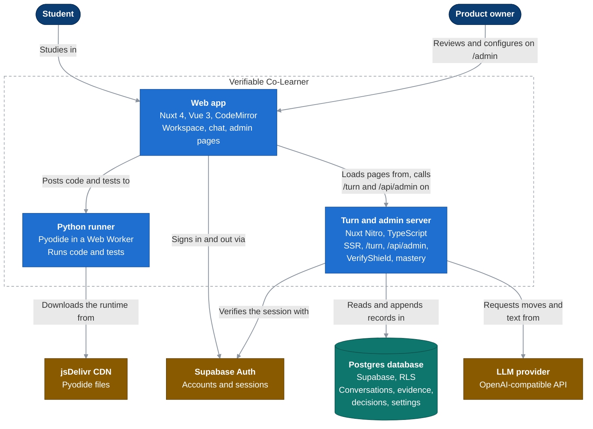

# C4 Level 2: Containers

> [C4 index](README.md) / Level 2: Containers

The application is one Nuxt 4 codebase (`web/`) that runs as two runtime containers: a browser
single-page app (with a Pyodide worker) and a Nitro server. Data and sign-in live in Supabase.

Colours: blue is code in this repo, brown is an external system, teal is a database.

## Containers

| Container | Technology | Responsibility |
|---|---|---|
| Web app | Nuxt 4, Vue 3, Nuxt UI, Tailwind 4, CodeMirror 6 | Renders the workspace (Study and Roadmap layouts), chat, practice panel, About and admin pages. Keeps drafts and roadmap arrangement in `localStorage` and layout in a cookie. Code in `web/app/`. |
| Python runner | Pyodide 314, Web Worker | Executes the student's code for Run and for the tests on Submit. Loads the runtime from jsDelivr (`browser-worker.mjs`). The browser then sends the test results to the server as counts (ADR 0002: the server trusts them). Code in `web/app/python/`. |
| Turn and admin server | Nuxt Nitro (`web/server/`) | Also renders pages on the server (SSR) and checks the session before rendering `/sign-in` and `/`. API: `POST /turn` (streamed NDJSON), `POST /api/admin`, `GET /course-outline`. Runs the turn handler, the VerifyShield (`verify-shield/`), BKT mastery (`student-model/`), the course (built from the course spec it reads from the database) and the language-model layer. |
| Postgres database | Supabase Postgres | Tables `courses` (each course's whole course spec, teacher-only content included, readable only with the secret key), `students`, `conversations`, `messages`, `resume_points`, `evidence`, `quiz_answers`, `decisions`, `model_settings`, `verify_shield_settings`. Written by the server with the secret key, which bypasses RLS. The two ledgers (`evidence`, `quiz_answers`) are append-only: no policy, and update and delete revoked from the anon and authenticated roles. Student data (`evidence`, `quiz_answers`, `conversations`, `resume_points`, `decisions`) carries a `course_id`. |
| Supabase Auth | Supabase | Email sign-in. A trigger on `auth.users` creates the matching `students` row. |
| LLM provider | OpenAI-compatible API | Both agents call it twice per turn: once to propose a move, once to render text for an approved move. |
| jsDelivr CDN | Public CDN | Serves the Pyodide runtime to the browser. |

## Notes

- The VerifyShield, the agents, the language-model layer and the student model (evidence ledger and BKT estimate) are components inside the server
  container, not separate containers: they are not deployed on their own. See
  [server/00-overview.md](03-components/server/00-overview.md).
- Supabase Postgres and Supabase Auth are drawn as two elements for clarity but belong to the one
  external system "Supabase" in [01-context.md](01-context.md).
- `web/server/python/node-runner.ts` (Python on the server) is imported only by
  `web/tests/python-runner.test.ts` (checked by search over `web/`), so it is not drawn. If the
  server starts to run Python in production, add it then.
- The browser never reads or writes the database. Verified: nothing under `web/app/` calls
  `supabase.from(...)` or creates its own client; the only browser use of `$supabase` is
  `signInWithPassword`, `signOut` and `getClaims`. All data access is in `web/server/storage/`.
  RLS also denies a signed-in student on `students` (`web/tests/students-boundary.test.ts`).
- The browser's `$supabase` client and the server's request client both use the publishable key;
  only the server's storage clients use the secret key.
- Deployment is in [04-deployment.md](04-deployment.md).
