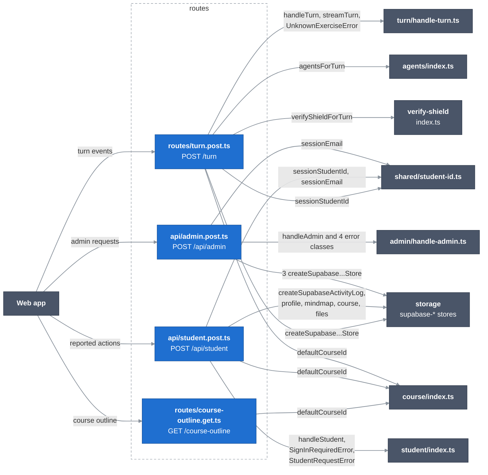

# Component: routes

> [C4 index](../../README.md) / Level 3: Components / Turn and admin server

HTTP endpoints of the server. They only read the session, build the dependencies, call a handler and map
errors to HTTP status codes. Part of [server/00-overview.md](00-overview.md).

Legend: solid = runtime import, thick = HTTP call with no import. Blue = this component, grey = another component.

## Files

| File | Responsibility (from the code) |
|---|---|
| `routes/turn.post.ts` | Returns 401 when there is no session. Navigation events (`select_module`, `select_exercise`, `preview_module`) skip the model and shield reads. `message` and `submission` events are answered as an NDJSON stream; the other events as JSON. Builds the Supabase stores on every request (the model-settings and shield stores only for events that call the model), including the activity log, and passes them to `handleTurn` or `streamTurn`. |
| `api/student.post.ts` | Returns 401 when there is no session and 400 for a rejected report. Builds the activity log, course, profile, mindmap and student-file stores and passes them to `handleStudent`. A preview is not selected here. |
| `api/admin.post.ts` | Passes the session email, `adminEmails`, the env model settings and three stores to `handleAdmin`. Maps `SignInRequiredError`, `ProductOwnerRequiredError`, `ModelSettingsError` and `AdminRequestError` to their `statusCode`. |
| `routes/course-outline.get.ts` | Public course outline for the About page: number, name, part, summary, availability, of the course read through the Supabase course store. No student data and none of the teacher-only content. |

## Verified imports

- `turn.post.ts`: `shared/student-id`, `agents` (`agentsForTurn`), `course` (`defaultCourseId`), `storage/supabase-conversation-store`, `supabase-decision-log`, `supabase-deskmate-setting-store`, `supabase-evidence-store`, `supabase-quiz-answer-store`, `supabase-model-settings-store`, `supabase-verify-shield-store`, `supabase-unlock-store`, `supabase-course-store`, `supabase-activity-log`, `verify-shield` (`verifyShieldForTurn`), `turn/handle-turn`.
- `student.post.ts`: `shared/student-id`, `course` (`defaultCourseId`), `storage/supabase-activity-log`, `supabase-course-store`, `supabase-mindmap-store`, `supabase-profile-store`, `supabase-student-file-store`, `student` (`handleStudent`, `SignInRequiredError`, `StudentRequestError`).
- `admin.post.ts`: `shared/student-id`, `admin/handle-admin`, `storage/supabase-decision-log`, `supabase-model-settings-store`, `supabase-verify-shield-store`.
- `course-outline.get.ts`: `course` (`defaultCourseId`), `storage` (`supabase-course-store`).
- `turn.post.ts` names the course of the turn (`defaultCourseId`: every student is enrolled in the Python course in sprint 1), creates the stores of student data for that course, and passes the Supabase course store and the course id to the turn handler.
- Auto-imported, no import statement: `defineEventHandler`, `readBody`, `createError`, `sendStream`, `setResponseHeader`, `useRuntimeConfig`.

## Tests

No test imports these files. `turn-endpoint.test.ts` tests `handle-turn.ts` directly, not the route.
