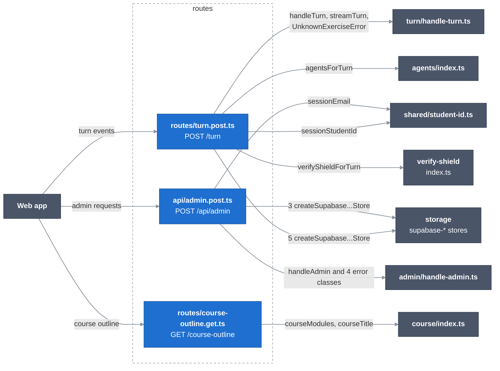

# Component: routes

> [C4 index](../../README.md) / Level 3: Components / Turn and admin server

HTTP endpoints of the server. They only read the session, build the dependencies, call a handler and map
errors to HTTP status codes. Part of [server/00-overview.md](00-overview.md).

Legend: solid = runtime import, thick = HTTP call with no import. Blue = this component, grey = another component.

## Files

| File | Responsibility (from the code) |
|---|---|
| `routes/turn.post.ts` | Returns 401 when there is no session. Navigation events (`select_module`, `select_exercise`, `preview_module`) skip the model and shield reads. `message` and `submission` events are answered as an NDJSON stream; the other events as JSON. Builds the Supabase stores on every request (the model-settings and shield stores only for events that call the model) and passes them to `handleTurn` or `streamTurn`. |
| `api/admin.post.ts` | Passes the session email, `adminEmails`, the env model settings and three stores to `handleAdmin`. Maps `SignInRequiredError`, `ProductOwnerRequiredError`, `ModelSettingsError` and `AdminRequestError` to their `statusCode`. |
| `routes/course-outline.get.ts` | Public course outline for the About page: number, name, part, summary, availability. No student data. |

## Verified imports

- `turn.post.ts`: `shared/student-id`, `agents` (`agentsForTurn`), `storage/supabase-conversation-store`, `supabase-decision-log`, `supabase-evidence-store`, `supabase-model-settings-store`, `supabase-verify-shield-store`, `verify-shield` (`verifyShieldForTurn`), `turn/handle-turn`.
- `admin.post.ts`: `shared/student-id`, `admin/handle-admin`, `storage/supabase-decision-log`, `supabase-model-settings-store`, `supabase-verify-shield-store`.
- `course-outline.get.ts`: `course` (`courseModules`, `courseTitle`).
- Auto-imported, no import statement: `defineEventHandler`, `readBody`, `createError`, `sendStream`, `setResponseHeader`, `useRuntimeConfig`.

## Tests

No test imports these files. `turn-endpoint.test.ts` tests `handle-turn.ts` directly, not the route.
