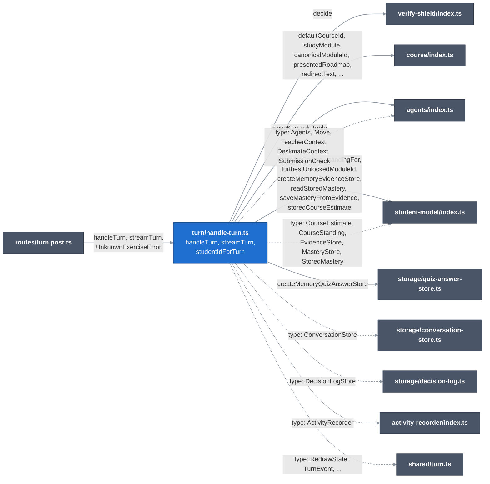

# Component: turn

> [C4 index](../../README.md) / Level 3: Components / Turn and admin server

`web/server/turn/handle-turn.ts`, one file. It runs one turn: it reads the student's standing, asks the agents
for moves, has the VerifyShield rule on them, renders text for approved moves, stores the conversation and
returns the screen state. Part of [server/00-overview.md](00-overview.md).

Legend: solid = runtime import, dashed = type-only import. Blue = this component, grey = other components.

## What the file does, by event

| Event in the request body | Behaviour (from the code) |
|---|---|
| `open` | Settles the placement from the resume point and evidence. First visit to a module: Teacher proposes a move; if it is not a teaching move, an `explain_concept` introduction is ruled instead. Redirect, or rendered text, or nothing is stored. Appends no activity event. |
| `select_module`, `preview_module` | A closed or unknown module changes nothing. Otherwise returns that module's state. Only `select_module` saves the resume point. Appends no activity event; the workspace reports `module_opened` to the student handler after a successful open. |
| `select_exercise` | Saves the resume point and appends an `event` message with the exercise title. |
| `quiz_answer` | Marks the chosen option against the module's quiz on the server. The first answer to a question is written to the `quiz_answers` ledger and an `event` message (`Quiz N: chose B, wrong`) is appended; a later answer to the same question changes neither. The turn recomputes mastery from the merged ledger, saves that new number, and returns the updated roadmap. A wrong first answer then starts an agent turn, as a failed submission does; a right answer, and a repeat of an answered question, calls no model. The working area carries each question's result (the correct choice and explanation) only once answered. The first stored answer also appends one `quiz_answered` activity event; a repeat appends nothing. That event is not evidence. |
| `submission` | Appends one evidence row, recomputes mastery and saves it, appends an `event` message (`N/M tests passed`), then answers like a message. Also appends one `submitted` activity event with the module, the exercise and the pass count, never the code. The activity event is not evidence; the evidence row is what changes mastery. |
| `message` | Appends the student message (with its optional `addressedAgent`, `teacher` or `deskmate`, stored apart from the text), then the agents taking part each propose a move in parallel; each proposal goes through `decide`, so redirects and the role table still apply; approved moves are rendered by the model and streamed; every proposal and verdict is written to the decision log with the turn's `addressedAgent` (null when none). Unaddressed: Teacher, then Mai. Addressed to `teacher` or `deskmate`: only that agent is called. Also appends one `message_sent` activity event with the module and whether the message quoted something, never the text, the draft or a run. |
| `deskmate_switch` | `{on: boolean}`. Saves the session student's own deskmate switch (`options.deskmateSettings`; a student id in the body is ignored) and returns the state. While the switch is off Mai is never called, so no deskmate proposal or decision is recorded, on any turn; a message addressed to `deskmate` is handled as unaddressed (Teacher only), its decisions record a null addressed agent, and the state carries `notice: 'Mai is switched off.'`. Every returned state carries `deskmateOn` (on by default). |

## Verified imports

- Runtime: `course` (`defaultCourseId`, `studyModule`, `canonicalModuleId`, roadmap helpers), `storage` (`createMemoryCourseStore`, the default when `options.courses` is not passed). The course is read once a turn from `options.courses` (`options.courseId`, else `defaultCourseId`), in parallel with the ledger and the resume point, and travels on the `Placement` (course, module, exercise), so every helper, the student model and `decide` read the same course; `agents` (`moveKey`, `roleTable`), `student-model` (`estimateCourse`, `standingFor`, `furthestUnlockedModuleId`, `readStoredMastery`, `saveMasteryFromEvidence`, `storedCourseEstimate`, and `createMemoryEvidenceStore`, used when no store is passed), `verify-shield` (`decide`).
- Type only: `shared/turn`, `agents` (`Agents`, `Move`, contexts), `verify-shield` (`Proposal`, `TurnSnapshot`, `Verdict`), `student-model` (`CourseEstimate`, `CourseStanding`, `EvidenceStore`, `MasteryStore`, `StoredMastery`), `storage/conversation-store`, `storage/decision-log`, `storage/deskmate-setting-store`, `storage/quiz-answer-store` (`QuizAnswerStore`, `QuizAnswerRow`; its in-memory version is used at runtime when no store is passed), `activity-recorder` (`ActivityRecorder`). The in-memory activity log is passed in by tests; the route passes the Supabase adapter.
- It imports no Supabase code. The model, the stores and the options are passed in as arguments (`handleTurn(request, store, agents, options)`), which is why `turn-endpoint.test.ts` can run it with in-memory stores.

## Importers and tests

- Imported by `routes/turn.post.ts`.
- Tests: `turn-endpoint.test.ts`, `deskmate-switch.test.ts` (the switch and the addressed agent), `quiz-answer.test.ts`, `wrong-quiz-brings-agents.test.ts`, `move-contract.test.ts`, `prompt-hardening.test.ts`, `real-language-model.test.ts`, `admin-handler.test.ts`, `stored-mastery-turn.test.ts` (the stored copy is what the response shows, and new evidence is what changes it) — all call `handleTurn` with in-memory stores.

## Notes

- Each turn reads the current course threshold and uses the resulting standing for the roadmap, the stored copy and VerifyShield. Mastery comes from `options.mastery` (ADR 0008): a submission or a quiz answer recomputes it from the ledger and saves it, and every other turn reads the stored rows, rebuilding them from the ledger first when the student has no row for a module of the course. Without `options.mastery` the turn estimates from the ledger on every request, as before the table existed. The server records newly opened modules in `module_unlocks`. Decisions log the stored numbers and the threshold used on that turn.

- Render text is streamed straight from the model to the student. In this file there is no check of the rendered text, only of the proposed move. See the note in [server/03-verify-shield.md](03-verify-shield.md).
- If a model call fails, the student sees a fixed fallback message and the server logs the cause with `console.error`.
