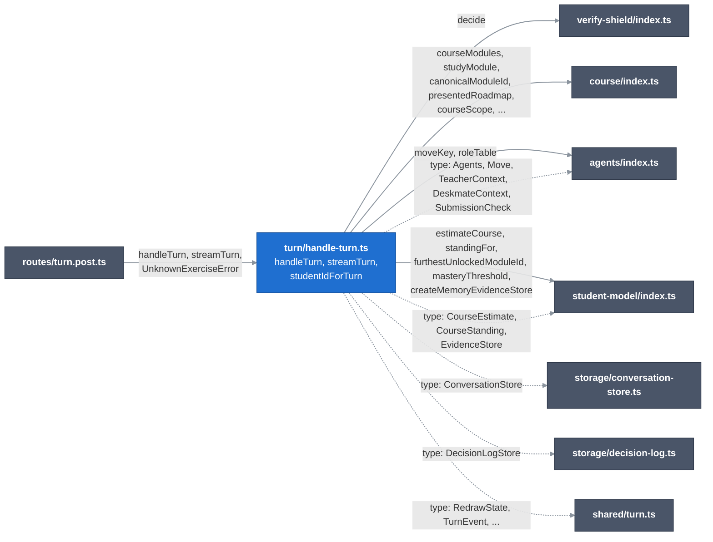

# Component: turn

> [C4 index](../../README.md) / Level 3: Components / Turn and admin server

`web/server/turn/handle-turn.ts`, one file. It runs one turn: it reads the student's standing, asks the agents
for moves, has the VerifyShield rule on them, renders text for approved moves, stores the conversation and
returns the screen state. Part of [server/00-overview.md](00-overview.md).

Legend: solid = runtime import, dashed = type-only import. Blue = this component, grey = other components.

## What the file does, by event

| Event in the request body | Behaviour (from the code) |
|---|---|
| `open` | Settles the placement from the resume point and evidence. First visit to a module: Teacher proposes a move; if it is not a teaching move, an `explain_concept` introduction is ruled instead. Redirect, or rendered text, or nothing is stored. |
| `select_module`, `preview_module` | A closed or unknown module changes nothing. Otherwise returns that module's state. Only `select_module` saves the resume point. |
| `select_exercise` | Saves the resume point and appends an `event` message with the exercise title. |
| `submission` | Appends one evidence row, recomputes mastery, appends an `event` message (`N/M tests passed`), then answers like a message. |
| `message` | Appends the student message, then Teacher and Deskmate each propose a move in parallel; each proposal goes through `decide`; approved moves are rendered by the model and streamed; every proposal and verdict is written to the decision log. |

## Verified imports

- Runtime: `course` (`courseModules`, `studyModule`, `canonicalModuleId`, roadmap helpers), `agents` (`moveKey`, `roleTable`), `student-model` (`estimateCourse`, `standingFor`, `furthestUnlockedModuleId`, `masteryThreshold`, and `createMemoryEvidenceStore`, used when no store is passed), `verify-shield` (`decide`).
- Type only: `shared/turn`, `agents` (`Agents`, `Move`, contexts), `verify-shield` (`Proposal`, `TurnSnapshot`, `Verdict`), `student-model` (`CourseEstimate`, `CourseStanding`, `EvidenceStore`), `storage/conversation-store`, `storage/decision-log`.
- It imports no Supabase code. The model, the stores and the options are passed in as arguments (`handleTurn(request, store, agents, options)`), which is why `turn-endpoint.test.ts` can run it with in-memory stores.

## Importers and tests

- Imported by `routes/turn.post.ts`.
- Tests: `turn-endpoint.test.ts`, `admin-handler.test.ts`.

## Notes

- Render text is streamed straight from the model to the student. In this file there is no check of the rendered text, only of the proposed move. See the note in [server/03-verify-shield.md](03-verify-shield.md).
- If a model call fails, the student sees a fixed fallback message and the server logs the cause with `console.error`.
