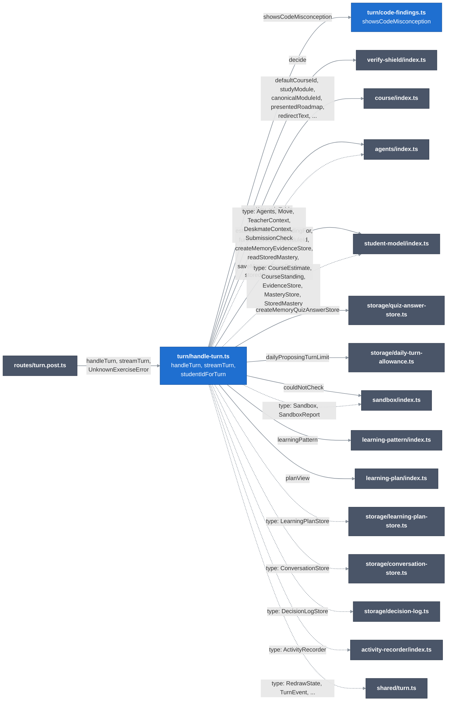

# Component: turn

> [C4 index](../../README.md) / Level 3: Components / Turn and admin server

`web/server/turn/`, the turn handler. `handle-turn.ts` runs one turn: it reads the student's standing, asks the agents
for moves, has the VerifyShield rule on them, renders text for approved moves, stores the conversation and
returns the screen state. `code-findings.ts` answers one question about a submission: does the code show the module's
declared misconception? Part of [server/00-overview.md](00-overview.md).

Legend: solid = runtime import, dashed = type-only import. Blue = this component, grey = other components.

> The Teacher's propose step gets the turn's [agent-tools](13-agent-tools.md), bound to the turn's student standing and course. Its tool calls go on its decisions as `toolTrace` (`tool_trace`); a Teacher whose tool loop ended at the 3-step cap gives no move and is recorded as a `none` decision with outcome `step_cap`, which is not a VerifyShield ruling and so has no verdict, rule or reason; a loop that stopped earlier without a move is just a quiet Teacher and is not recorded. Every decision of the turn is built through one path, with only its ending (ruled or step cap) differing. Mastery is no longer in the Teacher's context.

## What the file does, by event

| Event in the request body | Behaviour (from the code) |
|---|---|
| `open` | Settles the placement from the resume point and evidence. First visit to a module: Teacher proposes a move; if it is not a teaching move, an `explain_concept` introduction is ruled instead. Redirect, or rendered text, or nothing is stored. That first visit uses one of the student's 60 proposing turns for the Hanoi calendar day. When the day is full the module still opens, the state carries the daily-limit notice, and the Teacher is not called. When a plan store is wired, the Teacher is then asked for a plan for that module (`Teacher.plan`) if none is in force; the proposal is ruled by the VerifyShield and only a `propose_plan` whose steps survive is stored, as revision 1. The state carries `learningPlan`. Appends no activity event. |
| `select_module`, `preview_module` | A closed or unknown module changes nothing. Otherwise returns that module's state. Only `select_module` saves the resume point. `select_module` also asks for a plan when none is in force, as `open` does; a preview only reads the latest plan and never proposes or writes one. Appends no activity event; the workspace reports `module_opened` to the student handler after a successful open. |
| `plan_start` | Agreeing to the Teacher's plan. Reads the latest plan and, while it is unagreed, appends the next revision with `agreedAt` set to the turn's clock (no stored row is rewritten). A module with no plan, or one already agreed, changes nothing. Calls no model and uses none of the 60. The state carries the agreed plan. |
| `select_exercise` | Saves the resume point and appends an `event` message with the exercise title. |
| `quiz_answer` | Marks the chosen option against the module's quiz on the server. The first answer to a question is written to the `quiz_answers` ledger and an `event` message (`Quiz N: chose B, wrong`) is appended; a later answer to the same question changes neither. The turn recomputes mastery from the merged ledger, saves that new number, and returns the updated roadmap. A wrong first answer then starts an agent turn, as a failed submission does, and that turn uses one of the 60; a right answer, and a repeat of an answered question, calls no model and uses none. When the day is full the answer is still stored and no agent is called. The working area carries each question's result (the correct choice and explanation) only once answered. The first stored answer also appends one `quiz_answered` activity event; a repeat appends nothing. That event is not evidence. |
| `submission` | Asks the sandbox to run the code with the exercise's tests. The counts in the request are ignored. A `checked` report appends one evidence row from those results, recomputes mastery and saves it, stores the code, the per-test results, the findings (`code-findings.ts` run against the module's declared `codeMisconception`) and `passed` or `failed`, appends an `event` message (`N/M tests passed`), then answers like a message. Answering uses one of the 60 proposing turns. When the day is full the evidence and the event message are still stored, and no agent is called. Also appends one `submitted` activity event with the module, the exercise and the sandbox's pass count, never the code. A `refused` report (a disallowed import, or past 10 seconds, 512 MB or 64 KB) stores the code, the findings its text shows and the plain message, appends that message, records no evidence, and does not call the agents. Without a sandbox the turn refuses with "This submission could not be checked." |
| `message` | Appends the student message (with its optional `addressedAgent`, `teacher` or `deskmate`, stored apart from the text), then the agents taking part each propose a move in parallel; each proposal goes through `decide`, so redirects and the role table still apply; approved moves are rendered by the model and streamed; every proposal and verdict is written to the decision log with the turn's `addressedAgent` (null when none). Unaddressed: Teacher, then Mai. Addressed to `teacher` or `deskmate`: only that agent is called. Either way it is one proposing turn. When the day is full the student message is still stored, no agent is called, no decision is recorded, and the state carries `notice: 'You have used your 60 turns for today. The agents will answer again tomorrow.'`. Also appends one `message_sent` activity event with the module and whether the message quoted something, never the text, the draft or a run. |
| `deskmate_switch` | `{on: boolean}`. Saves the session student's own deskmate switch (`options.deskmateSettings`; a student id in the body is ignored) and returns the state. While the switch is off Mai is never called, so no deskmate proposal or decision is recorded, on any turn; a message addressed to `deskmate` is handled as unaddressed (Teacher only), its decisions record a null addressed agent, and the state carries `notice: 'Mai is switched off.'`. Every returned state carries `deskmateOn` (on by default). |

## Verified imports

- Runtime: `course` (`defaultCourseId`, `studyModule`, `canonicalModuleId`, roadmap helpers), `./code-findings` (`showsCodeMisconception`), `storage` (`createMemoryCourseStore`, the default when `options.courses` is not passed; `dailyProposingTurnLimit` from `daily-turn-allowance`), `sandbox` (`couldNotCheck`), `learning-pattern` (`learningPattern`), `learning-plan` (`planView`). The course is read once a turn from `options.courses` (`options.courseId`, else `defaultCourseId`), in parallel with the ledger and the resume point, and travels on the `Placement` (course, module, exercise), so every helper, the student model and `decide` read the same course; `agents` (`moveKey`, `roleTable`), `student-model` (`estimateCourse`, `standingFor`, `furthestUnlockedModuleId`, `readStoredMastery`, `saveMasteryFromEvidence`, `storedCourseEstimate`, and `createMemoryEvidenceStore`, used when no store is passed), `verify-shield` (`decide`).
- Type only: `shared/turn`, `agents` (`Agents`, `Move`, contexts), `verify-shield` (`Proposal`, `TurnSnapshot`, `Verdict`), `student-model` (`CourseEstimate`, `CourseStanding`, `EvidenceStore`, `MasteryStore`, `StoredMastery`), `storage/conversation-store`, `storage/decision-log`, `storage/deskmate-setting-store`, `storage/daily-turn-allowance` (`DailyTurnAllowance`), `storage/quiz-answer-store` (`QuizAnswerStore`, `QuizAnswerRow`; its in-memory version is used at runtime when no store is passed), `storage/submission-store` (`SubmissionStore`, `NewSubmission`), `storage/learning-plan-store` (`LearningPlanStore`), `sandbox` (`Sandbox`, `SandboxReport`), `activity-recorder` (`ActivityRecorder`). The in-memory activity log is passed in by tests; the route passes the Supabase adapter. The in-memory daily allowance is passed in by tests; the route passes the Supabase adapter. Without `options.dailyTurns` the limit does not apply. The sandbox and the submission store are passed the same way: the route passes the submission sandbox (Lambda in Sydney when `NUXT_SANDBOX_FUNCTION` is set, otherwise the local image) and the Supabase submission store, and the turn tests pass a fake sandbox and the in-memory submission store.
- It imports no Supabase code. The model, the stores and the options are passed in as arguments (`handleTurn(request, store, agents, options)`), which is why `turn-endpoint.test.ts` can run it with in-memory stores.

## Importers and tests

- Imported by `routes/turn.post.ts`.
- Tests: `turn-endpoint.test.ts`, `code-findings.test.ts` (each module's declared checks, and the reference solutions), `misconception-evidence.test.ts` (the Teacher's misconception claim stands only on the student's code or quiz answers), `deskmate-switch.test.ts` (the switch and the addressed agent), `daily-turn-limit.test.ts` (the 60 proposing turns), `decision-version.test.ts` (each decision records the code version and course history entry the turn was given), `quiz-answer.test.ts`, `wrong-quiz-brings-agents.test.ts`, `move-contract.test.ts`, `prompt-hardening.test.ts`, `real-language-model.test.ts`, `admin-handler.test.ts`, `stored-mastery-turn.test.ts` (the stored copy is what the response shows, and new evidence is what changes it), `sandbox-submission.test.ts` (a forged browser pass does not move mastery; a refusal records no pass; findings are stored with the submission), `learning-pattern-turn.test.ts` (the pattern reaches the Teacher's prompt and the decisions, Mai never sees it, the student sees plain words, mastery is untouched) — all call `handleTurn` with in-memory stores. `learning-plan-turn.test.ts` covers the plan: proposed once per module, agreed as a new revision, kept across a reload, mastery untouched, previews never propose, and the decision is logged.

## Notes

- Each turn reads the current course threshold and uses the resulting standing for the roadmap, the stored copy and VerifyShield. Mastery comes from `options.mastery` (ADR 0008): a submission or a quiz answer recomputes it from the ledger and saves it, and every other turn reads the stored rows, rebuilding them from the ledger first when the student has no row for a module of the course. Without `options.mastery` the turn estimates from the ledger on every request, as before the table existed. The server records newly opened modules in `module_unlocks`. Decisions log the stored numbers and the threshold used on that turn. When `options.codeVersion` or `options.courseHistoryId` is passed, every decision of the turn records both (null when that one was left out). The route passes `currentCodeVersion()` from `server/code-version.ts` (`CODE_VERSION`, else `RENDER_GIT_COMMIT`, else the git commit, else `unknown`). The database sets the course history entry on insert: the latest `course_history` row for the course. It also sets the hashes.
- A proposing turn is reserved before any agent is called, one per student per Hanoi calendar day (`Asia/Ho_Chi_Minh`), from `options.now` or the real clock. Choosing a module or exercise, switching Mai, a right quiz answer, a repeated quiz answer and a later visit do not reserve one. The next calendar day starts again at midnight, and one student's full day leaves every other student untouched. The reservation is `options.dailyTurns.take`; the Supabase version does it in one statement so two requests cannot both take the last turn.
- The turn snapshot's `shownMisconceptionIds` is the union of the findings the work shows and the misconception ids of the student's wrong quiz answers. On a submission turn the findings are read from the code in hand; on any other turn they come from the latest stored submission for the placed exercise (`SubmissionStore.latestForExercise`) or from the submission already in hand, when there is one. The same findings go to the Teacher's context as `codeFindings`, so the prompt lists the misconceptions the code shows and the Teacher proposes only those.
- `code-findings.ts` reads text, not a Python parse tree: it strips comments, blanks string contents, and matches the checks the module's spec declares (`unquoted_text`, `text_plus_number`, `separate_branches`, `accumulator_reset`, `sum_instead_of_loop`, `index_from_one`). Each check is narrow on purpose, and `code-findings.test.ts` checks that every module's reference solutions yield no finding.
- Each turn that calls an agent also computes the student's [learning pattern](16-learning-pattern.md) from their records in the course (evidence, submissions and their findings, wrong quiz answers that name a misconception, the activity log and the decision log). The Teacher's context carries the whole pattern and its prompt names it; the Deskmate's context never carries it. Every decision the turn records carries the turn's module id and the pattern snapshot the Teacher saw (`module_id`, `learning_pattern` on `decisions`). The returned state carries the weak spots in plain words (each spot's misconception response text from the course spec) as `weakSpots`. The pattern never changes mastery or an unlock.
- The [learning plan](17-learning-plan.md) is asked for only when `options.plans` is wired, on `open` and `select_module` while no plan is in force. The Teacher's plan call is separate from its everyday proposing: its own instructions (`teacherPlanInstructions`) and prompt (`teacherPlanPrompt`), listing the module's exercises, quiz questions and misconceptions. The VerifyShield holds it to one to five steps, each pointing at that module (and a misconception step only for a pattern weak spot); the turn stores only what the rules let through, and the turn snapshot carries `planTargets` and `weakSpotMisconceptionIds` for those rules. A plan proposal is not a proposing turn: it uses none of the 60, appends no activity event, and changes no mastery — proposing writes only the plan revision, and Start appends `agreedAt` as the next revision.

- Render text is streamed straight from the model to the student. In this file there is no check of the rendered text, only of the proposed move. See the note in [server/03-verify-shield.md](03-verify-shield.md).
- If a model call fails, the student sees a fixed fallback message and the server logs the cause with `console.error`.
