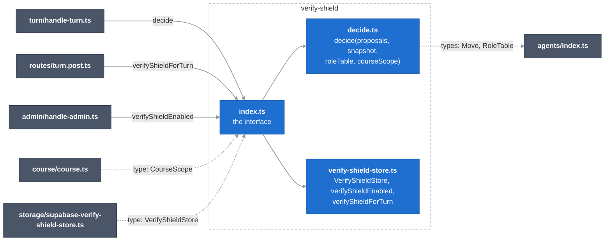

# Component: verify-shield

> [C4 index](../../README.md) / Level 3: Components / Turn and admin server

`web/server/verify-shield/`, the VerifyShield. It rules on each proposed move (allow, block or downgrade to a
redirect) and owns the on/off switch that turns that ruling off for every student. Everything outside the folder
goes through `index.ts`. Part of [server/00-overview.md](00-overview.md).

Legend: solid = runtime import, dashed = type-only import. Blue = this component, grey = other components.

## Interface (`index.ts`)

| Export | Kind | What it is for |
|---|---|---|
| `decide(proposals, snapshot, roleTable, courseScope)` | function | The ruling. Pure: the same inputs always give the same verdicts. |
| `Proposal`, `Verdict`, `TurnSnapshot` | types | What goes into and comes out of `decide`. |
| `CourseScope`, `CourseModule`, `ModuleMastery` | types | The course facts `decide` reads. `course/course.ts` builds a `CourseScope`. |
| `VerifyShieldStore` | type | `read()` and `save(enabled)` for the saved switch. |
| `createMemoryVerifyShieldStore` | function | In-memory store for tests and local runs. |
| `verifyShieldEnabled(envValue, saved)` | function | A saved row wins; otherwise the environment is on unless it says `off`, `false` or `0`. |
| `verifyShieldForTurn(store, envValue)` | function | Reads the saved switch (a failed read counts as no saved value) and applies `verifyShieldEnabled`. |

The Supabase version of the store stays in [`storage`](08-storage.md) (`supabase-verify-shield-store.ts`), so the
code that depends on Supabase stays in one place. It imports only the `VerifyShieldStore` type from here.

## Rules, in the order they are applied

| Order | Rule id | Reason code | Outcome |
|---|---|---|---|
| 1 | `verify_shield` | `VERIFYSHELD_OFF` | Shield switched off: every proposal is allowed unchanged. |
| 2 | `role_table` | `ROLE_FORBIDDEN` | No module or exercise in the snapshot: block. |
| 3 | `role_table` | `ROLE_FORBIDDEN` | The agent may not propose this move type (for example Deskmate proposing `explain_concept`): block. |
| 4 | `scope_keyword` | `OUT_OF_COURSE_KEYWORD`, `MODULE_CLOSED_KEYWORD` | Teacher teaching move on an unlocked scope, but the student's message names an out-of-course keyword or a closed module: downgrade to `redirect_to_module`. |
| 5 | `scope_in_course` | `OUT_OF_COURSE` | Teaching move labelled `out_of_course`: downgrade to redirect. |
| 6 | `scope_requires_unlocked_module` | `MODULE_CLOSED` | Teaching move whose scope is not unlocked: downgrade to redirect. Also applies to `advance_to_item` toward a locked module. |
| 7 | `role_table` | `ROLE_PERMITTED` | Allow. |

Note the code spells the reason code `VERIFYSHELD_OFF` (as it does the env var `NUXT_VERIFYSHELD`). Anything that
filters decisions by reason code needs that spelling.

## Verified imports

- Imports: types only (`agents` for `Move` and `RoleTable`). It has no runtime import, no I/O and no clock.
- Runtime importers, all through `index.ts`: `turn/handle-turn.ts` (`decide`), `routes/turn.post.ts` (`verifyShieldForTurn`), `admin/handle-admin.ts` (`verifyShieldEnabled`).
- Type-only importers: `course/course.ts` (`CourseScope`), `storage/supabase-verify-shield-store.ts` (`VerifyShieldStore`).
- Tests: `decide.test.ts` (also imports `course` and `agents` for `roleTable`), `verify-shield.test.ts`, `admin-handler.test.ts`. All import from `server/verify-shield`.
- The prompt-injection harness (`docs/security/harness/decision-provider.mjs`) imports `verify-shield/decide.ts` directly, because Node cannot resolve the extensionless imports inside `index.ts`.

## Notes

- `CONTEXT.md` defines the VerifyShield as also checking "every rendered text before the student sees it". `decide.ts` rules only on proposed moves, and `handle-turn.ts` streams rendered text without a further check. I found no code that checks rendered text. This is a gap between the glossary and the code, not a bug I can confirm; it may be planned work.
- ADR 0001 says the scope label comes from the language model and is ruled on here, with the keyword list as a backstop. That matches the code (rules 4 to 6).
- The role table lives in [`agents`](06-agents.md) and `decide` receives it as an argument. `course` imports the `CourseScope` type from here; `verify-shield` imports nothing from `course`.
