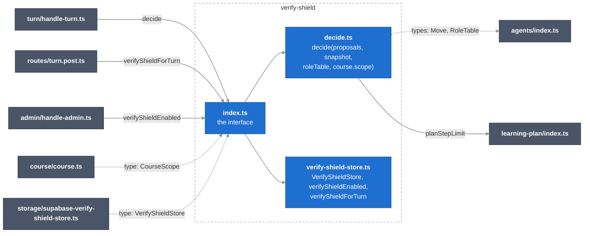

# Component: verify-shield

> [C4 index](../../README.md) / Level 3: Components / Turn and admin server

`web/server/verify-shield/`, the VerifyShield. It rules on each proposed move (allow, block, or downgrade to a
redirect, a lower hint rung, or a plain answer) and owns the on/off switch that turns that ruling off for every student. Everything outside the folder
goes through `index.ts`. Part of [server/00-overview.md](00-overview.md).

Legend: solid = runtime import, dashed = type-only import. Blue = this component, grey = other components.

## Interface (`index.ts`)

| Export | Kind | What it is for |
|---|---|---|
| `decide(proposals, snapshot, roleTable, courseScope)` | function | The ruling. Pure: the same inputs always give the same verdicts. Every argument is required. |
| `Proposal`, `Verdict`, `TurnSnapshot` | types | What goes into and comes out of `decide`. |
| `CourseScope`, `CourseModule`, `ModuleMastery` | types | The course facts `decide` reads. `course/course.ts` builds a `CourseScope` from the course spec (`Course.scope`); the turn handler passes it in. |
| `VerifyShieldStore` | type | `read()` and `save(enabled)` for the saved switch. |
| `createMemoryVerifyShieldStore` | function | In-memory store for tests and local runs. |
| `verifyShieldEnabled(envValue, saved)` | function | A saved row wins; otherwise the environment is on unless it says `off`, `false` or `0`. |
| `verifyShieldForTurn(store, envValue)` | function | Reads the saved switch (a failed read counts as no saved value) and applies `verifyShieldEnabled`. |

## The turn snapshot (`TurnSnapshot`)

What the VerifyShield knows about the turn. `turn/handle-turn.ts` builds it once a turn. Every field is required,
so leaving one out is a type error rather than a rule that silently does not run or a gap in the decision log; the same goes for the course scope.

| Field | What it holds | Read by |
|---|---|---|
| `moduleId` | The module the student is placed on, which is also the current module (one field, not two). | Rule 2; the fallback scope in rule 4; the target compared in rule 9 |
| `exerciseId` | The exercise the student is placed on. | Rule 2 |
| `masteries` | Mastery per module. | Not ruled on; recorded in the decision log and the VerifyShield trace |
| `unlockedModuleIds` | The open and mastered modules. | Rules 4, 7 and 10 |
| `studentMessage` | The student's text this turn (empty for an opening turn or a submission). | Rule 4 |
| `verifyShieldOn` | The switch. | Rule 1 |
| `highestHintRung` | The highest hint rung already given in the module's conversation (0 if none), worked out by `handle-turn.ts` from the stored approved moves. | Rule 12 |
| `shownMisconceptionIds` | The misconceptions the student's work shows: the findings kept with their latest submission for the placed exercise, plus the misconception ids of their wrong quiz answers, worked out by `handle-turn.ts`. | Rule 11 |
| `planTargets` | What the placed module holds: how many material blocks, and the ids of its exercises, quiz questions and misconception responses. | Rules 13 and 14 |
| `weakSpotMisconceptionIds` | The misconception ids the learning pattern calls weak spots for this student. | Rule 14 |

`verify-shield-contract.test-d.ts` holds the contract at the type level; `vitest run` checks it with `tsc` through
`web/tsconfig.type-tests.json`.

The Supabase version of the store stays in [`storage`](08-storage.md) (`supabase-verify-shield-store.ts`), so the
code that depends on Supabase stays in one place. It imports only the `VerifyShieldStore` type from here.

## Rules, in the order they are applied

| Order | Rule id | Reason code | Outcome |
|---|---|---|---|
| 1 | `verify_shield` | `VERIFYSHIELD_OFF` | Shield switched off: every proposal is allowed unchanged. |
| 2 | `turn_placement` | `NO_PLACEMENT` | No module or exercise in the snapshot: block every proposal. |
| 3 | `role_table` | `ROLE_FORBIDDEN` | The agent may not propose this move type (for example Deskmate proposing `explain_concept`): block. |
| 4 | `scope_keyword` | `OUT_OF_COURSE_KEYWORD`, `MODULE_CLOSED_KEYWORD` | Teacher teaching move on an unlocked scope, but the student's message names an out-of-course keyword or a closed module: downgrade to `redirect_to_module`. |
| 5 | `scope_in_course` | `OUT_OF_COURSE` | Teaching move labelled `out_of_course`: downgrade to redirect. |
| 6 | `scope_in_course` | `SCOPE_UNKNOWN` | Teaching move whose scope is neither a module of the course nor `out_of_course`, i.e. a scope the model invented: downgrade to `redirect_to_module` toward `out_of_course`, so the log matches what the student is told. |
| 7 | `scope_requires_unlocked_module` | `MODULE_CLOSED` | Teaching move whose scope is a course module that is not unlocked: downgrade to redirect. |
| 8 | `advance_known_module` | `ADVANCE_UNKNOWN_MODULE` | `advance_to_module` toward a module the course does not have: block, so the Teacher says nothing for that move. |
| 9 | `advance_not_current_module` | `ADVANCE_TO_CURRENT` | `advance_to_module` toward the module the student is already placed on: downgrade to `stay_and_practise`, so the suggestion makes sense. |
| 10 | `scope_requires_unlocked_module` | `MODULE_CLOSED` | `advance_to_module` toward a module the course has but the student has not unlocked: downgrade to redirect. |
| 11 | `misconception_shown` | `MISCONCEPTION_NOT_SHOWN` | Teacher `address_misconception` whose id is not in `shownMisconceptionIds`: downgrade to `answer_question` on the student's own module (`moduleId`, whatever scope the proposal named). Not a block, so the Teacher still answers while the student is wrong, and only a claim the student's code or quiz answers support stands. The scope rules run first, so an invented id on a closed module still redirects. |
| 12 | `hint_ladder` | `HINT_SKIPPED` | `hint_level_N` more than one rung above `highestHintRung`: downgrade to a `hint_level_N` at rung `highestHintRung + 1` (same scope). A rung at or below the highest given, or exactly one above it, is left alone. |
| 13 | `plan_step_count` | `PLAN_WITHOUT_STEPS`, `PLAN_TOO_LONG` | `propose_plan` with no steps, or more than five (`planStepLimit`): block. |
| 14 | `plan_steps_in_module` | `PLAN_NO_STEPS_IN_MODULE`, `PLAN_STEPS_DROPPED` | `propose_plan` whose steps point away from the placed module. A step fits when it is the module's materials and the module has some, one of its quiz questions, one of its exercises, or one of its misconceptions that the learning pattern calls a weak spot; a repeated step is dropped too. Every step dropped or repeated: block. Some dropped: downgrade to the plan with the steps that fit. |
| 13a | `approach_before_correction` | `APPROACH_NOT_TRIED` | Teacher `hint_level_N` or `address_misconception` while a plan is in force and the student wrote their approach and has run or submitted nothing since (`approachAwaitingTry`): downgrade to `continue_plan`, so the approach is tried before it is corrected. Runs before the misconception and hint rules. |
| 13b | `plan_revision_needs_trigger` | `NO_PLAN_IN_FORCE`, `PLAN_NO_TRIGGER`, `PLAN_TRIGGER_SEEN` | `revise_plan` with no plan in force: block. With a plan but no trigger since its last revision (`planTriggers` empty): downgrade to `continue_plan`. Otherwise passes, and the steps are then held to rules 13 and 14 like a proposal's (a downgrade keeps the `revise_plan` move with the steps that fit). |
| 13c | `plan_in_force` | `NO_PLAN_IN_FORCE`, `PLAN_IN_FORCE` | `continue_plan` (a check-in on the current step) with no plan in force: block. |
| 15 | `role_table` | `ROLE_PERMITTED` | Allow. |

## Rule checks

Each verdict carries `ruleChecks`: the ordered rule checks `decide` made for that proposal, each `{ ruleId, passed, reasonCode }`.
The list ends with the deciding check; on a block or downgrade its rule id and reason code are the verdict's `ruleId` and `reasonCode`. Rules
after the deciding one are not evaluated and do not appear. A rule that passed is recorded with its own reason code:

| Rule id | Passed reason code |
|---|---|
| `role_table` | `ROLE_PERMITTED` |
| `scope_keyword` | `NO_CLOSED_KEYWORD` |
| `scope_in_course` | `IN_COURSE` |
| `scope_requires_unlocked_module` | `MODULE_UNLOCKED` |
| `advance_known_module` | `MODULE_KNOWN` |
| `advance_not_current_module` | `NOT_CURRENT_MODULE` |
| `misconception_shown` | `MISCONCEPTION_SHOWN` |
| `hint_ladder` | `HINT_IN_ORDER` |
| `plan_step_count` | `PLAN_STEP_COUNT_OK` |
| `plan_steps_in_module` | `PLAN_STEPS_IN_MODULE` |

Checks stay in the order the rules ran, so `role_table` is always first. A block or downgrade ends with the failed rule.
An allow lists the rules that passed, then a final deciding `all_rules` / `ALL_RULES_PASSED` check (the verdict itself
keeps `role_table` / `ROLE_PERMITTED`, as logged before). The `RuleCheck` type lives in `shared/turn.ts` and is shared
with the decision log. A shield-off verdict has an empty list; a `NO_PLACEMENT` block has
only the failed `turn_placement` check. `decide` stays pure: the same input gives the same checks. The plain-English
wording of each reason code lives in the web app (`app/admin/decisions.ts`), not here.

The shield-off reason code is `VERIFYSHIELD_OFF`. Set `NUXT_VERIFYSHELD` to configure the shield through the environment.

## Verified imports

- Imports: types only from `agents` (`Move`, `RoleTable`), and one runtime import from
  [`learning-plan`](17-learning-plan.md) (`planStepLimit`). It has no I/O and no clock.
- Runtime importers, all through `index.ts`: `turn/handle-turn.ts` (`decide`), `routes/turn.post.ts` (`verifyShieldForTurn`), `admin/handle-admin.ts` (`verifyShieldEnabled`).
- Type-only importers: `course/course.ts` (`CourseScope`), `storage/supabase-verify-shield-store.ts` (`VerifyShieldStore`).
- Tests: `decide.test.ts` (also imports `course` and `agents` for `roleTable`), `verify-shield-contract.test-d.ts` (types only), `verify-shield.test.ts`, `admin-handler.test.ts`. All import from `server/verify-shield`. `turn-endpoint.test.ts` checks that each verdict reaches the decision log.
- The offline benchmark in `web/benchmark/` calls the turn handler with the existing scripted agents and independent in-memory stores. `pnpm benchmark` runs 25 committed prompt/proposal fixtures with the VerifyShield on and off, reads each verdict from the decision log, and writes paired Markdown and JSON reports. GitHub Check uploads these as an artifact. It adds no runtime component.
- The prompt-injection harness (`docs/security/harness/decision-provider.mjs`) imports `verify-shield/decide.ts` directly, because Node cannot resolve the extensionless imports inside `index.ts`. For the same reason it cannot load `course/course.ts`, so it passes its own one-module course scope.

## Notes

- The VerifyShield rules on moves only, as `CONTEXT.md` says: `handle-turn.ts` streams the text written for an approved move without a further check.
- ADR 0001 says the scope label comes from the language model and is ruled on here, with the keyword list as a backstop. That matches the code (rules 4 to 6).
- The role table lives in [`agents`](06-agents.md) and `decide` receives it as an argument. `course` imports the `CourseScope` type from here; `verify-shield` imports nothing from `course`.
