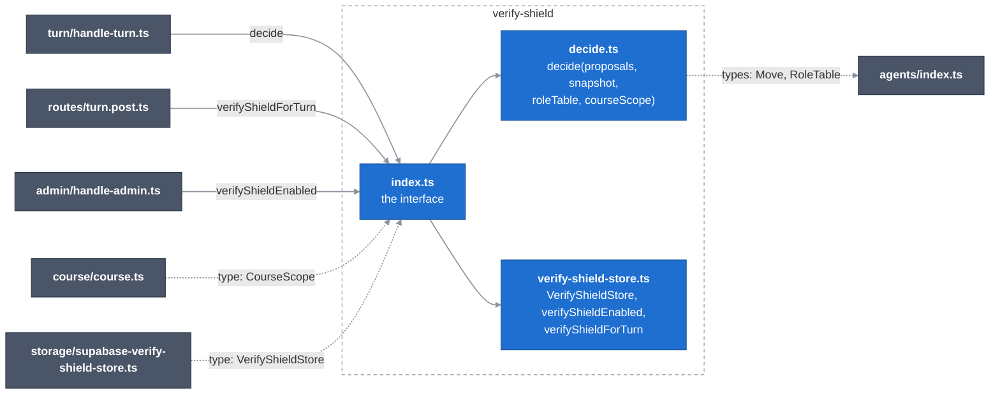

# Component: verify-shield

> [C4 index](../../README.md) / Level 3: Components / Turn and admin server

`web/server/verify-shield/`, the VerifyShield. It rules on each proposed move (allow, block, or downgrade to a
redirect or a lower hint rung) and owns the on/off switch that turns that ruling off for every student. Everything outside the folder
goes through `index.ts`. Part of [server/00-overview.md](00-overview.md).

Legend: solid = runtime import, dashed = type-only import. Blue = this component, grey = other components.

## Interface (`index.ts`)

| Export | Kind | What it is for |
|---|---|---|
| `decide(proposals, snapshot, roleTable, courseScope)` | function | The ruling. Pure: the same inputs always give the same verdicts. Every argument is required. |
| `Proposal`, `Verdict`, `TurnSnapshot` | types | What goes into and comes out of `decide`. |
| `CourseScope`, `CourseModule`, `ModuleMastery` | types | The course facts `decide` reads. `course/course.ts` builds a `CourseScope`. |
| `VerifyShieldStore` | type | `read()` and `save(enabled)` for the saved switch. |
| `createMemoryVerifyShieldStore` | function | In-memory store for tests and local runs. |
| `verifyShieldEnabled(envValue, saved)` | function | A saved row wins; otherwise the environment is on unless it says `off`, `false` or `0`. |
| `verifyShieldForTurn(store, envValue)` | function | Reads the saved switch (a failed read counts as no saved value) and applies `verifyShieldEnabled`. |

## The turn snapshot (`TurnSnapshot`)

What the VerifyShield knows about the turn. `turn/handle-turn.ts` builds it once a turn. Every field is required,
so leaving one out is a type error rather than a rule that silently does not run or a gap in the decision log; the same goes for the course scope.

| Field | What it holds | Read by |
|---|---|---|
| `moduleId` | The module the student is placed on, which is also the current module (one field, not two). | Rule 2; the fallback scope in rule 4 |
| `exerciseId` | The exercise the student is placed on. | Rule 2 |
| `masteries` | Mastery per module. | Not ruled on; recorded in the decision log and the VerifyShield trace |
| `unlockedModuleIds` | The open and mastered modules. | Rules 4 to 6 |
| `studentMessage` | The student's text this turn (empty for an opening turn or a submission). | Rule 4 |
| `verifyShieldOn` | The switch. | Rule 1 |
| `highestHintRung` | The highest hint rung already given in the module's conversation (0 if none), worked out by `handle-turn.ts` from the stored approved moves. | Rule 7 |

`verify-shield-contract.test-d.ts` holds the contract at the type level; `vitest run` checks it with `tsc` through
`web/tsconfig.type-tests.json`.

The Supabase version of the store stays in [`storage`](08-storage.md) (`supabase-verify-shield-store.ts`), so the
code that depends on Supabase stays in one place. It imports only the `VerifyShieldStore` type from here.

## Rules, in the order they are applied

| Order | Rule id | Reason code | Outcome |
|---|---|---|---|
| 1 | `verify_shield` | `VERIFYSHIELD_OFF` | Shield switched off: every proposal is allowed unchanged. |
| 2 | `turn_placement` | `NO_PLACEMENT` | No module or exercise in the snapshot: block every proposal. |
| 3 | `role_table` | `ROLE_FORBIDDEN` | The agent may not propose this move type (for example Deskmate proposing `explain_concept`): block. |
| 4 | `scope_keyword` | `OUT_OF_COURSE_KEYWORD`, `MODULE_CLOSED_KEYWORD` | Teacher teaching move on an unlocked scope, but the student's message names an out-of-course keyword or a closed module: downgrade to `redirect_to_module`. |
| 5 | `scope_in_course` | `OUT_OF_COURSE` | Teaching move labelled `out_of_course`: downgrade to redirect. |
| 6 | `scope_requires_unlocked_module` | `MODULE_CLOSED` | Teaching move whose scope is not unlocked: downgrade to redirect. Also applies to `advance_to_module` toward a locked module. |
| 7 | `hint_ladder` | `HINT_SKIPPED` | `hint_level_N` more than one rung above `highestHintRung`: downgrade to a `hint_level_N` at rung `highestHintRung + 1` (same scope). A rung at or below the highest given, or exactly one above it, is left alone. |
| 8 | `role_table` | `ROLE_PERMITTED` | Allow. |

The shield-off reason code is `VERIFYSHIELD_OFF`. Set `NUXT_VERIFYSHELD` to configure the shield through the environment.

## Verified imports

- Imports: types only (`agents` for `Move` and `RoleTable`). It has no runtime import, no I/O and no clock.
- Runtime importers, all through `index.ts`: `turn/handle-turn.ts` (`decide`), `routes/turn.post.ts` (`verifyShieldForTurn`), `admin/handle-admin.ts` (`verifyShieldEnabled`).
- Type-only importers: `course/course.ts` (`CourseScope`), `storage/supabase-verify-shield-store.ts` (`VerifyShieldStore`).
- Tests: `decide.test.ts` (also imports `course` and `agents` for `roleTable`), `verify-shield-contract.test-d.ts` (types only), `verify-shield.test.ts`, `admin-handler.test.ts`. All import from `server/verify-shield`. `turn-endpoint.test.ts` checks that each verdict reaches the decision log.
- The prompt-injection harness (`docs/security/harness/decision-provider.mjs`) imports `verify-shield/decide.ts` directly, because Node cannot resolve the extensionless imports inside `index.ts`. For the same reason it cannot load `course/course.ts`, so it passes its own one-module course scope.

## Notes

- The VerifyShield rules on moves only, as `CONTEXT.md` says: `handle-turn.ts` streams the text written for an approved move without a further check.
- ADR 0001 says the scope label comes from the language model and is ruled on here, with the keyword list as a backstop. That matches the code (rules 4 to 6).
- The role table lives in [`agents`](06-agents.md) and `decide` receives it as an argument. `course` imports the `CourseScope` type from here; `verify-shield` imports nothing from `course`.
