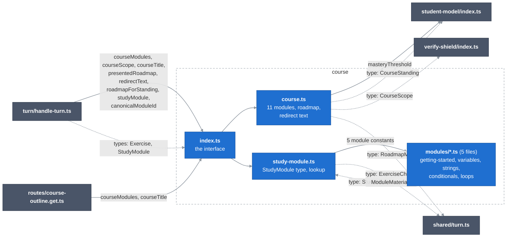

# Component: course

> [C4 index](../../README.md) / Level 3: Components / Turn and admin server

`web/server/course/`, the course as data: its modules, the keywords that mark something as out of course, the
study content of the modules that have any, and the roadmap a student sees. Everything outside the folder goes
through `index.ts`. Part of [server/00-overview.md](00-overview.md).

Legend: solid = runtime import, dashed = type-only import. Blue = this component, grey = other components.

## Files

| File | Responsibility |
|---|---|
| `course.ts` | `courseModules` (11 modules in 5 parts; modules 1 to 5 `available: true`, 6 to 11 `available: false`), out-of-course keywords, `courseScope` (what the VerifyShield reads), `roadmapForStanding`, `presentedRoadmap`, `redirectText`. |
| `study-module.ts` | The `StudyModule` and `Exercise` types, the list `studyModules` (5 entries), `studyModule(id)`, and `canonicalModuleId` (maps the old id `for_loop` to `loops`). |
| `modules/*.ts` | One file per study module: materials, exercises (3 tests each), hint ladder, misconception responses. Each imports only the `StudyModule` type. |
| `index.ts` | The interface: `courseModules`, `courseScope`, `courseTitle`, `presentedRoadmap`, `redirectText`, `roadmapForStanding`, `studyModule`, `studyModules`, `canonicalModuleId`, and the types `Exercise` and `StudyModule`. |

The mastery parameters are not here; they are in [`student-model`](05-student-model.md), and the role table (which agent
may propose which move) is in [`agents`](06-agents.md).

## Verified imports

- Runtime: `course.ts` imports `student-model` (`masteryThreshold`); `study-module.ts` imports the five `modules/*` files.
- Type only: `shared/turn`, `student-model` (`CourseStanding`), `verify-shield` (`CourseScope`), `study-module` (from the module files).
- Runtime importers, through `index.ts`: `turn/handle-turn.ts`, `routes/course-outline.get.ts`.
- Tests: `decide.test.ts` (`courseScope`), `mastery.test.ts` (`courseModules`), `python-runner.test.ts` (`studyModule`, `studyModules`), all through `server/course`.

## Notes

- `course.ts` and `study-module.ts` do not import each other. The list of available modules in `course.ts` and the list `studyModules` in `study-module.ts` are two separate lists kept in step by hand; I found no check in non-test code that they agree (I did not read the tests for one). The sprint-1 status document notes the course content has no runtime validation.
- `course.ts` mixes course data with the roadmap a student sees (`roadmapForStanding`, `presentedRoadmap`) and the redirect text. They are in one file because they all read `courseModules`.
- `CourseModule` in `course.ts` (the full module record) is a different type from `CourseModule` in `verify-shield` (`id` and `keywords` only). `courseScope` is the bridge between them.
