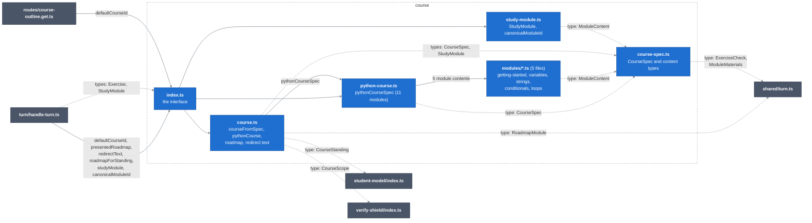

# Component: course

> [C4 index](../../README.md) / Level 3: Components / Turn and admin server

`web/server/course/`, the course as data. A course is built from its **course spec** (ADR-0004): one value that
declares the parts, the modules in order, each module's content (materials, quiz, exercises, hint ladder,
misconception responses) and the out-of-course keywords. From the spec the component builds a `Course`, which the
turn handler passes to the student model and the VerifyShield, and draws the roadmap a student sees. Everything
outside the folder goes through `index.ts`. Part of [server/00-overview.md](00-overview.md).

Legend: solid = runtime import, dashed = type-only import. Blue = this component, grey = other components.

## Files

| File | Responsibility |
|---|---|
| `course-spec.ts` | The course spec shape: `CourseSpec` (`specVersion` 1, `courseId`, `title`, `masteryThreshold`, `parts`, `modules` in order, `outOfCourseKeywords`), `ModuleSpec` (`id`, `name`, `part`, `summary`, `keywords`, optional `content`), `ModuleContent`, `Exercise`, `QuizQuestion`, `MisconceptionResponse`. Tuple types enforce the counts: a quiz of exactly three questions of four choices, three tests per exercise, at least three exercises, a hint ladder of three rungs. `course-spec.test-d.ts` checks that a spec breaking one does not compile. |
| `python-course.ts` | `pythonCourseSpec`: Introduction to Programming with Python as one course spec. 11 modules in 5 parts; modules 1 to 5 carry content from `modules/*.ts`, 6 to 11 are listed without content. Mastery threshold 0.9. |
| `modules/*.ts` | The content of one module each: materials, exercises (3 tests each), three quiz questions drawn from the module materials, hint ladder, and misconception responses. Quiz distractors can reference those responses. Each imports only the `ModuleContent` type. |
| `course.ts` | `Course` and `courseFromSpec(spec)`: numbers modules by their order, derives `available` from whether the spec gives a module content, collects `studyModules`, builds `scope` (the `CourseScope` the VerifyShield reads), and refuses a spec the server could not run: no modules, a first module without content, two modules with one id, a part the spec does not list or modules out of the parts' order, or a mastery threshold outside (0, 1]. `defaultCourseId` (`intro_python`, the course every student studies until enrollment exists). `pythonCourse`, the Python course built from the spec in code: the copy the in-memory course store holds for tests. `CourseModule` also lists each module's `exerciseIds` and `questionIds`, which the student model uses to ignore evidence for removed ones. `studyModule(course, id)`, and the roadmap and redirect functions, which all take the course: `roadmapForStanding`, `presentedRoadmap` (reads the course's mastery threshold), `redirectText`. |
| `study-module.ts` | `StudyModule` (a module's content plus its id; a module has no name of its own, `CourseModule.name` is the only one) and `canonicalModuleId` (maps the old id `for_loop` to `loops`). |
| `index.ts` | The interface: `courseFromSpec`, `defaultCourseId`, `pythonCourse`, `pythonCourseSpec`, `presentedRoadmap`, `redirectText`, `roadmapForStanding`, `studyModule`, `canonicalModuleId`, and the types `Course`, `CourseModule`, `CourseSpec`, `ModuleSpec`, `ModuleContent`, `Exercise`, `QuizQuestion`, `StudyModule`. |

The learning parameters of the mastery estimate are not here; they are in [`student-model`](05-student-model.md),
which takes the mastery threshold from the course. The role table (which agent may propose which move) is in
[`agents`](06-agents.md).

## Verified imports

- Runtime: `course.ts` imports `python-course.ts`; `python-course.ts` imports the five `modules/*` files. Nothing outside the folder at runtime.
- Type only: `shared/turn`, `student-model` (`CourseStanding`), `verify-shield` (`CourseScope`), `course-spec` (from `course.ts`, `study-module.ts`, `python-course.ts` and the module files).
- Runtime importers, through `index.ts`: `turn/handle-turn.ts`, `routes/turn.post.ts`, `routes/course-outline.get.ts`, `api/admin.post.ts` (`defaultCourseId`), `storage/course-store.ts` and `storage/supabase-course-store.ts`.
- Tests: `course-spec.test.ts` and `course-spec.test-d.ts` (the spec and the course built from it), `decide.test.ts` (`pythonCourse.scope`), `mastery.test.ts` and `course-roadmap.test.ts` (`pythonCourse`), `python-runner.test.ts` (`studyModule`, `pythonCourse.studyModules`), `study-module-quiz.test.ts` (the quiz content), `turn-endpoint.test.ts`, all through `server/course`.

## Notes

- Whether a module is available is never written by hand: it is whether its spec gives it content. `study-module-quiz.test.ts` is the content test: for every available module it checks a valid correct index, an explanation, and that each misconception a wrong choice names resolves to one of that module's misconception responses.
- The server reads the course from the database: the `courses` table holds each course's spec, and the [`storage`](08-storage.md) course store builds the `Course` from it. `python-course.ts` is where the Python course was written and the source of the first stored spec; after that, a lecturer's import changes the stored copy, not this file.
- `CourseModule` in `course.ts` (the full module record) is a different type from `CourseModule` in `verify-shield` (`id` and `keywords` only). `Course.scope` is the bridge between them.
