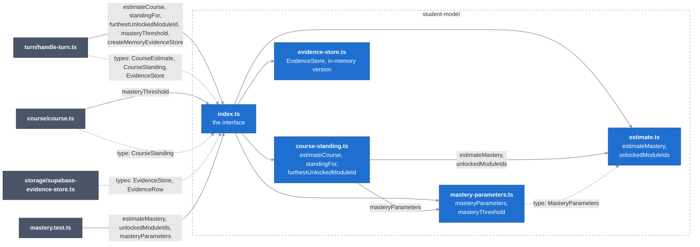

# Component: student-model

> [C4 index](../../README.md) / Level 3: Components / Turn and admin server

`web/server/student-model/`, where this student stands on the course. The evidence ledger holds what the student
submitted; the estimate turns it into one mastery per module (Bayesian Knowledge Tracing) and the set of modules that
are open. This is the mastery half of M6 in the research documents. Everything outside the folder goes through
`index.ts`. Part of [server/00-overview.md](00-overview.md).

Legend: solid = runtime import, dashed = type-only import. Blue = this component, grey = other components.

## Files

| File | Responsibility |
|---|---|
| `estimate.ts` | Pure Bayesian Knowledge Tracing and the unlock rule. `estimateMastery(evidence, moduleIds, parameters)`: one update per observation, in ledger order. For an exercise submission, the first pass counts and marks the module's `passedExercise`; once an exercise is passed, later submissions on it — passes and failures alike — stop being observations, so experimenting on a finished exercise never moves mastery. A `quiz_answer` observation always counts but never marks a passed exercise. `everMastered` is set only when mastery reaches the threshold **and** the module has a passed exercise, so understanding alone never masters a module. `unlockedModuleIds(modules, estimated)`: a straight, permanent chain, where the first available module is open and each later one opens once the one before it has ever been mastered; a module with `available: false` stays closed. |
| `mastery-parameters.ts` | `masteryParameters` (`prior` 0.1, `learning` 0.15, `threshold` 0.9, and slip/guess by observation kind: submission 0.1/0.2 and quiz answer 0.1/0.25) and `masteryThreshold`. The one place they are written down. |
| `course-standing.ts` | `estimateCourse(modules, evidence)`: mastery, unlocked modules and the modules with a passed exercise (`passedExerciseModuleIds`) for a whole course, derived from the ledger every time (nothing is stored). `standingFor(estimate, currentModuleId)` adds the module the student is on. `furthestUnlockedModuleId(modules, estimate)`: where a student with no resume point starts. |
| `evidence-store.ts` | The server-side evidence ledger combines submissions and quiz answers. `EvidenceStore` (`append`, `forStudent`), `NewEvidence`, `EvidenceRow` and an in-memory version. Submissions append through the evidence store. The quiz-answer store records the first answer to each question. Reads merge both sources in timestamp order. |
| `index.ts` | The interface: `estimateMastery`, `unlockedModuleIds`, `masteryParameters`, `masteryThreshold`, `estimateCourse`, `standingFor`, `furthestUnlockedModuleId`, `createMemoryEvidenceStore`, and the types `MasteryParameters`, `ModuleMastery`, `Observation`, `UnlockableModule`, `CourseEstimate`, `CourseStanding`, `EvidenceStore`, `EvidenceRow`, `NewEvidence`. |

The Supabase version of the ledger stays in [`storage`](08-storage.md) (`supabase-evidence-store.ts`), so the code that
depends on Supabase stays in one place. It imports only the `EvidenceStore` and `EvidenceRow` types from here.

## Verified imports

- Imports: none outside its own files. It does not import `course`: `estimateCourse` and `furthestUnlockedModuleId` take the course's modules as an argument, and read only `id` and `available` from each. The estimator accepts observations tagged as `submission` or `quiz_answer`. Only a passing submission counts as a passed exercise.
- Runtime importers, through `index.ts`: `turn/handle-turn.ts`, `course/course.ts` (`masteryThreshold`).
- Type-only importers: `turn/handle-turn.ts` (`CourseEstimate`, `CourseStanding`, `EvidenceStore`), `course/course.ts` (`CourseStanding`), `storage/supabase-evidence-store.ts` (`EvidenceStore`, `EvidenceRow`).
- Tests: `mastery.test.ts` (also imports `course`); `turn-endpoint.test.ts` and `admin-handler.test.ts` reach it through `handle-turn.ts`.

## Notes

- The resume point (which module the student was on) is not here. `storage/conversation-store.ts` keeps it, because it belongs to the conversation, not to what the student knows.
- The other half of M6, the misconception state (which principles the student's code broke), is not in the code. `TeacherContext` carries `misconceptionResponses`, but those are fixed course content, not per-student state.
- `ModuleMastery` here (`moduleId`, `mastery`, `passedExercise`, `everMastered`) is a different type from `ModuleMastery` in `verify-shield` (`moduleId`, `mastery`). Both are exported under the same name from their own component.
