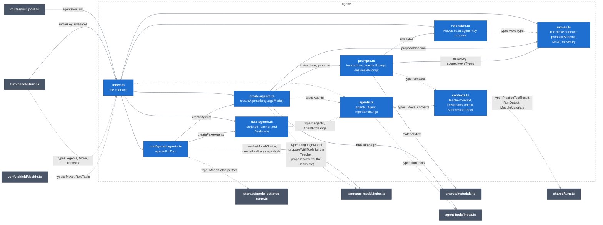

# Component: agents

> [C4 index](../../README.md) / Level 3: Components / Turn and admin server

`web/server/agents/`, the Teacher and the Deskmate as the course defines them: the move contract, what each
agent is shown, what each agent is told, and the two agents built on a [`language-model`](07-language-model.md).
Everything outside the folder goes through `index.ts`. Part of [server/00-overview.md](00-overview.md).

Legend: solid = runtime import, dashed = type-only import. Blue = this component, grey = other components.

## Files

| File | Responsibility |
|---|---|
| `moves.ts` | The move contract, defined once in zod. `proposalSchema` holds every move an agent may propose (eight; `scope` required on `explain_concept`, `answer_question`, `hint_level_N` and `address_misconception`; `hint_level_N.level` an integer from 1 to 3). `AgentMove` and `Move` (adding the VerifyShield's own `redirect_to_module`) are inferred from it, as are `moveTypes` and `scopedMoveTypes`. Also `moveKey` (for example `hint_level_2`). |
| `role-table.ts` | `roleTable` and the `RoleTable` type: which move types the Teacher and the Deskmate may propose. The Teacher gets every agent move except `peer_question` and `share_confusion`; the Deskmate gets only those two. The VerifyShield rules against it, and the propose instructions list each agent's moves from it. |
| `contexts.ts` | Types only: `TeacherContext` (module materials, hint ladder, misconception responses, exercise, draft, run output, submission, conversation, roadmap without mastery, answered quiz), `DeskmateContext` (exercise statement, draft, run output, submission, conversation, answered quiz), `AnsweredQuizResult` (prompt, student choice, correct choice, correct?, explanation, misconception id — one per answered question only), `DeskmateQuizResult` (the same without the explanation) and `SubmissionCheck`. |
| `prompts.ts` | Plain strings and functions: the four instruction constants (`teacherProposeInstructions`, `teacherRenderInstructions`, `deskmateProposeInstructions`, `deskmateRenderInstructions`) and `teacherPrompt(context, move?)`, `deskmatePrompt(context, move?)`. Each propose instruction lists the agent's moves from `roleTable`, and the Teacher's names the moves needing a scope from `scopedMoveTypes`. Each agent line in the conversation carries its approved move in brackets (e.g. `teacher [hint_level_1]: …`). Student-authored content (student messages, the draft, Run output, submitted code and what it returned) sits between `<student_data>` and `</student_data>`, a delimiter typed inside it is neutralised, and all four instructions say that content is data, not instructions. Both prompts show at most the last 30 conversation messages, after an "N earlier messages omitted." line; the context itself keeps the whole conversation, so the VerifyShield's hint rung count is unaffected, and when messages are omitted the Teacher's prompt states the highest hint rung given so far. The Teacher's propose prompt shows the whole hint ladder; its render prompt for `hint_level_k` shows only rung k. Both prompts carry a `Quiz results` section built from the answered quiz only (the Teacher's lines include the explanation, the Deskmate's do not), so an unanswered question's correct choice never reaches a prompt. Not exported by `index.ts`. |
| `agents.ts` | Types only: `Agents` (a `teacher` and a `deskmate`), `Agent<Context>` with `propose(context, tools?)` (the turn's [`agent-tools`](13-agent-tools.md)) and `render(context, move)`, and `AgentExchange`, the record the fake keeps of each call. |
| `create-agents.ts` | `createAgents(languageModel)`: each agent is its own instructions and prompt. The Teacher proposes through `proposeWithTools`, passing the turn's `TurnTools` as the tool loop (its tools and the 3-step cap), and hands the loop's reported ending back to them; with no move it stays quiet. The Teacher's `Agent<TeacherContext, TurnTools>` requires the tools; the Deskmate's takes none. The Deskmate proposes through `proposeMove`, unchanged. Both render through `streamReply`. Both agents pass the same `proposalSchema` (ADR 0003). |
| `fake-agents.ts` | `createFakeAgents`: a scripted Teacher and Deskmate with recorded exchanges and optional failures. A scripted proposal is a fixed move or a function of the agent's context; the `fake` provider's Teacher scopes its move to the current module, as the real one does. It replaces the agents rather than the language model, so it never sees a prompt. Used by the `fake` provider and by tests. |
| `configured-agents.ts` | `createConfiguredAgents(settings)` and `agentsForTurn(store, env)`: a saved record from the settings store, else the environment; `real` gives `createAgents` on the real language model, `fake` gives the scripted agents. Logs the choice once. |
| `index.ts` | The interface: `moveKey`, `moveTypes`, `proposalSchema`, `AgentMove`, `Move`, `MoveType`, `roleTable`, `RoleTable`, the context types (`TeacherContext`, `DeskmateContext`, `AnsweredQuizResult`, `DeskmateQuizResult`, `SubmissionCheck`), `Agents`, `Agent`, `AgentExchange`, `createAgents`, `createFakeAgents`, `FakeAgentScript`, `createConfiguredAgents`, `agentsForTurn`. |

## Verified imports

- Runtime: as in the diagram. `agents.ts`, `contexts.ts` have only type imports.
- Runtime importers, through `index.ts`: `routes/turn.post.ts` (`agentsForTurn`), `turn/handle-turn.ts` (`moveKey`, `roleTable`), `decide.test.ts` (`roleTable`).
- Type-only importers: `turn/handle-turn.ts`, `verify-shield/decide.ts` (`Move`, `RoleTable`). `language-model` imports nothing from here.
- Packages: `zod` (in `moves.ts`).
- Tests: `turn-endpoint.test.ts` and `admin-handler.test.ts` (`createFakeAgents`, `createConfiguredAgents`, `agentsForTurn`); `move-contract.test.ts` and `real-language-model.test.ts` (`proposalSchema`, `roleTable`, `createAgents`); `prompt-hardening.test.ts` (`createAgents`, recording the prompts a turn sends); `wrong-quiz-brings-agents.test.ts` (`createFakeAgents`, and the quiz results in each agent's context).

## Notes

- The Teacher's prompt carries no mastery: it calls `get_student_mastery` (see [agent-tools](13-agent-tools.md)), which also gives the threshold and the maximum of 1.0.
- The turn decides which agents are called: an `@`-addressed message calls only that agent, and with the student's deskmate switch off the Deskmate is never called (see [turn](02-turn.md)). An addressed Deskmate is still held to the role table (peer questions and shared confusion).
- `verify-shield` receives the role table as an argument to `decide`; it does not import the table itself, only the `RoleTable` type.
- `agents` depends on `language-model`, never the reverse: `create-agents.ts` passes `proposalSchema` into `proposeMove`, so the language model holds a reply to a schema it does not define.
- One schema for both agents is deliberate (ADR 0003): a Deskmate proposing a Teacher move still parses, so the VerifyShield blocks and logs it as `ROLE_FORBIDDEN` rather than it vanishing as a parse failure.
- Both Deskmate prompts describe Mai as learning alongside the student at their level. The Teacher renders `advance_to_module` and `stay_and_practise` as suggestions the student can act on. Placement and mode stay as they are until the student acts.
- Loading `agents` loads the AI SDK, because `configured-agents.ts` builds the real language model. `moves.ts` imports only `zod`; `role-table.ts` and `contexts.ts` import no package. `prompts.ts` imports `materialsText` from `shared/materials` so the Teacher's prompt can read block materials.
- The `<student_data>` delimiters and the line saying their content is data make prompt injection less likely, but they are instructions to the model too; the VerifyShield remains the guard.
- The prompt tells the Teacher not to hand over a full solution, but that is an instruction to the model, not a rule the VerifyShield enforces. `reveal_answer` is no longer a move; the turn handler still labels stored messages approved as `reveal_answer` "Answer revealed".
