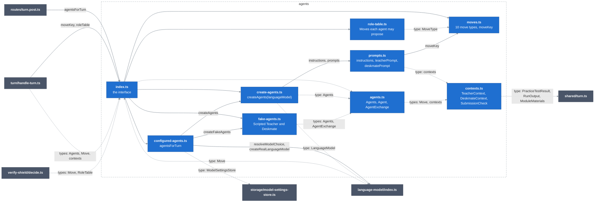

# Component: agents

> [C4 index](../../README.md) / Level 3: Components / Turn and admin server

`web/server/agents/`, the Teacher and the Deskmate as the course defines them: the move vocabulary, what each
agent is shown, what each agent is told, and the two agents built on a [`language-model`](07-language-model.md).
Everything outside the folder goes through `index.ts`. Part of [server/00-overview.md](00-overview.md).

Legend: solid = runtime import, dashed = type-only import. Blue = this component, grey = other components.

## Files

| File | Responsibility |
|---|---|
| `moves.ts` | The closed set of 10 move types, the `Move` union and `moveKey` (for example `hint_level_2`). |
| `role-table.ts` | `roleTable` and the `RoleTable` type: which move types the Teacher and the Deskmate may propose. The Teacher gets every move except `peer_question` and `share_confusion`; the Deskmate gets only those two. The VerifyShield rules against it. |
| `contexts.ts` | Types only: `TeacherContext` (module materials, hint ladder, misconception responses, exercise, draft, run output, submission, conversation, roadmap), `DeskmateContext` (a smaller view: no materials, no hint ladder, no roadmap) and `SubmissionCheck`. |
| `prompts.ts` | Plain strings and functions: the four instruction constants (`teacherProposeInstructions`, `teacherRenderInstructions`, `deskmateProposeInstructions`, `deskmateRenderInstructions`) and `teacherPrompt(context, move?)`, `deskmatePrompt(context, move?)`. Not exported by `index.ts`. |
| `agents.ts` | Types only: `Agents` (a `teacher` and a `deskmate`), `Agent<Context>` with `propose(context)` and `render(context, move)`, and `AgentExchange`, the record the fake keeps of each call. |
| `create-agents.ts` | `createAgents(languageModel)`: each agent is its own instructions and prompt sent through `proposeMove` and `streamReply`. |
| `fake-agents.ts` | `createFakeAgents`: a scripted Teacher and Deskmate with recorded exchanges and optional failures. It replaces the agents rather than the language model, so it never sees a prompt. Used by the `fake` provider and by tests. |
| `configured-agents.ts` | `createConfiguredAgents(settings)` and `agentsForTurn(store, env)`: a saved record from the settings store, else the environment; `real` gives `createAgents` on the real language model, `fake` gives the scripted agents. Logs the choice once. |
| `index.ts` | The interface: `moveKey`, `moveTypes`, `Move`, `MoveType`, `roleTable`, `RoleTable`, the three context types, `Agents`, `Agent`, `AgentExchange`, `createAgents`, `createFakeAgents`, `FakeAgentScript`, `createConfiguredAgents`, `agentsForTurn`. |

## Verified imports

- Runtime: as in the diagram. `agents.ts`, `contexts.ts` have only type imports.
- Runtime importers, through `index.ts`: `routes/turn.post.ts` (`agentsForTurn`), `turn/handle-turn.ts` (`moveKey`, `roleTable`), `decide.test.ts` (`roleTable`).
- Type-only importers: `turn/handle-turn.ts`, `verify-shield/decide.ts` (`Move`, `RoleTable`), `language-model/language-model.ts` (`Move`).
- Tests: `turn-endpoint.test.ts` and `admin-handler.test.ts` (`createFakeAgents`, `createConfiguredAgents`, `agentsForTurn`).

## Notes

- `verify-shield` receives the role table as an argument to `decide`; it does not import the table itself, only the `RoleTable` type.
- `agents` and `language-model` import each other, but only one way at runtime: `agents` calls `language-model`; `language-model` imports only the `Move` type back.
- Loading `agents` loads the AI SDK, because `configured-agents.ts` builds the real language model. `moves.ts`, `role-table.ts`, `contexts.ts` and `prompts.ts` alone import no package.
- The prompt tells the Teacher not to hand over a full solution, but that is an instruction to the model, not a rule the VerifyShield enforces (the status document lists `reveal_answer` as ungated).
- `agents/prompts.ts` repeats the move names in plain text, and `language-model/provider-language-model.ts` repeats them again in its zod schema. Nothing checks that the three lists agree with `moves.ts`.
