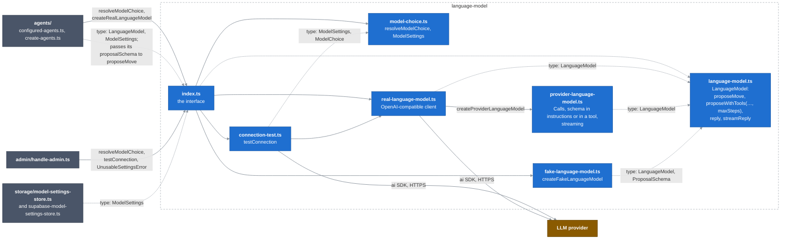

# Component: language-model

> [C4 index](../../README.md) / Level 3: Components / Turn and admin server

`web/server/language-model/`, a model that proposes a move and answers in words, given instructions, a prompt and, for a
proposal, the schema to hold the reply to. A proposal is asked for either as JSON in the text or as a tool call the model
must make; words come back either streamed or whole. It does not know who is asking or which moves exist: the
[`agents`](06-agents.md) component writes the instructions and the prompt and passes the proposal schema. It holds the
OpenAI-compatible client, the scripted model that stands in for it, the reading of the saved model settings and the two
calls the product owner's connection test makes. Everything outside the folder goes through `index.ts`. Part of
[server/00-overview.md](00-overview.md).

Legend: solid = runtime import, dashed = type-only import. Blue = this component, grey = other components, brown = external.

## Files

| File | Responsibility |
|---|---|
| `language-model.ts` | Interface only: `LanguageModel` with `proposeMove(instructions, prompt, schema)`, generic over the schema it is given (a `ProposalSchema`: `{ proposal: … \| null }`), which returns the parsed proposal or null and rejects when two replies in a row do not parse or the call fails; `proposeWithTools(instructions, prompt, schema, maxSteps)`, the same proposal asked for as a tool call, which stops as soon as the tool answers and returns no move when the step cap is reached; `streamReply(instructions, prompt)`, which yields the words of one reply; and `reply(instructions, prompt)`, which returns them whole and, unlike the stream, reaches the caller with the provider's own message when the request fails. |
| `provider-language-model.ts` | `createProviderLanguageModel(model)`: the `generateText` / `streamText` calls (package `ai`), holding the reply to the caller's schema. For a JSON proposal it writes that schema's JSON shape into the instructions because the provider accepts `json_object` but not `json_schema`; for a tool-call proposal the schema travels in the tool definition, with `tool_choice` required and no `response_format`, and the loop stops at `hasToolCall` or at `stepCountIs(maxSteps)`. `proposeMove` asks once more when a reply does not parse, breaks the schema, or is empty (`NoObjectGeneratedError`, `NoOutputGeneratedError`), and nothing here retries a network or provider error (`maxRetries: 0`, so the SDK's own retries are off too). The tool is named `propose` and carries only the caller's schema, so no move is known here. Internal. |
| `real-language-model.ts` | Builds the OpenAI-compatible provider (`@ai-sdk/openai-compatible`) with `supportsStructuredOutputs: false` and hands it to `createProviderLanguageModel`. |
| `fake-language-model.ts` | `createFakeLanguageModel(script)`: the same interface answered from a script instead of a provider, with every call recorded. `steps` is one entry per step of `proposeWithTools` (a step carrying a `proposal` is the tool call, a step naming none is a step that does not propose, an `Error` is a refused request), `proposals` the JSON of each `proposeMove` and `replies` the words of each `reply` and `streamReply`. A call past the end of its list fails, so a script that runs short is reported rather than quietly answering nothing. |
| `connection-test.ts` | `testConnection(settings)`: the two questions the product owner can ask of a provider by hand, each timed and each reported on its own as `{ ok, ms, error? }` — one answer in words, one proposal forced as a tool call, with a probe schema of the same shape as a real proposal and a cap of one step. Nothing is saved and nothing is retried. The provider's message is the answer, with the API key taken out of it in case the provider quotes it. `UnusableSettingsError` says the settings describe no call: the fake provider, or a blank field a real model needs. |
| `model-choice.ts` | `resolveModelChoice`: `real`, `fake`, or an error naming the blank field. Reads neither the environment nor the network. Also holds the `ModelSettings` and `ModelChoice` types. |
| `index.ts` | The interface: `LanguageModel`, `ProposalSchema`, `createRealLanguageModel`, `createFakeLanguageModel` and its script types, `testConnection`, `UnusableSettingsError` and the report types, `resolveModelChoice`, `ModelSettings`, `ModelChoice`. |

## Verified imports

- Runtime: as in the diagram. `language-model.ts` has only a type import (`zod`). Nothing here imports from `agents`.
- Runtime importers, through `index.ts`: `agents/configured-agents.ts` (`resolveModelChoice`, `createRealLanguageModel`), `admin/handle-admin.ts` (`resolveModelChoice`, `testConnection`, `UnusableSettingsError`).
- Type-only importers: `agents/create-agents.ts` (`LanguageModel`), `storage/model-settings-store.ts` and `storage/supabase-model-settings-store.ts` (`ModelSettings`), `admin/handle-admin.ts` (`ConnectionReport`).
- Packages: `ai`, `zod`, `@ai-sdk/openai-compatible`.
- Tests: `model-choice.test.ts`, `real-language-model.test.ts`, `fake-language-model.test.ts` and `connection-test.test.ts`, all through `server/language-model`. `real-language-model.test.ts` calls `proposeMove` and `proposeWithTools` directly with the agents' `proposalSchema`, with no agent in front of it, over a stubbed `fetch`, and also drives a turn through `handleTurn` to check what the student sees after one or two malformed proposals. `connection-test.test.ts` stubs the same `fetch` and reads only the report.

## Notes

- There are two fakes at two seams, and they are not the same thing: `createFakeLanguageModel` here scripts the model's answers and sees the instructions and the prompt, while `createFakeAgents` in [`agents`](06-agents.md) scripts the two agents and records their contexts. The `fake` provider is still the scripted agents, because the scripts and the recorded exchanges are per agent (Teacher or Deskmate), and this component cannot tell them apart.
- The step cap of `proposeWithTools` is a bound, not the usual ending: with the proposal tool the only tool on offer and `tool_choice` required, a call of it ends the loop at one step, and a model that answers in words instead fails at once. It is what bounds the loop once [`agents`](06-agents.md) gives the Teacher a tool of its own, and `fake-language-model.ts` is where it is rehearsed.
- Because `admin/handle-admin.ts` imports `resolveModelChoice` and `testConnection` through `index.ts`, loading the admin handler also loads the real client and the AI SDK.
- The schema is a parameter, not a definition here, so adding a move changes only `agents/moves.ts`. The component imports nothing from `agents`, at runtime or as a type: the connection test's probe schema has the shape of a proposal but names no move.
