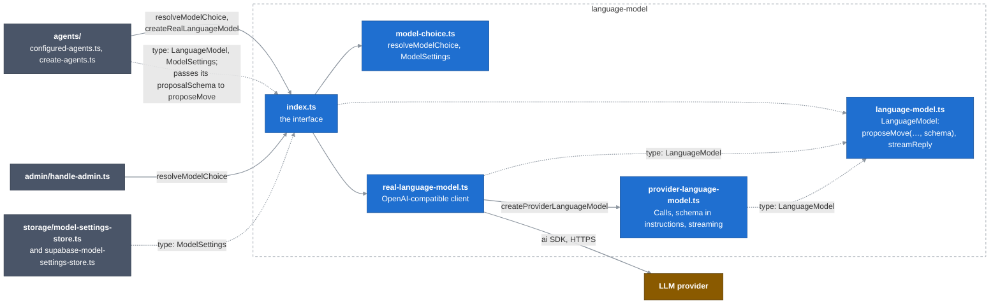

# Component: language-model

> [C4 index](../../README.md) / Level 3: Components / Turn and admin server

`web/server/language-model/`, a model that proposes a move and streams a reply, given instructions, a prompt and, for a
proposal, the schema to hold the reply to. It does not know who is asking or which moves exist: the
[`agents`](06-agents.md) component writes the instructions and the prompt and passes the proposal schema. It holds the
OpenAI-compatible client and the reading of the saved model settings. Everything outside the folder goes through
`index.ts`. Part of [server/00-overview.md](00-overview.md).

Legend: solid = runtime import, dashed = type-only import. Blue = this component, grey = other components, brown = external.

## Files

| File | Responsibility |
|---|---|
| `language-model.ts` | Interface only: `LanguageModel` with `proposeMove(instructions, prompt, schema)`, generic over the schema it is given (a `ProposalSchema`: `{ proposal: … \| null }`), which returns the parsed proposal or null and rejects when two replies in a row do not parse or the call fails; and `streamReply(instructions, prompt)`, which yields the words of one reply. |
| `provider-language-model.ts` | `createProviderLanguageModel(model)`: the `generateText` / `streamText` calls (package `ai`), holding the reply to the caller's schema. It writes that schema's JSON shape into the instructions because the provider accepts `json_object` but not `json_schema`. `proposeMove` asks once more when a reply does not parse, breaks the schema, or is empty (`NoObjectGeneratedError`, `NoOutputGeneratedError`), and never retries a network or provider error (`maxRetries: 0`, so the SDK's own retries are off too). Internal. |
| `real-language-model.ts` | Builds the OpenAI-compatible provider (`@ai-sdk/openai-compatible`) with `supportsStructuredOutputs: false` and hands it to `createProviderLanguageModel`. |
| `model-choice.ts` | `resolveModelChoice`: `real`, `fake`, or an error naming the blank field. Reads neither the environment nor the network. Also holds the `ModelSettings` and `ModelChoice` types. |
| `index.ts` | The interface: `LanguageModel`, `ProposalSchema`, `createRealLanguageModel`, `resolveModelChoice`, `ModelSettings`, `ModelChoice`. |

## Verified imports

- Runtime: as in the diagram. `language-model.ts` has only a type import (`zod`). Nothing here imports from `agents`.
- Runtime importers, through `index.ts`: `agents/configured-agents.ts` (`resolveModelChoice`, `createRealLanguageModel`), `admin/handle-admin.ts` (`resolveModelChoice`).
- Type-only importers: `agents/create-agents.ts` (`LanguageModel`), `storage/model-settings-store.ts` and `storage/supabase-model-settings-store.ts` (`ModelSettings`).
- Packages: `ai`, `zod`, `@ai-sdk/openai-compatible`.
- Tests: `model-choice.test.ts` and `real-language-model.test.ts`, both through `server/language-model`. `real-language-model.test.ts` calls `proposeMove` directly with the agents' `proposalSchema`, with no agent in front of it, and also drives a turn through `handleTurn` with the real client over a stubbed `fetch` to check what the student sees after one or two malformed proposals.

## Notes

- There is no scripted model here. The `fake` choice is made in [`agents`](06-agents.md), because the scripts and the recorded exchanges are per agent (Teacher or Deskmate), and this component cannot tell them apart.
- Because `admin/handle-admin.ts` imports `resolveModelChoice` through `index.ts`, loading the admin handler also loads the real client and the AI SDK.
- The schema is a parameter, not a definition here, so adding a move changes only `agents/moves.ts`. The component imports nothing from `agents`, at runtime or as a type.
