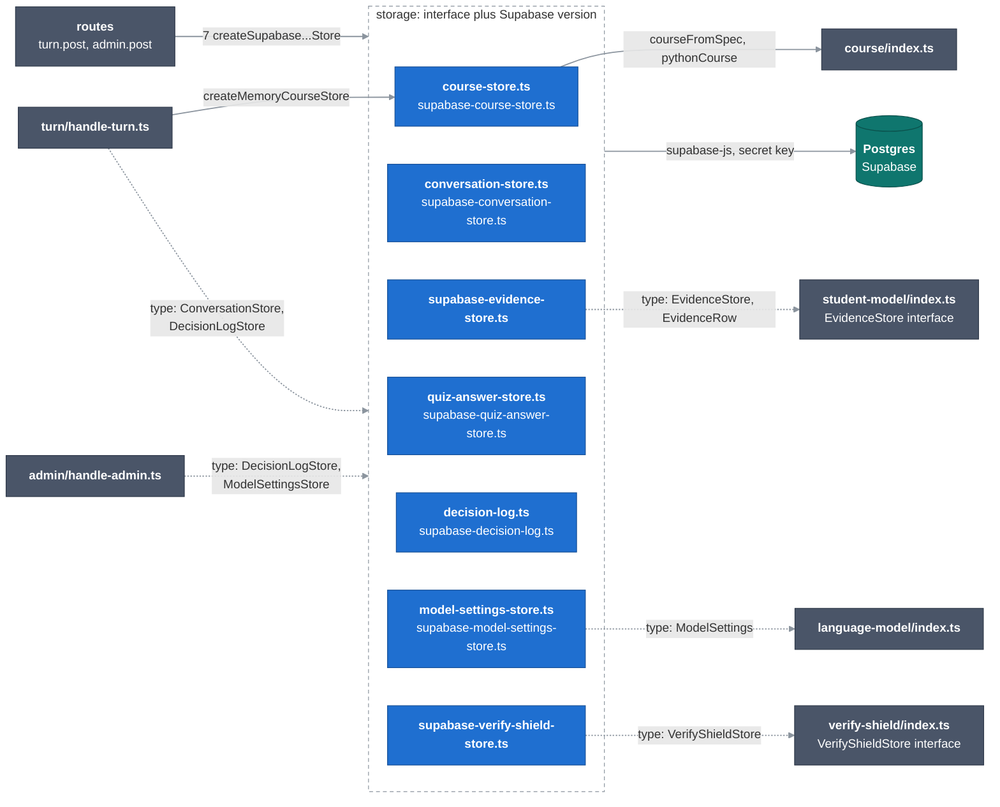

# Component: storage

> [C4 index](../../README.md) / Level 3: Components / Turn and admin server

Persistence behind interfaces. Each store has an interface with an in-memory version, and a Supabase version
that talks to Postgres. The course store reads a course's stored course spec; the stores of student data
(conversation, evidence, quiz answers, decision log) are each created for one course and read and write only
its rows. Part of [server/00-overview.md](00-overview.md).

Legend: solid = runtime import, dashed = type-only import. Blue = this component, grey = other components, teal = database.

Each box is a pair of files: the interface file (with its in-memory version) and the `supabase-` file that
implements it with `import type` from the interface file. The verify shield and evidence boxes are the exceptions: their interface
files are in the `verify-shield` and `student-model` components, so only the `supabase-` file is here.

## Stores and the tables they use

| Store | Interface offers | Tables (from the Supabase version) |
|---|---|---|
| course | `course(courseId)`: the course built from its stored spec with `courseFromSpec`; throws for an unknown id. Read on every call, so an imported spec applies on the next request. The in-memory version holds `pythonCourse` unless given others. | `courses` |
| conversation | `displayName`, `resumePoint`, `saveResumePoint`, `messages`, `appendMessage`. One resume point per student per course. | `students`, `resume_points`, `conversations`, `messages` |
| evidence | `append`, `forStudent` (attempt number is assigned by a database trigger). Reads merge submissions with quiz answers by timestamp. Only the Supabase version is here; the interface and the in-memory version live in [`student-model`](05-student-model.md). | `evidence` |
| quiz answers | `record` (keeps the first answer per student, module and question; a second returns the first unchanged), `forStudentModule`, and `observationsForStudent` for the evidence store. Interface and in-memory version in `quiz-answer-store.ts`. | `quiz_answers` |
| decision log | `append`, `list` (newest 100, filter by verdict and student) | `decisions` |
| lecturer | `forLecturer` reads owned course titles, exact enrollment counts and course history. | `courses`, `enrollments`, `course_history` |
| model settings | `read`, `save` (single row, id 1) | `model_settings` |
| verify shield | `read`, `save`. Only the Supabase version is here; the interface, the in-memory version and the `verifyShieldEnabled` / `verifyShieldForTurn` rules live in [`verify-shield`](03-verify-shield.md). | `verify_shield_settings` |

## Verified imports

- The Supabase stores use `@supabase/supabase-js` and import their store interfaces. The evidence adapter also calls the quiz-answer adapter and merges the observations using `student-model/index.ts`.
- The course store imports `course` (`courseFromSpec` in the Supabase version, `pythonCourse` in the in-memory one).
- Runtime importers from outside: `routes/turn.post.ts` (all seven Supabase files), `routes/course-outline.get.ts` (`supabase-course-store`), `api/admin.post.ts` (three Supabase files). `turn/handle-turn.ts` also imports `quiz-answer-store.ts` and `course-store.ts` at runtime for their in-memory defaults.
- Type-only importers: `turn/handle-turn.ts` (`conversation-store`, `decision-log`, and the `QuizAnswerStore`/`QuizAnswerRow` types), `admin/handle-admin.ts` (`decision-log`, `model-settings-store`), `agents/configured-agents.ts` (`model-settings-store`).
- Tests: `courses-boundary.test.ts`, `conversation-storage.test.ts`, `decisions-boundary.test.ts`, `model-settings-boundary.test.ts`, `quiz-answers-boundary.test.ts` (Supabase versions, against the live project); `turn-endpoint.test.ts`, `admin-handler.test.ts`, `quiz-answer.test.ts`, `wrong-quiz-brings-agents.test.ts`, `move-contract.test.ts`, `prompt-hardening.test.ts`, `real-language-model.test.ts` (the interfaces and their in-memory versions).

## Notes

- Every row of `evidence`, `quiz_answers`, `conversations`, `resume_points` and `decisions` carries a required `course_id` (rows from before were backfilled with `intro_python`). The Supabase stores of student data take a `courseId` when created, write it on every insert and filter every read by it, so their interfaces carry no course.
- `courses` holds one row per course: its id, title and whole course spec as `jsonb`. The spec includes teacher-only content (hint ladders, misconception responses, reference solutions, the correct quiz choices), so RLS is on with no policy and every privilege is revoked from anon and authenticated; only the secret key reaches it. The migration that created the table inserted the Python course, so a fresh database has it.
- All seven Supabase files create their own client with the same options (secret key, no session). They share no helper, so the setup is repeated seven times, and `routes/turn.post.ts` creates them again on every request (each `createSupabase...Store` call makes a new client).
- The decision log, evidence and quiz-answers tables have no RLS policy, so only the server's secret key can read or write them. On the two ledgers (`evidence` and `quiz_answers`) update and delete are revoked from the anon and authenticated roles as well, so append-only is enforced there even if a policy were added later; `quiz_answers` keeps only the first answer through a `unique (student_id, course_id, module_id, question_id)` constraint.
