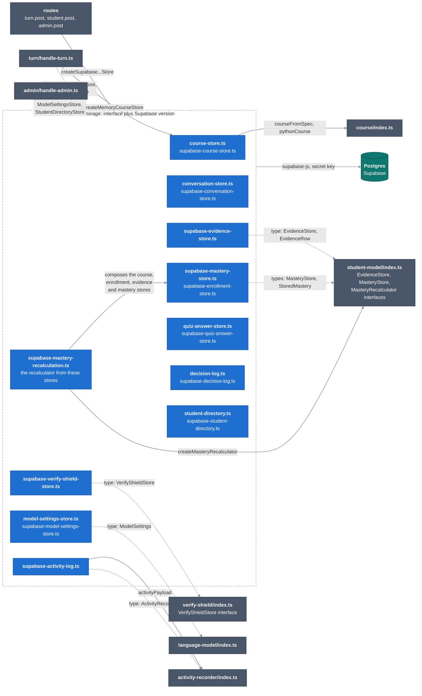

# Component: storage

> [C4 index](../../README.md) / Level 3: Components / Turn and admin server

Persistence behind interfaces. Each store has an interface with an in-memory version, and a Supabase version
that talks to Postgres. The course store reads a course's stored course spec; the stores of student data
(conversation, evidence, quiz answers, module unlocks, stored mastery, decision log) are each created for one course
and read and write only its rows. Part of [server/00-overview.md](00-overview.md).

Legend: solid = runtime import, dashed = type-only import. Blue = this component, grey = other components, teal = database.

Each box is a pair of files: the interface file (with its in-memory version) and the `supabase-` file that
implements it with `import type` from the interface file. The verify shield, evidence, stored mastery and activity log are the exceptions: their interface
files are in the `verify-shield`, `student-model` and `activity-recorder` components, so only the `supabase-` file is here.
`supabase-mastery-recalculation.ts` is not a store either: it builds `student-model`'s recalculator out of the course,
enrollment, evidence and mastery stores, so the two lecturer routes each get one object to call after a change. It takes
only the connection, never a course id: each `forCourse` call opens the evidence and mastery stores of the course it is
asked to recompute, because those stores are scoped to one course.
## Stores and the tables they use

| Store | Interface offers | Tables (from the Supabase version) |
|---|---|---|
| course | `course(courseId)`: the course built from its stored spec with `courseFromSpec`; throws for an unknown id. Read on every call, so an imported spec applies on the next request. The in-memory version holds `pythonCourse` unless given others. | `courses` |
| conversation | `displayName`, `resumePoint`, `saveResumePoint`, `messages`, `appendMessage`. One resume point per student per course. Each stored message carries `createdAt`, the time the database stamped it on insert, or `null` for messages written before times were recorded, and `addressedAgent` (`teacher`, `deskmate` or `null`; only a student message has one). | `students`, `resume_points`, `conversations`, `messages` |
| evidence | `append`, `forStudent` (attempt number is assigned by a database trigger). Reads merge submissions with quiz answers by timestamp. Only the Supabase version is here; the interface and the in-memory version live in [`student-model`](05-student-model.md). | `evidence` |
| quiz answers | `record` (keeps the first answer per student, module and question; a second returns the first unchanged), `forStudentModule`, and `observationsForStudent` for the evidence store. Interface and in-memory version in `quiz-answer-store.ts`. | `quiz_answers` |
| activity log | `record`. Drops `code`, `draft` and `keystrokes` before insert. The event types and the in-memory log live in [`activity-recorder`](12-activity-recorder.md); only the Supabase adapter is here. The adapter does not send a time; `created_at` is the database clock. | `activity_log` |
| decision log | `append`, `list` (newest 100, filter by verdict and student). Each record carries the verdict's ordered `ruleChecks` (`rule_checks` jsonb column). A row recorded before that column existed holds null and reads back with `ruleChecks` absent, which is different from the empty list of a shield-off decision. Each record also carries the turn's `addressedAgent` (`addressed_agent` column; null when no agent was addressed, and on rows from before it). |
| deskmate setting | `read(studentId)` (true when no row), `save(studentId, on)`. One switch per student, not scoped to a course. Only the server reads it, for the session student. Interface and in-memory version in `deskmate-setting-store.ts`. | `deskmate_settings` | `decisions` |
| lecturer | Reads owned course titles, enrollment counts, thresholds and history. Saves threshold and history together. | `courses`, `enrollments`, `course_history` |
| module unlocks | Reads and records unlocked module IDs for one student and course. | `module_unlocks` |
| stored mastery | `forStudent(studentId)` and `save(studentId, masteries)`, which clears the student's rows for the course and inserts the new picture, so a module the course no longer has leaves no row. Only the Supabase version is here; the interface, the in-memory version and every rule about when the number changes live in [`student-model`](05-student-model.md). | `module_masteries` |
| enrollments | `enrolledStudentIds(courseId)`: who is learning the course, which is who a publish or a threshold change recomputes stored mastery for. The interface is in the Supabase file, because the lecturer store reads the same table for its own counts. | `enrollments` |
| model settings | `read`, `save` (single row, id 1) | `model_settings` |
| student directory | `list`: each student's id, display name, student number, email and campus. `changeCampus`: `changed`, `unchanged` or `not-found`; the Supabase version calls `set_student_campus`, which writes the `campus_changes` history row. `changeNumber`: `changed`, `unchanged`, `duplicate` (another student holds it), `used` (a different student had it before), or `not-found`. The Supabase version calls the `set_student_number` function, which locks the row, keeps the number's first assignment in the write-once assignments table and writes the history row; the student's own earlier number may be restored, no other student's may. | `students`, `student_directory` view, `student_number_changes`, `private.student_number_assignments` |
| verify shield | `read`, `save`. Only the Supabase version is here; the interface, the in-memory version and the `verifyShieldEnabled` / `verifyShieldForTurn` rules live in [`verify-shield`](03-verify-shield.md). | `verify_shield_settings` |

## Verified imports

- The Supabase stores use `@supabase/supabase-js` and import their store interfaces. The evidence adapter also calls the quiz-answer adapter and merges the observations using `student-model/index.ts`. The mastery adapter type-imports `MasteryStore` and `StoredMastery` from `student-model/index.ts`, and `supabase-mastery-recalculation.ts` calls `createMasteryRecalculator` there and the course, enrollment, evidence and mastery adapters here. The activity adapter imports `activityPayload` from `activity-recorder` and type-imports `ActivityRecorder`.
- The course store imports `course` (`courseFromSpec` in the Supabase version, `pythonCourse` in the in-memory one).
- Runtime importers from outside: `routes/turn.post.ts` (the turn stores, including `supabase-activity-log`, `supabase-deskmate-setting-store` and `supabase-mastery-store`), `api/lecturer.post.ts` and `api/lecturer/spec.post.ts` (`supabase-mastery-recalculation`), `api/student.post.ts` (`supabase-activity-log`, `supabase-course-store`, plus the profile, mindmap and student-file stores), `routes/course-outline.get.ts` (`supabase-course-store`), `api/admin.post.ts` (four Supabase files, including `supabase-student-directory`). `turn/handle-turn.ts` also imports `quiz-answer-store.ts` and `course-store.ts` at runtime for their in-memory defaults.
- Type-only importers: `turn/handle-turn.ts` (`conversation-store`, `decision-log`, and the `QuizAnswerStore`/`QuizAnswerRow` types), `admin/handle-admin.ts` (`decision-log`, `model-settings-store`, `student-directory`), `agents/configured-agents.ts` (`model-settings-store`).
- Tests: `message-time-migration.test.ts` (the `messages.created_at` migration, on PGlite); `student-numbers-migration.test.ts` (the student number backfill and the change function, on PGlite); `activity-log-migration.test.ts` (the activity log is append-only, stamps its own time, and refuses `anon` and `authenticated`, on PGlite); `stored-mastery-migration.test.ts` (one row per student, course and module, the mastery range, and that no non-server role reads or writes it, on PGlite); `courses-boundary.test.ts`, `conversation-storage.test.ts`, `decisions-boundary.test.ts`, `model-settings-boundary.test.ts`, `quiz-answers-boundary.test.ts`, `student-numbers-boundary.test.ts`, `activity-mindmap-boundary.test.ts` (Supabase versions, against the live project); `turn-endpoint.test.ts`, `admin-handler.test.ts`, `quiz-answer.test.ts`, `wrong-quiz-brings-agents.test.ts`, `move-contract.test.ts`, `prompt-hardening.test.ts`, `real-language-model.test.ts`, `student-handler.test.ts` (the interfaces and their in-memory versions).

## Notes

- Every row of `evidence`, `quiz_answers`, `conversations`, `resume_points`, `module_unlocks`, `module_masteries` and `decisions` carries a required `course_id` (rows from before were backfilled with `intro_python`). The Supabase stores of student data take a `courseId` when created, write it on every insert and filter every read by it, so their interfaces carry no course.
- `courses` holds one row per course: its id, title and whole course spec as `jsonb`. The spec includes teacher-only content (hint ladders, misconception responses, reference solutions, the correct quiz choices), so RLS is on with no policy and every privilege is revoked from anon and authenticated; only the secret key reaches it. The migration that created the table inserted the Python course, so a fresh database has it.
- Each Supabase file creates its own client with the same options (secret key, no session). They share no helper, so the setup is repeated, and `routes/turn.post.ts` creates the turn stores again on every request (each `createSupabase...Store` call makes a new client).
- `students.campus` is null until the student chooses one of Hanoi, Da Nang, Ho Chi Minh City or Can Tho. `public.choose_student_campus` sets it only when it is null; `public.set_student_campus` is the product owner's change and records actor, old and new value in `campus_changes`. Both are executable only with the server key (`student-campus-migration.test.ts`, on PGlite). The profile store reads the campus and offers `chooseCampus`; it has no way to change one.
- `students.student_number` is unique when present and null for staff. A BEFORE INSERT trigger takes the next value from `private.student_number_seq`, formats `SWB` plus at least four digits and writes it to `private.student_number_assignments` before stamping the row; the assignments table is write-once and the sequence skips any number already recorded there, so a number is never handed out twice. The migration backfilled existing students in sign-up order (`auth.users.created_at`). `public.set_student_number` is the only way to renumber, is executable only with the server key, and records the actor, old and new value in `student_number_changes` in the same statement. The `student_directory` view joins the profile to its account for the email, leaves out staff, and is granted only to `service_role`.
- The decision log, evidence and quiz-answers tables have no RLS policy, so only the server's secret key can read or write them. On the two ledgers (`evidence` and `quiz_answers`) update and delete are revoked from the anon and authenticated roles as well, so append-only is enforced there even if a policy were added later; `quiz_answers` keeps only the first answer through a `unique (student_id, course_id, module_id, question_id)` constraint. `activity_log` is the same kind of ledger: `course_id` may be null, update and delete are revoked from every role, and a check rejects a payload that carries `code`, `draft` or `keystrokes`. `anon` and `authenticated` have no privileges on it.
- `module_masteries` (ADR 0008) is keyed `(student_id, course_id, module_id)`, checks `mastery` between 0 and 1 and defaults `passed_exercise` and `ever_mastered` to false. RLS is on with no policy and every privilege is revoked from `anon` and `authenticated`, so the number a student sees is only ever what a server-side recompute wrote; `service_role` also holds delete, because a save replaces the picture. The table arrives with this change, so those privileges are pinned by `stored-mastery-migration.test.ts` on PGlite rather than a boundary test against a project that has the table.
