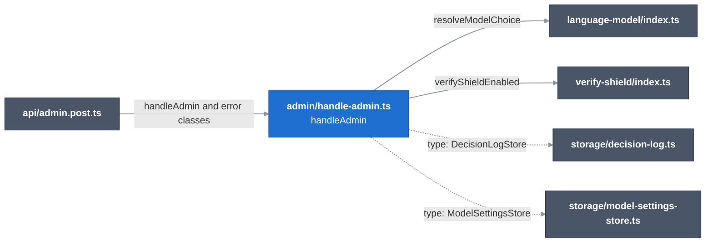

# Component: admin

> [C4 index](../../README.md) / Level 3: Components / Turn and admin server

`web/server/admin/handle-admin.ts`, one file. The product owner's handler: it checks who is asking, then saves
the model choice, switches the VerifyShield and lists decisions. Part of [server/00-overview.md](00-overview.md).

Legend: solid = runtime import, dashed = type-only import. Blue = this component, grey = other components.

## Behaviour (from the code)

| Step | What happens |
|---|---|
| Who may call | No email: `SignInRequiredError` (401). Email not in the comma-separated `adminEmails`: `ProductOwnerRequiredError` (403). |
| `save` event | Validates the provider with `resolveModelChoice`, keeps the current API key if the new one is blank, and stores the settings. |
| `verifyShield` event | Saves the on or off switch. |
| Every call | Returns the model settings with the API key masked, the current shield state, and up to 100 decisions filtered by verdict and student id. |

## Verified imports

- Runtime: `language-model` (`resolveModelChoice`; type `ModelSettings`), `verify-shield` (`verifyShieldEnabled`; type `VerifyShieldStore`).
- Type only: `storage/decision-log`, `storage/model-settings-store`.
- It never imports Supabase code; the route passes the stores in.
- Imported by `api/admin.post.ts`. Tests: `admin-handler.test.ts`.
