# Component: admin

> [C4 index](../../README.md) / Level 3: Components / Turn and admin server

`web/server/admin/handle-admin.ts`, one file. The product owner's handler: it checks who is asking, then saves
the model choice, switches the VerifyShield, lists decisions and lists or renumbers students. Part of
[server/00-overview.md](00-overview.md).

Legend: solid = runtime import, dashed = type-only import. Blue = this component, grey = other components.

```mermaid
flowchart LR
  classDef comp fill:#1f6fd0,stroke:#164f96,color:#ffffff
  classDef near fill:#4a5568,stroke:#2d3748,color:#ffffff
  linkStyle default stroke:#8b949e,stroke-width:1.5px

  route["<b>api/admin.post.ts</b>"]:::near
  handle["<b>admin/handle-admin.ts</b><br/>handleAdmin"]:::comp
  choice["<b>language-model/index.ts</b>"]:::near
  shield["<b>verify-shield/index.ts</b>"]:::near
  decisionLog["<b>storage/decision-log.ts</b>"]:::near
  settings["<b>storage/model-settings-store.ts</b>"]:::near
  directory["<b>storage/student-directory.ts</b>"]:::near

  route -->|"handleAdmin and error classes"| handle
  handle -->|"resolveModelChoice"| choice
  handle -->|"verifyShieldEnabled"| shield
  handle -.->|"type: DecisionLogStore"| decisionLog
  handle -.->|"type: ModelSettingsStore"| settings
  handle -.->|"type: StudentDirectoryStore"| directory
```

## Behaviour (from the code)

| Step | What happens |
|---|---|
| Who may call | No email: `SignInRequiredError` (401). Email not in the comma-separated `adminEmails`: `ProductOwnerRequiredError` (403). |
| `role` event | `checkAdminRole`: the same 401/403 checks, then `{ productOwner: true }`. Reads no settings and no decisions; `api/admin.post.ts` routes it there before `handleAdmin`. |
| `save` event | Validates the provider with `resolveModelChoice`, keeps the current API key if the new one is blank, and stores the settings. |
| `verifyShield` event | Saves the on or off switch. |
| `studentNumber` event | Checks `SWB` + at least four digits (400 otherwise) before reading the directory, then asks the store to change the number: an unknown student is 404, a number another student holds or one a student had before is 400. The store writes the change record with the acting product owner's email. |
| Every other call | Returns the model settings with the API key masked, the current shield state, up to 100 decisions filtered by verdict and student id, and every student in the directory (`students` event and any read). |

## Verified imports

- Runtime: `language-model` (`resolveModelChoice`; type `ModelSettings`), `verify-shield` (`verifyShieldEnabled`; type `VerifyShieldStore`).
- Type only: `storage/decision-log`, `storage/model-settings-store`, `storage/student-directory` (`StudentDirectoryStore`, `AdminStudent`).
- It never imports Supabase code; the route passes the stores in, including the student directory.
- Each decision it returns includes `ruleChecks` when the decision log recorded them.
- Imported by `api/admin.post.ts`. Tests: `admin-handler.test.ts`.
