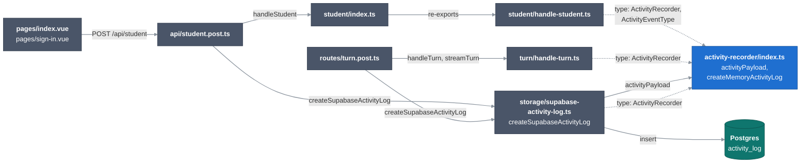

# Component: activity recorder

The one way the server appends to the activity log. The student handler and the turn handler both receive the same recorder. A payload never keeps code, a draft or keystrokes. The log is not evidence, so it never changes mastery, and no screen lists it.

> [C4 index](../../README.md) / Level 3: Components / Turn and admin server

`web/server/activity-recorder/index.ts` holds the event types, the payload filter and the in-memory log. The Supabase adapter is `web/server/storage/supabase-activity-log.ts`. Part of [server/00-overview.md](00-overview.md).

Legend: solid = runtime import, dashed = type-only import, thick = HTTP call with no import. Blue = this component, grey = other components, teal = database.

## Events

| Type | Written by | Payload |
|---|---|---|
| `signed_in` | Student handler, reported from sign-in when the student is sent to the workspace | `{}`, and the course is null |
| `module_opened` | Student handler, reported by the workspace after a module opens | `{ moduleId }` |
| `mode_switched` | Student handler, reported by the workspace | `{ mode }`: `learn` or `practice` |
| `layout_switched` | Student handler, reported by the workspace | `{ layout }`: `study` or `mindmap` |
| `code_run` | Student handler, reported by the workspace | `{ exerciseId }` only. A run still going when the practice panel goes away is included |
| `submitted` | Turn, on a submission | Module, exercise, tests passed and tests total. Never the code |
| `quiz_answered` | Turn, on the first stored answer to a question | Module, question and whether it was correct. A repeat appends nothing |
| `message_sent` | Turn, on a student message | Module, and whether the message quoted something. Never the text, the draft or a run |
| `note_created`, `note_changed`, `note_linked`, `note_unlinked`, `note_deleted` | Student handler | Ids only, never the note text |
| `mindmap_moved` | Student handler | The kind and id, `{ imported: true }` for a one-time import, or `{ reset: true }` when clearing saved positions |
| `profile_changed` | Student handler | Whether the name or the picture changed, never the picture |

A turn that opens or selects a module appends nothing. The workspace reports `module_opened` once that open has succeeded. A preview request on the student handler writes nothing. A rejected report writes nothing.

## The table

`activity_log` columns: student, course (optional), event type, a JSON object payload, and `created_at`. The adapter does not send `created_at`; the database stamps the server time. `activityPayload` drops the keys `code`, `draft` and `keystrokes` before the in-memory log or the insert, and a check constraint rejects a payload that still has one of those keys.

Row-level security is on with no policy. Insert and select are granted to the server role only. Update and delete are granted to nobody, including the server role. `anon` and `authenticated` cannot read, update or delete.

Home and the profile tell the student that activity is recorded and is not used for a grade. No page lists the events. The student model does not import this component.

## Verified imports

- Runtime: `storage/supabase-activity-log.ts` imports `activityPayload` from `activity-recorder`. `student/index.ts` re-exports `handle-student.ts`, which is what `api/student.post.ts` imports.
- Type only: `storage/supabase-activity-log.ts` imports `ActivityRecorder`. `student/handle-student.ts` imports `ActivityRecorder` and `ActivityEventType`. `turn/handle-turn.ts` imports `ActivityRecorder`. The routes do not import this folder; they construct `createSupabaseActivityLog` and pass it in.
- Browser: `app/activity/record.ts` posts to `POST /api/student` and ignores a failure, so a missed report does not undo the action. `pages/index.vue` reports `module_opened` for the module the workspace opens onto and again when the student opens another, `mode_switched` only when the student chooses Learn or Practice, `layout_switched`, and `code_run` when a run ends (the exercise id only, including a failure, a stop, or the practice panel going away while the run is still going). `pages/sign-in.vue` reports `signed_in`. Applying a turn's own mode does not record a mode switch.
- Tests: `student-handler.test.ts` and `turn-endpoint.test.ts` use `createMemoryActivityLog`. `activity-log-migration.test.ts` runs the migration (and the note-with-first-link function) on PGlite. `activity-mindmap-boundary.test.ts` checks the live project.
