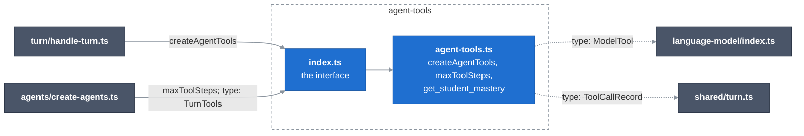

# Component: agent-tools

> [C4 index](../../README.md) / Level 3: Components / Turn and admin server

`web/server/agent-tools/`, the tools an agent may call in one turn, bound by the server to the turn's student and
course, and the record of the calls made with them. Imported only through `index.ts`. Part of
[server/00-overview.md](00-overview.md).

Legend: solid = runtime import, dashed = type-only import. Blue = this component, grey = other components.

## Files

| File | Responsibility |
|---|---|
| `agent-tools.ts` | `createAgentTools({ readMastery, masteryThreshold })` gives one turn's `TurnTools`: the tools, the `trace` of calls (name, input, short result summary), `stepCapReached` and `noteStepCap()`. Today one tool, `get_student_mastery`: no input; returns each module's id, name, state and stored mastery, the mastery threshold and the maximum of 1.0. `maxToolSteps` is 3. |
| `index.ts` | The interface: `createAgentTools`, `maxToolSteps`, `AgentToolsBinding`, `ToolModuleMastery`, `TurnTools`. |

## Notes

- No tool takes a student id from the model: the turn handler binds `readMastery` to the turn's student standing and course.
- The turn handler records the trace on the Teacher's decisions (`tool_trace` column), and the product owner's verdict drawer lists it.
- Tests: `mastery-tool-turn.test.ts` drives turns with the fake language model scripted to call the tool; `tool-trace-migration.test.ts` checks the column.
