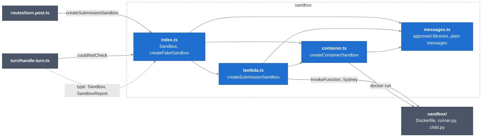

# Component: sandbox

> [C4 index](../../README.md) / Level 3: Components / Turn and admin server

Re-runs a submission with the exercise's tests. The evidence ledger records only that report.
A run in the browser is not evidence. On the deployed server, `web/server/sandbox/` invokes the
Lambda function in Sydney. With no function name, it runs the container image in `sandbox/`.
Part of [server/00-overview.md](00-overview.md).

Legend: solid = runtime import, dashed = type-only import, thick = a process started with no import.
Blue = this component, grey = another part of this repo.

## Files

| File | Responsibility |
|---|---|
| `index.ts` | The `Sandbox` interface: `check({ code, tests })` returns `checked` with one result per test, or `refused` with a plain message. `createFakeSandbox` is what the turn tests use. |
| `messages.ts` | The approved libraries (`math`, `random`, `string`, `itertools`, `collections`, `datetime`, `re`, `statistics`, `functools`) and the plain messages for a library, for 10 seconds, for 512 MB, for 64 KB, and for a busy sandbox ("Try again in a moment."). |
| `lambda.ts` | `createSubmissionSandbox` invokes `colearner-sandbox` in `ap-southeast-2` when `runtimeConfig.sandboxFunction` is set, and uses that payload as the sandbox result. At most five submissions run at once, on one shared gate. A sixth submission, and a throttled invoke, return "Try again in a moment." and record no evidence. A function killed for memory returns the 512 MB message. Anything else that is not a report is "This submission could not be checked." With no function name, it uses `createContainerSandbox`. |
| `container.ts` | Runs the image `colearner-sandbox` (or `runtimeConfig.sandboxImage`) with no network, a read-only root, a temporary directory the jailed user can write, a 512 MB memory cap and a process cap. A killed container is the memory message. Anything that is not a report is "This submission could not be checked." |
| `sandbox/runner.py` | The image entrypoint for a local run. Refuses a disallowed import by name before it runs. Starts `child.py` with the interpreter that is already running, an empty environment and a 10 second limit, then deletes the jail's temporary directory. When Lambda sets `AWS_LAMBDA_RUNTIME_API`, it also asks the child to cap new processes at 32. |
| `sandbox/child.py` | Inside the image, enters the jail and drops privileges, then starts a further process for the student code. Lambda runs the function as an unprivileged user and rejects the jail, so there the process uses a private directory under `/tmp` instead, denies new sockets with a seccomp filter, and the handler removes AWS credential values from the report it returns. That process returns each test's actual value and does not receive the expected value. This process decides `passed` by comparing them, so a document the student writes on the output channel is not a pass. A process the student forks is not given that channel. The same import list is enforced again around the student code. Output past 64 KB, and a memory error, come back as a refusal. |
| `sandbox/guard.py` | The approved list and the scan of `import`, `from` and a literal `__import__` or `import_module`. |
| `sandbox/Dockerfile` | CPython 3.14, the same minor version as the browser's Pyodide, and a jail that holds the interpreter and the standard library, and not the rest of the image. `entrypoint.sh` runs `runner.py` for a local `docker run`, and the Lambda runtime client with `handler.py` when `AWS_LAMBDA_RUNTIME_API` is set. The handler returns the report and does not write the student's code to stdout or stderr. |
| `infra/sandbox` | Terraform for the registry (immutable tags, one per commit), the function, the private network with no outbound route, the function role, the server user that can only invoke the function, the seven-day log group, and the $50 monthly budget. State is an S3 backend in `ap-southeast-2`. The account owner applies it. |

## What a report means

| Report | What the turn does |
|---|---|
| `checked` | Appends one evidence row from those results, stores the code, the per-test results and `passed` or `failed`, then the agents answer. The counts in the request are not read. |
| `refused` | Stores the code, no per-test results, and the message. Appends no evidence row, so mastery does not move. The student sees the message. The agents are not called. |

The owning student reads a stored submission through `POST /api/submission`. Another student is refused.

## Verified imports

- `index.ts` re-exports `messages.ts`, `container.ts` and `lambda.ts`. `lambda.ts` imports `container.ts`, `messages.ts` and `@aws-sdk/client-lambda`. `container.ts` imports `messages.ts` and spawns `docker`. Neither imports the turn.
- Runtime importers: `routes/turn.post.ts` (`createSubmissionSandbox`), `turn/handle-turn.ts` (`couldNotCheck`).
- Type-only: `turn/handle-turn.ts` (`Sandbox`, `SandboxReport`).
- Tests: `sandbox-submission.test.ts` and `sandbox-runner.test.ts` (`createFakeSandbox` and the messages), `sandbox-lambda.test.ts` (the invoke result, the five-at-a-time gate, and the handler writing no student code), `sandbox-infrastructure.test.ts` (the Terraform description), `sandbox-image.test.ts` (the docker arguments and `interpretSandboxOutput`), `python-runner.test.ts` (the same refusal on Run and on the browser check).

## Notes

- Run stays in the browser. Submit is checked again here. When the two disagree, this report is the one that is stored (ADR 0010).
- The turn tests pass a fake sandbox and do not need an AWS account or a running image. The Lambda tests pass a fake invoke and do not call AWS.
- The deployed server sets `NUXT_SANDBOX_FUNCTION=colearner-sandbox` and `NUXT_SANDBOX_REGION=ap-southeast-2` (`render.yaml`). The access key is the IAM user `colearner-server`, which can only invoke that function.
- The image tests in `sandbox-image.test.ts` build `sandbox/` and run it locally. They show that student code cannot reach the network, the environment or the file system, cannot spawn processes without a limit, and cannot see a file left by an earlier run in the same container. They are skipped when the Docker daemon is not running.
