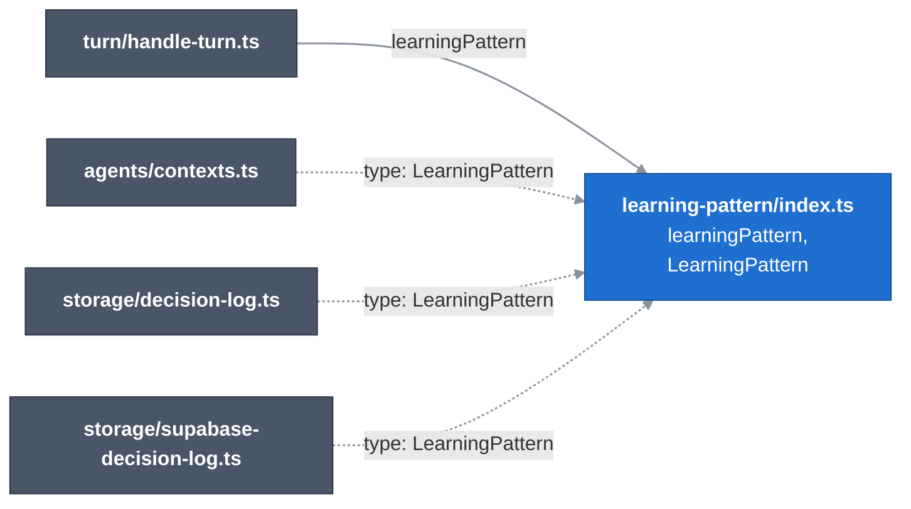

# Component: learning pattern

> [C4 index](../../README.md) / Level 3: Components / Turn and admin server

`web/server/learning-pattern/index.ts`, the student's learning pattern: where their work says they
struggle and how they study. The single entry point `learningPattern(records)` is a pure function of
the student's records in one course — evidence, submissions with their detector findings, wrong quiz
answers that name a misconception, the activity log and the decision log. The same records always give
the same pattern. It is computed when needed, never stored, and it never writes anything and never
moves mastery or an unlock. Part of [server/00-overview.md](00-overview.md).

Legend: solid = runtime import, dashed = type-only import. Blue = this component, grey = other components.

## What it reports

| Part | Shape | Read from |
|---|---|---|
| Weak spots | Misconception id, times seen, last seen | Each finding kept with a submission, and each wrong quiz answer that names a misconception |
| Recurring errors | Error kind, count | `run_finished` events (the error name, else the outcome) and failed submissions |
| Attempts to pass | Exercise id, attempts, passed? | Submission evidence rows up to the first pass; rows after it are practice, not attempts |
| Hint rungs used | Module id, the rungs climbed | The decision log's ruled moves matching `hint_level_N`, per decision's turn module |
| Time on materials | Module id, seconds | `module_opened` starts a stretch on that module's materials, `mode_switched` away from materials or another `module_opened` ends it; a stretch back to materials belongs to the open module. The last stretch ends at the last event, so no clock is read |

Every list is sorted (count descending then id, or id ascending), so the output is deterministic
however the input rows were ordered.

`gather.ts` (`gatherLearningPattern`) reads the five stores and calls `learningPattern`; the turn and the staff review both use it, so both show the same pattern.

## How the turn uses it

- The Teacher's context carries the whole pattern; the Teacher's propose prompt has a `Learning
  pattern` section naming each weak spot, the recurring errors, the attempts per exercise, the hint
  rungs per module and the seconds on materials per module. The Deskmate's context never carries it.
- Every decision the turn records carries the turn's module id and the pattern snapshot the Teacher
  saw (`module_id` and `learning_pattern` on `decisions`), for audit against the hash chain.
- The student sees the weak spots, in plain words: each spot's misconception response text from
  the course spec, on the state as `weakSpots`, and the passed exercises with their attempts, on the
  state as `progress` (built by the turn from `exerciseAttempts`). Nothing else of the pattern reaches them.

The records the function takes are minimal shapes of its own (one entry per evidence row, submission,
quiz answer, activity event and decision), so the stores it reads through are not coupled to it. A
store the turn was not given contributes nothing.

## Verified imports

- Runtime importers: `turn/handle-turn.ts` (`learningPattern`).
- Type-only importers: `agents/contexts.ts` (`LearningPattern` on `TeacherContext`),
  `storage/decision-log.ts` and `storage/supabase-decision-log.ts` (the snapshot on `DecisionRecord`).
- Tests: `learning-pattern.test.ts` (the pure function: determinism under reordered input, weak
  spots, recurring errors, attempts, rungs, materials seconds) and `learning-pattern-turn.test.ts`
  (the pattern reaches the Teacher's prompt and the decisions, Mai never sees it, the student sees
  plain words, mastery is untouched).
