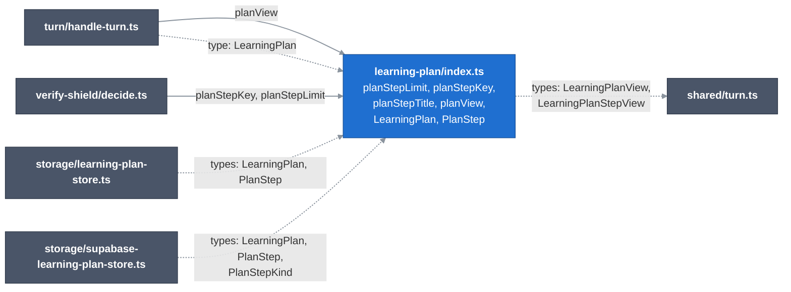

# Component: learning plan

> [C4 index](../../README.md) / Level 3: Components / Turn and admin server

`web/server/learning-plan/index.ts`, the Teacher's learning plan for one module: the steps, their wording,
and the view the student sees. A plan is one to five steps, in the order the student should do them, each
pointing at the module's own materials, one of its quiz questions, one of its exercises, or a misconception
the learning pattern calls a weak spot. The student agrees before it starts, and agreeing is recorded as a
new revision, so a plan is never rewritten. Part of [server/00-overview.md](00-overview.md).

Legend: solid = runtime import, dashed = type-only import. Blue = this component, grey = other components.

## What a plan is

| Part | Shape | Notes |
|---|---|---|
| Step kind | `materials`, `quiz`, `exercise`, `misconception`, `approach` or `try` | A `materials` step points at all of the module's materials and carries an empty ref |
| Step ref | A question, exercise or misconception id | Only ids of the module the student opened |
| Plan | Module id, revision, steps, current step, agreed time, created time, trigger, decision turn | The highest revision for a student and module is the plan in force |
| Agreement | `agreedAt` | Null while the plan is only proposed; pressing Start appends a new revision with the time instead of updating the row |

`planStepKey` is the step's stable id in its plan (`materials`, else `kind:ref`). `planStepTitle` reads the
step's words from the module content, so they always match what the step points at; a step whose target the
module no longer has has no title. `planView` is what the student sees: `steps` (each with its id, title and
whether it is the current one), `revision`, `agreed` and `currentStep`. A step that no longer matches the
module is left out of the view rather than shown with no words.

## Progress and revision

`learning-plan/progress.ts` (re-exported by `index.ts`) holds `planProgress(plan, records, failureLimit)`, a pure
function of the student's verified records of the module: sandbox-checked submissions, marked quiz answers,
the activity log and the seconds on the materials. It returns which steps are `done`, the `currentStep` (the first
step not done), the `triggers` since the plan's latest revision and whether the student's `approachAwaitingTry`.

| Step | Done when |
|---|---|
| `materials` | the plan is agreed and the module's materials have 60 seconds (`materialsSecondsNeeded`) |
| `quiz` | the question's answer is recorded right |
| `approach` | an `approach_written` event for the exercise after this revision: the student's next message while the step is current |
| `try` | a run or a checked submission on the exercise at or after the approach |
| `exercise` | a sandbox-verified pass |
| `misconception` | a later sandbox-verified pass whose code no longer shows it |

Nothing is done before the student agreed. Triggers, strictly after the revision's `createdAt`: `failed_submissions`
(the same exercise failed `Course.failuresBeforeRevision` times, three unless the course spec's optional
`failuresBeforeRevision` says otherwise), `wrong_quiz_answer`, `misconception` (a checked submission whose code
shows one) and `step_done` (the current step moved past the one the revision recorded). A revision therefore
resets the triggers. `revise_plan` is ruled only when a trigger is present; otherwise the VerifyShield turns it
into a `continue_plan` check-in.

A revision row records `trigger` (the triggers the server saw, never the model's claim) and `decisionTurnId`, the turn
whose decision-log entries ruled on it. A revised plan keeps `agreedAt`. Agreeing copies both from the plan it agrees to.

## How it is used

- The [turn](02-turn.md) asks the Teacher for a plan (`Teacher.plan`) when the student opens or selects a
  module with no plan in force, and only when a plan store is wired. The proposal goes through the
  [VerifyShield](03-verify-shield.md) like any other move; only an allowed or downgraded `propose_plan`
  whose steps survive the rules is stored, as revision 1. A preview never proposes a plan and writes
  nothing.
- A `plan_start` turn reads the latest plan and, while it is unagreed, appends the next revision with
  `agreedAt` set to the turn's clock. Starting a module with no plan, or one already agreed, changes
  nothing.
- A `revise_plan` the VerifyShield allows or downgrades (with the steps that fit) is written by the turn as the
  next revision; a block writes nothing. `continue_plan` writes nothing. A right quiz answer that finishes a step,
  a message while an `approach` step is current, and an `idle` turn each run the Teacher over the plan; see
  [turn](02-turn.md).
- Plans never touch mastery or an unlock: proposing and agreeing are a read of the student's records and
  a write of the plan only.
- The returned state carries `learningPlan` (`LearningPlanView | null`); the web app shows it as a
  checklist above the materials, with Start until the plan is agreed.

## Verified imports

- Imports: type only from `shared/turn` (`LearningPlanView`, `LearningPlanStepView`). Pure: no I/O, no
  clock, no package.
- Runtime importers: `turn/handle-turn.ts` (`planView`), `verify-shield/decide.ts` (`planStepKey`,
  `planStepLimit`). `turn/handle-turn.ts` also type-imports `LearningPlan`.
- Type-only importers: `storage/learning-plan-store.ts` and `storage/supabase-learning-plan-store.ts`
  (`LearningPlan`, `PlanStep`, `PlanStepKind`).
- Tests: `learning-plan.test.ts` (titles, keys, the view, a stale step left out), `learning-plan-turn.test.ts`
  (propose once, agree as a new revision, survive reload, mastery untouched, previews never propose),
  `learning-plans-migration.test.ts` (the table, the revision constraint and its grants, on PGlite), `plan-progress.test.ts` (each step kind's done rule and each trigger), `plan-revision-turn.test.ts` (revisions after three failures, a wrong answer, a misconception or a finished step; the approach; the quiet check-in) and `plan-revision-migration.test.ts` (the trigger and decision columns and the new activity events, on PGlite).
