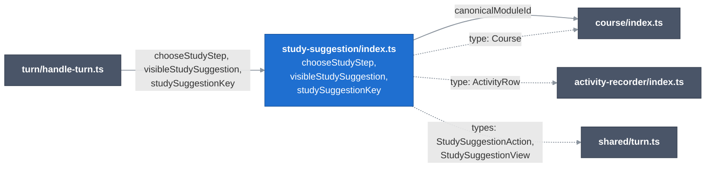

# Component: study suggestion

> [C4 index](../../README.md) / Level 3: Components / Turn and admin server

`web/server/study-suggestion/index.ts`, the fixed rules that choose the one next step a student is shown. They
read the student's activity log for the current course, in the log's own order, and choose at most one step
among the modules the student has unlocked and the work of the current module. Nothing is stored except what the
student dismissed; the language model never chooses the situation or the step, and the log is not evidence, so
nothing here touches mastery, an unlock or the roadmap. Part of [server/00-overview.md](00-overview.md).

Legend: solid = runtime import, dashed = type-only import. Blue = this component, grey = other components.

## What is read

`chooseStudyStep({ course, rows, currentModuleId, currentExerciseId, unlockedModuleIds })` is a pure function.
`rows` are `ActivityRow`s (each has the log's `id` and the `courseId` it was about); only this course's rows are
read. `signed_in`, `profile_changed`, `mindmap_moved` and every note event are ignored, so is the time of day, and
a row naming an exercise or module the course does not have is dropped. A mode or layout switch carries no module
of its own, so it belongs to the module of the row before it. "Full pass" means a `submitted` row whose passed
count equals its total.

## The twelve situations

Highest first; a situation names the exercise, module or error type where it was most recently true (its latest
satisfying row, not necessarily its anchor), and one that would name a closed module is skipped, so the next is
considered.

| # | Identity | True when | Action |
|---|---|---|---|
| 1 | `pasted_pass` | the first submission of an exercise is a full pass, a paste of 40 or more characters came before it, and the module was never switched to Learn | Learn on the module |
| 2 | `repeated_error` | three runs on an exercise ended in the same error type, and no full pass since | Practice on the exercise |
| 3 | `repeated_failed_submission` | two submissions that did not pass every test, no full pass since | Practice on the exercise |
| 4 | `partial_submission` | one submission that passed some tests and not all, and not two failed | Practice on the exercise |
| 5 | `runs_without_submission` | three runs on an exercise, no submission after the first of them | Practice on the exercise |
| 6 | `asked_first` | a message on a module with no run and no submission | Practice on its first unfinished exercise |
| 7 | `quiz_only` | a quiz answer and no exercise of the module passed | Practice on its first unfinished exercise |
| 8 | `reading_only` | the module was opened, with no run, submission or switch to Practice (the default Learn screen records none) | Practice on its first unfinished exercise |
| 9 | `abandoned_module` | a module opened, then another module or the Mindmap layout, with no submission or quiz answer in it | Practice on its first unfinished exercise |
| 10 | `hopping` | the openings and submissions end in three openings that each change module (reopening the same module is not a hop) | Practice on the current module's first unfinished exercise |
| 11 | `left_study_layout` | the latest layout switch is to the Mindmap layout and the current exercise has no full pass | Study layout on the current exercise |
| 12 | `returned_to_exercise` | went idle then returned on the same exercise, with no run, submission or message since | Practice on the exercise |

The sentence and button are fixed words with the module and exercise names the student sees, never ids; the
sentence in the dialog is the sentence the Teacher's prompt carries. A step that would send the student to a
module whose exercises are all passed has nowhere to go and is skipped.

## Episodes and dismissal

A step's identity is the situation, module, exercise (when it names one) and error type (when the sentence names
one). Its anchor is the id of the activity row that makes the episode true, kept the same while the episode lasts:
the row that completed the pattern (the third run, the second failed submission, the third error of that type).
A situation that, once ended, cannot become true again is anchored on its first row: the first message
(`asked_first`), quiz answer (`quiz_only`), module opening (`reading_only`) and leaving of the module
(`abandoned_module`). The page logs a module opening on every reload, so a reload never starts a new episode. The
situations that re-fire on an event are anchored on the latest such row (the latest hop, the latest layout switch,
the latest return). A dismissal stores identity and anchor ([storage](08-storage.md)); the suggestion is
hidden while the winning step's identity and anchor are the ones dismissed. The rules do not fill the dialog with
the next situation: it shows later, once it is the step chosen and its own episode was not dismissed. The same
identity shows again only after its episode ended and a later one began.

## Where it is used

`turn/handle-turn.ts` computes the step on every redraw (`RedrawState.studySuggestion`, null when none or
dismissed, and always null for a module preview), on `dismiss_study_suggestion` (which stores the dismissal only
when the key sent is the key of the step the rules choose now), in the Teacher's context
(`TeacherContext.studySuggestion`, sentence and module, kept after a dismissal for as long as the rules still
choose the step) and in the turn snapshot (`studyStepModuleId`, for [VerifyShield](03-verify-shield.md) rule 8a).
Mai's context never carries it.

## Tests

`study-suggestion-turn.test.ts` (every situation, the count one short of each, priority, dismissal, new episodes,
other courses, previews), `study-suggestion-agents.test.ts` (the Teacher's prompt, Mai's, the verdicts),
`decide.test.ts`, `study-suggestion-migration.test.ts`.
