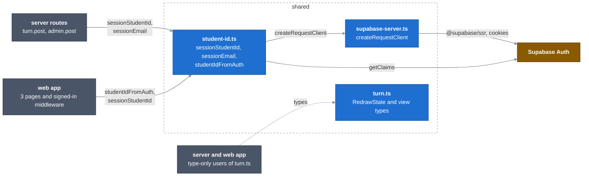

# Component: shared

> [C4 index](../README.md) / Level 3: Components / Shared by both

`web/shared/`: code and types used by both the server and the browser. Part of
[server/00-overview.md](server/00-overview.md) and [web-app/00-overview.md](web-app/00-overview.md).

Legend: solid = runtime import, dashed = type-only import. Blue = this component, grey = users of it, brown = external.

## Files

| File | Responsibility |
|---|---|
| `student-id.ts` | `studentIdFromAuth(client)` reads the signed-in user's id from the session claims (`getClaims`). `sessionStudentId(event)` and `sessionEmail(event)` do the same on the server from request cookies and return `null` when Supabase is not configured. |
| `supabase-server.ts` | `createRequestClient(event, url, publishableKey)`: a Supabase server client that reads cookies from the request and writes refreshed ones to the response. |
| `turn.ts` | Types only: the screen state (`RedrawState`), roadmap, working area, conversation, trace and the `TurnEvent` stream. |

## Verified imports

- `student-id.ts` imports `supabase-server.ts` at runtime and, as types, `@supabase/supabase-js` and `h3`. It also uses `useRuntimeConfig`, which is auto-imported.
- `supabase-server.ts` imports `@supabase/ssr` and `h3`.
- Runtime importers of `student-id.ts`: `routes/turn.post.ts`, `api/admin.post.ts`, `app/middleware/signed-in.ts`, `app/pages/index.vue`, `home.vue`, `sign-in.vue`.
- Type-only importers of `turn.ts`: `course/course`, `course/study-module`, `agents/contexts`, `turn/handle-turn`, `app/pages/index.vue`, six workspace components (`ConversationPanel`, `CourseRoadmap`, `PracticePanel`, `QuizPanel`, `RoadmapCanvas`, `WorkingArea`), `app/python/protocol`, `app/roadmap/arrangement`. The browser files reach it through the Nuxt alias `#shared/turn`, `app/python/protocol` by relative path.
- No test imports `student-id.ts` or `supabase-server.ts`. `roadmap-arrangement.test.ts` imports `turn.ts`.

## Notes

- `student-id.ts` is imported from browser code and server code alike. The `event`-based functions are called only on the server (`import.meta.server` branches in the pages), the `studentIdFromAuth` one in both.
