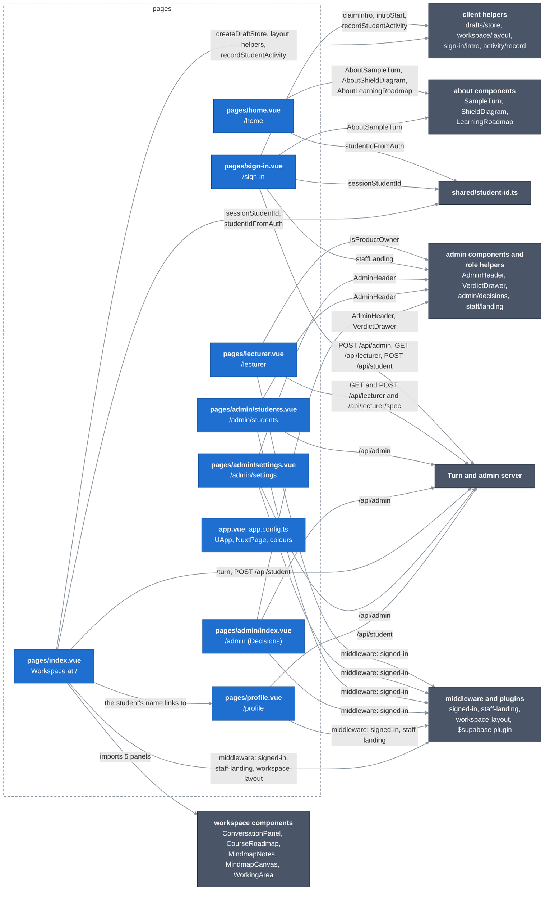

# Component: pages

> [C4 index](../../README.md) / Level 3: Components / Web app

The routes of the web app and the app shell. Part of [web-app/00-overview.md](00-overview.md).

Legend: solid = runtime import, thick = runtime link with no import (Nuxt auto-registration, HTTP call, middleware
by name). Blue = this component, grey = other components or containers.

## Files

| File | Responsibility (from the code) |
|---|---|
| `pages/index.vue` | The workspace. Opens the student's module with `{event: 'open'}` and reports that module as `module_opened`. Reads streamed turn events (NDJSON), sends messages, submissions and quiz answers (`{event: 'quiz_answer'}`, one question at a time, under the same lock as a submission), selects modules and exercises, prefetches module views on hover, and switches between the Study and Mindmap layouts (query `?layout=`, cookie). In the Mindmap layout the same conversation panel appears under the notes editor. On phones it opens in a bottom sheet over the canvas. Selecting an unlocked module uses the usual turn to update the resume point. The Study link opens that module in the Study layout, and selecting a closed module shows its reason. A note has a title, text underneath, a colour, one required module and an optional image, and it can link to the student's other notes. Save is what writes it; the saved note is a draggable card on the canvas with a line to that module, and two linked notes are joined by a line. An image the browser would refuse (not JPEG, PNG or WebP, or over 2 MB) never leaves the panel. Reads the deskmate switch from the turn state and sets it with `{event: 'deskmate_switch'}`; it makes no `/api/admin` request. There is no staff opt-out: the `staff-landing` middleware sends staff away on every open. Signs out with `$supabase.auth.signOut()`. Choosing Learn or Practice, switching layout, opening another module, and a finished, failed or stopped run are each one report to `POST /api/student`. A run still going when the practice panel goes away is the same report. A run report is the exercise id only. A mode the turn itself applies is not a report. The page does not list the activity log. |
| `pages/sign-in.vue` | Email and password form using `$supabase.auth.signInWithPassword`. After sign-in, and on the server for a user already signed in, `staffLanding` (`staff/landing`) sends the product owner to `/admin`, a lecturer to `/lecturer`, and anyone else to `/`. A student sent to `/` reports `signed_in` to `POST /api/student`. Plays a first-visit intro (`sign-in/intro`). |
| `pages/home.vue` | Public Home page: a small course roadmap that plays one module unlock, the shield diagram, the sample turn and the team. Tells a visitor that activity in the app is recorded and is not used to grade them. |
| `pages/profile.vue` | Profile page, reached from the student's name in the workspace: the display name and the picture, saved with `{event: 'profile_changed'}`. A new name shows as `Saved.` and a new picture as `Picture saved.`. The picture is cropped square on the device before it is sent; the page checks the type (JPEG, PNG or WebP) and size (2 MB or smaller) first so a file the server would refuse is stopped there. Email and student number are shown and cannot be changed. Tells the student their activity is recorded and is not used to grade them. |
| `pages/admin/index.vue` | Decisions page: the newest 100 decisions at full width with verdict and student filters, shown 10 per page. Each verdict is a button that opens `VerdictDrawer` from the decision already loaded (no extra request), showing the rule checks, the proposed and ruled moves and the addressed agent of the turn; closing returns focus to the verdict. Shows a refusal on 403. |
| `pages/admin/students.vue` | Students page: every student's name, student number and email, with an inline form to change one student's number. The page checks `SWB` + at least four digits before sending; the server's 400 keeps the reason (wrong format, duplicate, a number used before) as an alert, and a successful change refreshes the list. Shows a refusal on 403. |
| `pages/admin/settings.vue` | Settings page: the VerifyShield switch and the language model form. Shows a refusal on 403. |
| `components/admin/AdminHeader.vue` | Header shared by the three admin pages: the Decisions/Students/Settings nav (`aria-current` on the current page), a Lecturer page link when `isLecturer` succeeds (the switch for someone who also lectures), and Sign out. It has no link to a student page. |
| `components/admin/VerdictDrawer.vue` | Native modal `<dialog>` drawer: the rule checks in order with ✓/✗ and plain-English reasons, the deciding check highlighted, proposed and ruled move, masteries, unlocked modules, threshold and VerifyShield state. Escape, the close button or a click on the backdrop close it; full screen on a phone. |
| `admin/decisions.ts`, `staff/landing.ts` | The admin payload types (decisions, model settings, the student directory), the reason-code wording and `drawerChecks` (shield off: no checks and a note; older record: the deciding rule only and a note); `isProductOwner` and `isLecturer` through the cheap role checks (`POST /api/admin` with `{event: 'role'}`, `GET /api/lecturer`), and `staffLanding`, which runs both checks and sends a product owner to `/admin`, a lecturer to `/lecturer` and a student nowhere. Agent names (`Teacher`, `Mai`) come from `agentNames` in `shared/turn.ts`, shared with the `@` menu. |
| `pages/lecturer.vue` | Shows owned courses, enrollment counts, course history and the enrolled students of each course: name, student number, email and enrollment date, searchable by name or student number and sortable by any of those columns client-side. The page never shows code, conversations, mastery or activity. Lecturers can set the mastery threshold. The Editor pane (`components/lecturer/CourseEditor.vue`) edits the course draft: add, reorder and remove parts and modules, move a module to a part, edit materials blocks with a live Mermaid preview, the quiz (choices, correct choice, explanation), exercises (statement, starter code, reference solution), the hint ladder and misconception responses. It saves the draft, discards it, imports a course spec JSON into it, exports the draft and the published spec, and Publish saves what is on screen and then publishes it. Validation errors from the server name the module and field. The Preview pane (`components/lecturer/CoursePreviewPanel.vue`) shows the draft as a student would see it: one module at a time, its materials blocks, its quiz with the correct choice named, the hint ladder and the misconception responses, each teacher-only part marked, beside a practice panel that runs the module's exercises and Submits against the draft's own tests in the browser. It loads `GET /api/lecturer/spec?preview=1`, so it never calls the turn endpoint, asks an agent or records anything, and reference solutions never reach it. Both are imported explicitly, since Nuxt's auto-import would name them `Lecturer…`. A product owner who also lectures gets the Admin page switch; staff sign out from this header. Sign-in routes authorized lecturers here, and the page has no link to a student page. |
| `app.vue`, `app.config.ts` | `UApp` with `NuxtPage`, light colour mode, indigo and slate palette. |

## Verified imports

- `index.vue`: `ConversationPanel`, `CourseRoadmap`, `MindmapNotes`, `MindmapCanvas`, `WorkingArea`, `shared/turn` (type), `shared/student-id`, `drafts/store`, `workspace/layout`, `activity/record`.
- `sign-in.vue`: `shared/student-id`, `sign-in/intro`, `activity/record`.
- `home.vue`: `shared/student-id`.
- `profile.vue`: `StudentResponse` (type) from `server/student`.
- `admin/index.vue`: `AdminHeader`, `VerdictDrawer`, `admin/decisions` (types). `admin/settings.vue` and `admin/students.vue`: `AdminHeader`, `admin/decisions` (type), `admin/message`. `admin/students.vue` also imports `shared/student-number`. `sign-in.vue`, `lecturer.vue` and `AdminHeader.vue` also import `staff/landing`. `lecturer.vue` imports `CourseEditor` and `CoursePreviewPanel`; `CourseEditor` imports `MermaidDiagram`.
- `AboutSampleTurn`, `AboutShieldDiagram` and `AboutLearningRoadmap` are used in templates without an import (Nuxt component auto-registration from `components/about/`).
- Middleware is attached by name in `definePageMeta`: `index.vue` uses `['signed-in', 'staff-landing', 'workspace-layout']`; `profile.vue` uses `['signed-in', 'staff-landing']`; the three admin pages and `lecturer.vue` use `'signed-in'`. `home.vue` and `sign-in.vue` set none.
- Nothing imports the pages; Nuxt routes them from the file names. No test imports them; the Playwright specs in `web/e2e/` drive them in a browser.
