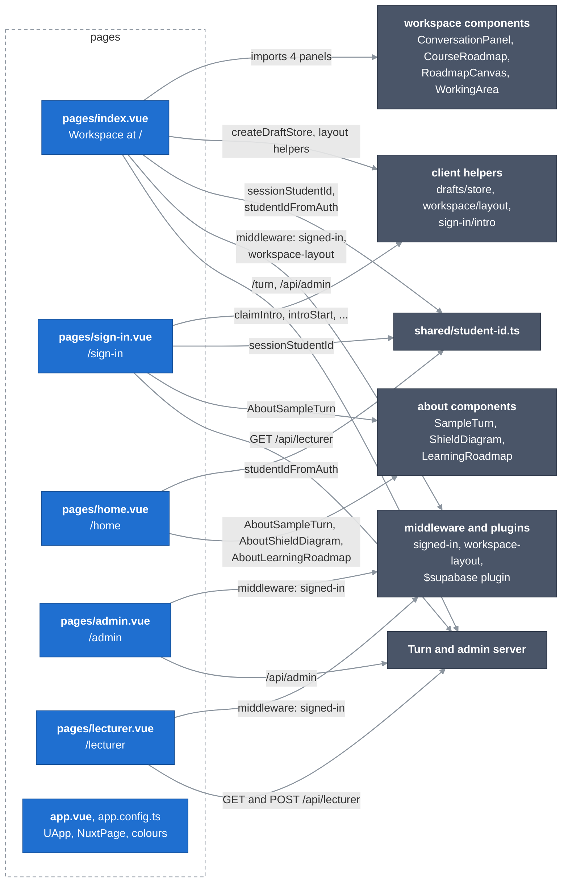

# Component: pages

> [C4 index](../../README.md) / Level 3: Components / Web app

The four routes of the web app and the app shell. Part of [web-app/00-overview.md](00-overview.md).

Legend: solid = runtime import, thick = runtime link with no import (Nuxt auto-registration, HTTP call, middleware
by name). Blue = this component, grey = other components or containers.

## Files

| File | Responsibility (from the code) |
|---|---|
| `pages/index.vue` | The workspace. Opens the student's module with `{event: 'open'}`, reads streamed turn events (NDJSON), sends messages, submissions and quiz answers (`{event: 'quiz_answer'}`, one question at a time, under the same lock as a submission), selects modules and exercises, prefetches module views on hover, and switches between the Study and Roadmap layouts (query `?layout=`, cookie). In the Roadmap layout the conversation panel can be closed and reopened. Shows a Dashboard link to `/admin` beside the layout switch once `/api/admin` confirms the user is a product owner. Also reads and sets the VerifyShield switch through `/api/admin`. Signs out with `$supabase.auth.signOut()`. |
| `pages/sign-in.vue` | Email and password form using `$supabase.auth.signInWithPassword`. On the server it redirects a signed-in user to `/`. Plays a first-visit intro (`sign-in/intro`). |
| `pages/home.vue` | Public Home page: a small course roadmap that plays one module unlock, the shield diagram, the sample turn and the team. |
| `pages/admin.vue` | Product-owner page: model provider settings, VerifyShield switch, newest 100 decisions with filters, shown 10 per page. Shows a refusal on 403. |
| `pages/lecturer.vue` | Shows owned courses, enrollment counts and course history. Lecturers can save a mastery threshold between 50% and 99%. Sign-in routes authorized lecturers here. |
| `app.vue`, `app.config.ts` | `UApp` with `NuxtPage`, light colour mode, indigo and slate palette. |

## Verified imports

- `index.vue`: `ConversationPanel`, `CourseRoadmap`, `RoadmapCanvas`, `WorkingArea`, `shared/turn` (type), `shared/student-id`, `drafts/store`, `workspace/layout`.
- `sign-in.vue`: `shared/student-id`, `sign-in/intro`.
- `home.vue`: `shared/student-id`.
- `admin.vue`: no imports from this repo.
- `AboutSampleTurn`, `AboutShieldDiagram` and `AboutLearningRoadmap` are used in templates without an import (Nuxt component auto-registration from `components/about/`).
- Middleware is attached by name in `definePageMeta`: `index.vue` uses `['signed-in', 'workspace-layout']`, `admin.vue` uses `'signed-in'`. `home.vue` and `sign-in.vue` set none.
- Nothing imports the pages; Nuxt routes them from the file names. No test imports them; the Playwright specs in `web/e2e/` drive them in a browser.
