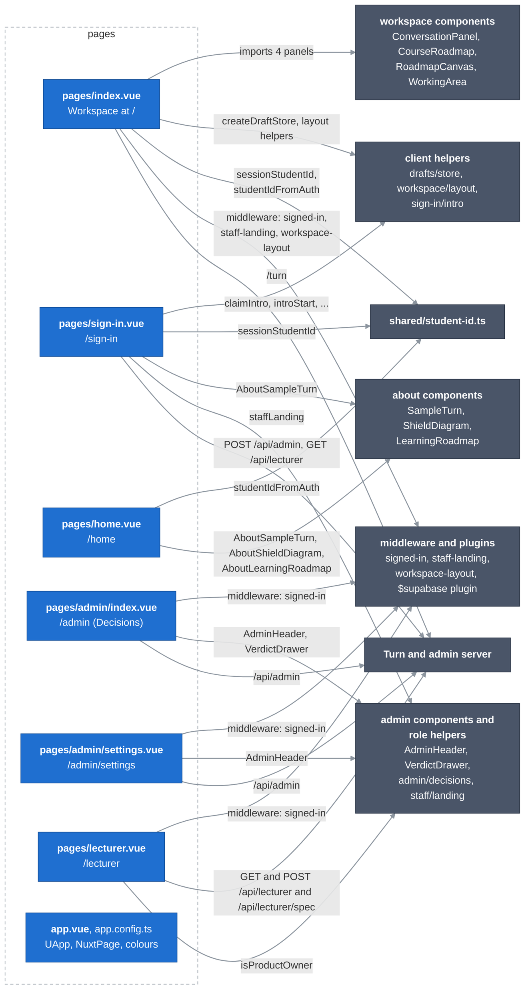

# Component: pages

> [C4 index](../../README.md) / Level 3: Components / Web app

The routes of the web app and the app shell. Part of [web-app/00-overview.md](00-overview.md).

Legend: solid = runtime import, thick = runtime link with no import (Nuxt auto-registration, HTTP call, middleware
by name). Blue = this component, grey = other components or containers.

## Files

| File | Responsibility (from the code) |
|---|---|
| `pages/index.vue` | The workspace. Opens the student's module with `{event: 'open'}`, reads streamed turn events (NDJSON), sends messages, submissions and quiz answers (`{event: 'quiz_answer'}`, one question at a time, under the same lock as a submission), selects modules and exercises, prefetches module views on hover, and switches between the Study and Roadmap layouts (query `?layout=`, cookie). In the Roadmap layout the conversation panel can be closed and reopened. Reads the deskmate switch from the turn state and sets it with `{event: 'deskmate_switch'}`; it makes no `/api/admin` request. There is no staff opt-out: the `staff-landing` middleware sends staff away on every open. Signs out with `$supabase.auth.signOut()`. |
| `pages/sign-in.vue` | Email and password form using `$supabase.auth.signInWithPassword`. After sign-in, and on the server for a user already signed in, `staffLanding` (`staff/landing`) sends the product owner to `/admin`, a lecturer to `/lecturer`, and anyone else to `/`. Plays a first-visit intro (`sign-in/intro`). |
| `pages/home.vue` | Public Home page: a small course roadmap that plays one module unlock, the shield diagram, the sample turn and the team. |
| `pages/admin/index.vue` | Decisions page: the newest 100 decisions at full width with verdict and student filters, shown 10 per page. Each verdict is a button that opens `VerdictDrawer` from the decision already loaded (no extra request), showing the rule checks, the proposed and ruled moves and the addressed agent of the turn; closing returns focus to the verdict. Shows a refusal on 403. |
| `pages/admin/settings.vue` | Settings page: the VerifyShield switch and the language model form. Shows a refusal on 403. |
| `components/admin/AdminHeader.vue` | Header shared by both admin pages: the Decisions/Settings nav (`aria-current` on the current page), a Lecturer page link when `isLecturer` succeeds (the switch for someone who also lectures), and Sign out. It has no link to a student page. |
| `components/admin/VerdictDrawer.vue` | Native modal `<dialog>` drawer: the rule checks in order with ✓/✗ and plain-English reasons, the deciding check highlighted, proposed and ruled move, masteries, unlocked modules, threshold and VerifyShield state. Escape, the close button or a click on the backdrop close it; full screen on a phone. |
| `admin/decisions.ts`, `staff/landing.ts` | The admin payload types, the reason-code wording and `drawerChecks` (shield off: no checks and a note; older record: the deciding rule only and a note); `isProductOwner` and `isLecturer` through the cheap role checks (`POST /api/admin` with `{event: 'role'}`, `GET /api/lecturer`), and `staffLanding`, which runs both checks and sends a product owner to `/admin`, a lecturer to `/lecturer` and a student nowhere. Agent names (`Teacher`, `Mai`) come from `agentNames` in `shared/turn.ts`, shared with the `@` menu. |
| `pages/lecturer.vue` | Shows owned courses, enrollment counts and course history. Lecturers can set the mastery threshold and import or download the Python course spec as JSON. A product owner who also lectures gets the Admin page switch; staff sign out from this header. Sign-in routes authorized lecturers here, and the page has no link to a student page. |
| `app.vue`, `app.config.ts` | `UApp` with `NuxtPage`, light colour mode, indigo and slate palette. |

## Verified imports

- `index.vue`: `ConversationPanel`, `CourseRoadmap`, `RoadmapCanvas`, `WorkingArea`, `shared/turn` (type), `shared/student-id`, `drafts/store`, `workspace/layout`.
- `sign-in.vue`: `shared/student-id`, `sign-in/intro`.
- `home.vue`: `shared/student-id`.
- `admin/index.vue`: `AdminHeader`, `VerdictDrawer`, `admin/decisions` (types). `admin/settings.vue`: `AdminHeader`, `admin/decisions` (type). `sign-in.vue` and `lecturer.vue` also import `staff/landing`.
- `AboutSampleTurn`, `AboutShieldDiagram` and `AboutLearningRoadmap` are used in templates without an import (Nuxt component auto-registration from `components/about/`).
- Middleware is attached by name in `definePageMeta`: `index.vue` uses `['signed-in', 'staff-landing', 'workspace-layout']`; both admin pages use `'signed-in'`. `home.vue` and `sign-in.vue` set none.
- Nothing imports the pages; Nuxt routes them from the file names. No test imports them; the Playwright specs in `web/e2e/` drive them in a browser.
