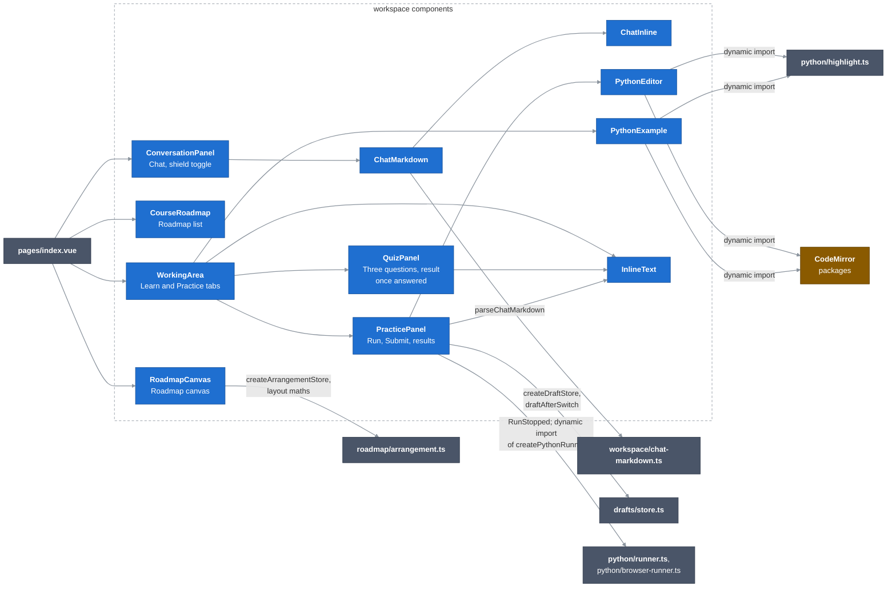

# Component: workspace components

> [C4 index](../../README.md) / Level 3: Components / Web app

The panels of the workspace: conversation, course roadmap (list and canvas), materials, the module quiz, practice and editor.
`web/app/components/workspace/`. Part of [web-app/00-overview.md](00-overview.md).

Legend: solid = runtime import (dashed lines are not used here because every `shared/turn` import is a type and
is listed below). Blue = this component, grey = other components, brown = external.

## Files

| File | Responsibility |
|---|---|
| `ConversationPanel.vue` | Bubbles for student, Teacher and Deskmate with portraits, typing rows, event rows (exercise and test summaries), the message box with the `@` menu (an `@` at the start offers Teacher and Mai, Mai only while the deskmate switch is on; the choice becomes a removable chip, Backspace on an empty box removes it; the sent bubble shows the tag), the deskmate switch with a busy spinner, and the turn's notice. Menu logic is in `workspace/addressed-agent.ts`. Emits `send(text, addressedAgent)`, `openLearn`, `toggleDeskmate`, and `close` (close button, Roadmap layout only). |
| `ChatMarkdown.vue`, `ChatInline.vue` | Render the small Markdown subset of a reply from the tree that `chat-markdown.ts` produces (never raw HTML). |
| `CourseRoadmap.vue` | Roadmap as a list grouped by part, with mastery bars, the threshold mark and the reason a module is closed. Emits `selectModule` and `prefetchModule`. |
| `RoadmapCanvas.vue` | Roadmap as a canvas: draggable module cards, zoom and pan, connectors. A saved note is a smaller card with a line to its module, and dragging that card reports a new point. The student's module arrangement is read and written through `createArrangementStore(localStorage, ...)`. |
| `WorkingArea.vue` | Learn mode (materials, example, the module quiz) and Practice mode (the practice panel). In the floating canvas layout it shows Learn only. Passes the quiz's `answer` event up as `quizAnswer`, which the page binds as `@quiz-answer`. |
| `QuizPanel.vue` | The module's three questions under the materials, four choices each. A choice on an unanswered question emits `answer`, which the page sends as a `quiz_answer` turn; the server marks it. Once a question is answered, its result (right or wrong, the correct choice, the explanation) comes back in the working area, and the student can click other choices to explore without another turn, because only the first answer counts. |
| `PracticePanel.vue` | Exercise chips, editor, Run and Submit. Runs code and tests in the Pyodide worker, keeps the draft in `localStorage` per student and exercise, emits `draft`, `run`, `runFinished` and `submit`. `runFinished` is the exercise id when a run ends, including a failure, a stop, or the panel going away mid-run, and never the code. |
| `PythonEditor.vue` | CodeMirror 6 editor bound with `v-model`. |
| `PythonExample.vue` | Read-only, highlighted code example. |
| `InlineText.vue` | Shows backtick spans as inline code. It has its own small parser; it does not use `chat-markdown.ts`. |

## Verified imports

- As drawn. `CourseRoadmap.vue` and `ConversationPanel.vue` import only types from `shared/turn` (and `ChatMarkdown`).
- Type-only imports of `shared/turn` (through the `#shared/turn` alias): `ConversationPanel`, `CourseRoadmap`, `PracticePanel`, `QuizPanel` (`QuizQuestionView`), `RoadmapCanvas`, `WorkingArea`. `ChatInline` has a type-only import of `workspace/chat-markdown`.
- `PracticePanel` also has a runtime import of `python/runner` (`RunStopped`) and a dynamic import of `python/browser-runner`.
- `PythonEditor` and `PythonExample` load `codemirror`, `@codemirror/lang-python`, `@codemirror/state` and `python/highlight` with dynamic `import()` inside `onMounted`.
- Imported by: `pages/index.vue` (four panels); everything else is imported by sibling files only.
- No test imports these components.
