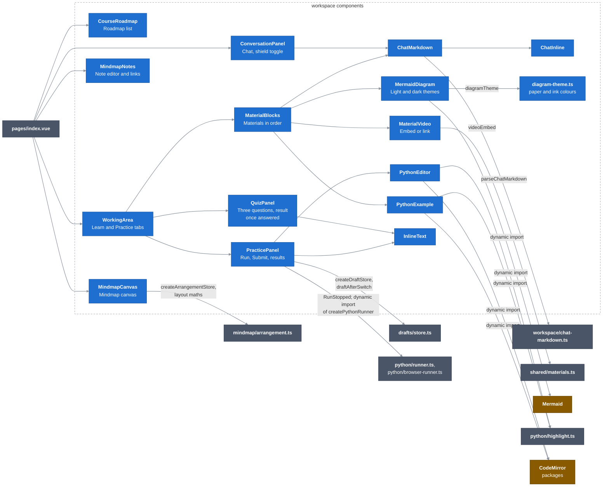

# Component: workspace components

> [C4 index](../../README.md) / Level 3: Components / Web app

The panels of the workspace: conversation, course roadmap list, mindmap canvas, materials, the module quiz, practice and editor.
`web/app/components/workspace/`. Part of [web-app/00-overview.md](00-overview.md).

Legend: solid = runtime import (dashed lines are not used here because every `shared/turn` import is a type and
is listed below). Blue = this component, grey = other components, brown = external.

## Files

| File | Responsibility |
|---|---|
| `ConversationPanel.vue` | Bubbles for student, Teacher and Deskmate with portraits, typing rows, event rows (exercise and test summaries), the message box with the `@` menu (an `@` at the start offers Teacher and Mai, Mai only while the deskmate switch is on; the choice becomes a removable chip, Backspace on an empty box removes it; the sent bubble shows the tag), the deskmate switch with a busy spinner, and the turn's notice. Menu logic is in `workspace/addressed-agent.ts`. Emits `send(text, addressedAgent)`, `openLearn`, `toggleDeskmate`. |
| `ChatMarkdown.vue`, `ChatInline.vue` | Render the small Markdown subset of a reply from the tree that `chat-markdown.ts` produces (never raw HTML). A reply keeps a heading line as bold text. Materials pass `headings`, so a lesson title is a heading (`h2` to `h6`; the module name stays the page's only `h1`). |
| `CourseRoadmap.vue` | Roadmap as a list grouped by part, with mastery bars, the threshold mark and the reason a module is closed. Emits `selectModule` and `prefetchModule`. |
| `MindmapCanvas.vue` | Mindmap canvas with draggable module cards, connectors, and a view that pans and zooms, including pinch zoom on phones. A saved note is a smaller card with a line to its module, and a line also joins two notes the student linked. The canvas emits position changes to the workspace page, which saves them with the student account. |
| `MindmapNotes.vue` | The notes panel: the student's notes as a list, and one editor for the chosen note or a new one. Title and text, a colour from the palette tokens in `shared/mindmap.ts`, the module the note hangs on, and the links to the student's other notes with their `Remove link`. After a save the page shows `Note saved.` under the form for a few seconds (the `saved` prop). Emits `select`, `save(draft)`, `remove`, `link(noteId, targetNoteId)` and `unlink(linkId)`, which the page sends as the note events on `/api/student`. |
| `WorkingArea.vue` | Learn mode (the module's materials, then the quiz) and Practice mode (the practice panel). Materials are an ordered list of blocks. In the floating canvas layout it shows Learn only. The learn column cannot scroll sideways. Passes the quiz's `answer` event up as `quizAnswer`, which the page binds as `@quiz-answer`. |
| `QuizPanel.vue` | The module's three questions under the materials, four choices each. A choice on an unanswered question emits `answer`, which the page sends as a `quiz_answer` turn; the server marks it. Once a question is answered, its result (right or wrong, the correct choice, the explanation) comes back in the working area, and the student can click other choices to explore without another turn, because only the first answer counts. |
| `PracticePanel.vue` | Exercise chips, editor, Run and Submit. Runs code and tests in the Pyodide worker, keeps the draft in `localStorage` per student and exercise, emits `draft`, `run`, `runFinished` and `submit`. `runFinished` is the exercise id when a run ends, including a failure, a stop, or the panel going away mid-run, and never the code. |
| `PythonEditor.vue` | CodeMirror 6 editor bound with `v-model`. Tab accepts the highlighted autocomplete suggestion; with none open Tab moves focus on, so keyboard users are not trapped. |
| `PythonExample.vue` | Read-only, highlighted code example. A long line scrolls inside the example, not the page. |
| `MaterialBlocks.vue` | Renders one module's materials in order: text (Markdown), a Python example, a Mermaid diagram, an image (URL and alt text), or a video. |
| `MaterialVideo.vue` | A YouTube or Vimeo address is an embedded player. Any other address is a link with the video's title. |
| `MermaidDiagram.vue` | Draws a Mermaid diagram in the browser. `diagram-theme.ts` supplies the light theme (paper and navy) and the dark theme (ink), and the diagram follows the colour mode. The drawing fits the column width and is never drawn larger than its natural size. The app's reduced-motion rule is switched off inside the diagram (`main.css`), because it made Mermaid mis-measure its edge labels and draw a huge, tiny-texted diagram. A diagram Mermaid cannot draw shows its source, wrapped. |
| `diagram-theme.ts` | `diagramTheme('light' \| 'dark', color)`: Mermaid settings for the two themes. `color` reads a palette variable from the page. `useMaxWidth` makes the SVG fit a phone. |
| `InlineText.vue` | Shows backtick spans as inline code. It has its own small parser; it does not use `chat-markdown.ts`. |

## Verified imports

- As drawn. `MindmapNotes.vue` imports only the `NoteColour` type from `shared/mindmap`. `CourseRoadmap.vue` and `ConversationPanel.vue` import only types from `shared/turn` (and `ChatMarkdown`).
- Type-only imports of `shared/turn` (through the `#shared/turn` alias): `ConversationPanel`, `CourseRoadmap`, `MaterialBlocks` (`MaterialBlock`), `PracticePanel`, `QuizPanel` (`QuizQuestionView`), `MindmapCanvas`, `WorkingArea`. `ChatInline` has a type-only import of `workspace/chat-markdown`.
- `MaterialVideo` imports `videoEmbed` from `shared/materials` at runtime. `MermaidDiagram` imports `diagram-theme.ts` and loads `mermaid` with a dynamic `import()`.
- `PracticePanel` also has a runtime import of `python/runner` (`RunStopped`) and a dynamic import of `python/browser-runner`.
- `PythonEditor` and `PythonExample` load `codemirror`, `@codemirror/lang-python`, `@codemirror/state` and `python/highlight` with dynamic `import()` inside `onMounted`.
- Imported by: `pages/index.vue` (the workspace panels). `CoursePreviewPanel.vue` imports `MaterialBlocks` and `PracticePanel`. `CourseEditor.vue` imports `MermaidDiagram`. The other files are imported by siblings only.
- `diagram-theme.ts` and `shared/materials.ts` are tested by `materials.test.ts`. No test imports the Vue files.
