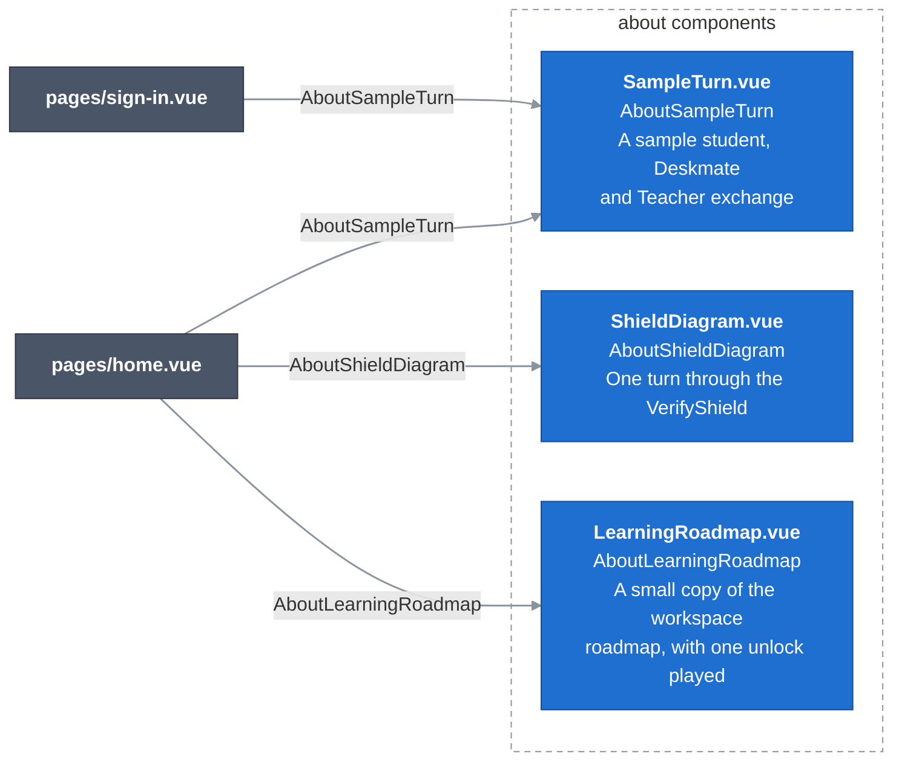

# Component: about components

> [C4 index](../../README.md) / Level 3: Components / Web app

`web/app/components/about/`: three presentational components used on the sign-in and Home pages. Part of
[web-app/00-overview.md](00-overview.md).

Legend: thick = runtime link with no import (Nuxt auto-registration). Blue = this component, grey = other components.

## Verified

- No file has an `import` statement. All are static: hard-coded text and the portrait images from `public/portraits/`. `LearningRoadmap.vue` copies the look of `workspace/MindmapCanvas.vue` with general module names; it uses an `IntersectionObserver` to play one unlock (loop ticks, mastery past the threshold, next module opens) when it first scrolls into view.
- They are used by tag name only (`<AboutSampleTurn>`, `<AboutShieldDiagram>`, `<AboutLearningRoadmap>`), through Nuxt's directory-prefixed auto-registration of `components/about/`.
- `ShieldDiagram.vue` says in a comment that its wording follows `server/verify-shield/decide.ts`. That is a copy of the rule text, not a link: if the rules change, the diagram text does not change with them.
- No test imports them; `web/e2e/home-page.spec.ts` checks the Home page in a browser.
