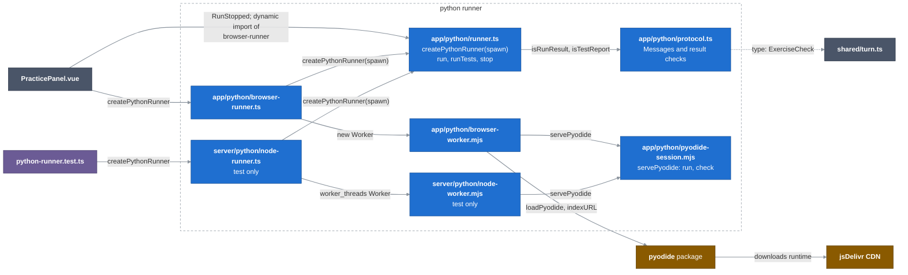

# Component: python runner

> [C4 index](../../README.md) / Level 3: Components / Web app

Runs student Python and exercise tests. It has one core that works the same everywhere and two ways to start
a worker: the browser (used by the product) and Node (used only by a test). `web/app/python/` and
`web/server/python/`. Part of [web-app/00-overview.md](00-overview.md).

Legend: solid = runtime import, dashed = type-only import, thick = runtime link with no import (a Worker is
started). Blue = this component, grey = other components, brown = external.

Note: the two "PracticePanel" arrows are the same file importing two different files (`runner.ts` for
`RunStopped` and types, `browser-runner.ts` through a dynamic `import()`).

## Files

| File | Responsibility |
|---|---|
| `runner.ts` | The runner core. Takes a `spawn` function that returns a `WorkerPort` (`post`, `onMessage`, `onError`, `terminate`). One pending request at a time; `run(code)`, `runTests(code, tests)`, `stop()` (rejects with `RunStopped`). |
| `protocol.ts` | The message types between runner and worker (`ToWorker`, `FromWorker`), result types, and the guards `isRunResult` and `isTestReport`. |
| `browser-runner.ts` | `createPythonRunner()` with a spawn that starts `browser-worker.mjs` as a module Web Worker. |
| `browser-worker.mjs` | Calls `servePyodide` with `loadPyodide({ indexURL: https://cdn.jsdelivr.net/pyodide/v<version>/full/ })`. |
| `pyodide-session.mjs` | Installs two Python helpers in Pyodide: one runs the student's code and captures stdout, stderr and the error line; one runs each test expression against the student's namespace and compares `str(value)` with the expected text. |
| `node-runner.ts`, `node-worker.mjs` | The same core started in a Node `worker_threads` Worker with Pyodide from `node_modules`. |
| `highlight.ts` (in the same folder) | CodeMirror highlight style, used by `PythonEditor` and `PythonExample` through dynamic imports. It is not part of running Python. |

## Verified imports

- As drawn. `runner.ts` imports `protocol.ts` at runtime; `browser-runner.ts` and `node-runner.ts` import `runner.ts` at runtime and `protocol.ts` as a type.
- Packages: `pyodide` (both workers), `node:worker_threads` and `node:url` (`node-runner.ts`).
- Importers: `PracticePanel.vue` (`runner`, `browser-runner`); `web/tests/python-runner.test.ts` (`node-runner`, `runner`, `study-module`).
- `server/python/*` is not imported by any server code. Only the test uses it, so the product runs student code in the browser only.

## Notes

- Tests run in the student's browser, so the server gets only the counts the browser reports (ADR 0002).
- `python-runner.test.ts` runs exercise reference solutions through the Node worker, which makes it a way to check that the course exercises pass their own tests. That is my reading of the test file's imports (`study-module`), not something I ran.
