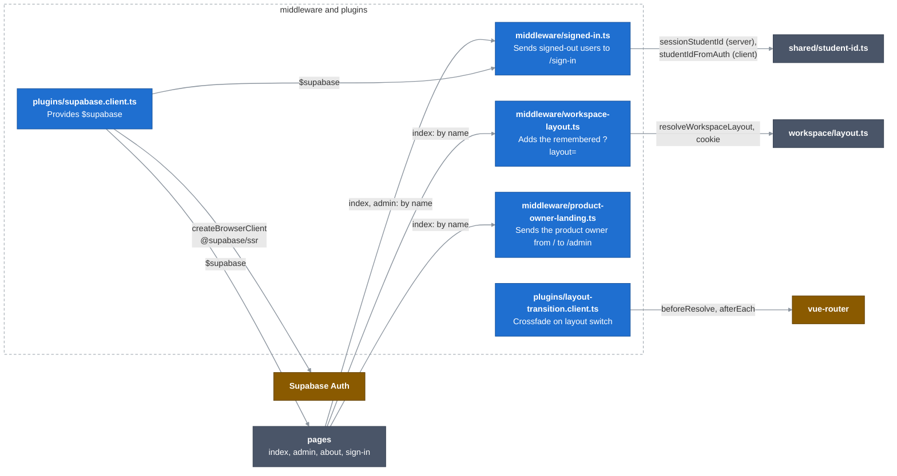

# Component: middleware and plugins

> [C4 index](../../README.md) / Level 3: Components / Web app

Nuxt route guards and client plugins. Nothing imports them; Nuxt loads them by folder, and pages attach the
middleware by name. Part of [web-app/00-overview.md](00-overview.md).

Legend: solid = runtime import, thick = runtime link with no import (Nuxt middleware by name, plugin injection).
Blue = this component, grey = other components, brown = external.

## Files

| File | Responsibility (from the code) |
|---|---|
| `middleware/signed-in.ts` | On the server: no session in the request cookies leads to `/sign-in`. In the browser: no signed-in user from `$supabase` leads to `/sign-in`. |
| `middleware/workspace-layout.ts` | On `/` without `?layout=` in the browser, replaces the route with one that carries the remembered layout, so Back returns to the layout that was showing. The server renders `/` from the cookie without a redirect. |
| `middleware/product-owner-landing.ts` | On `/` without `?workspace=`, asks `POST /api/admin` with `{event: 'role'}` (through `admin/landing`) and redirects a product owner to `/admin`. A move within `/` (a layout switch) is left alone. |
| `plugins/supabase.client.ts` | Creates the browser Supabase client with the URL and publishable key from the public runtime config, and provides it as `$supabase`. |
| `plugins/layout-transition.client.ts` | Uses the View Transitions API to crossfade the switch between Study and Roadmap on the same page without remounting the panels. Skipped when reduced motion is requested or the API is missing. |

## Verified

- Imports from this repo: `signed-in.ts` imports `shared/student-id`; `workspace-layout.ts` imports `workspace/layout`. The two plugins import nothing from this repo.
- Who reads `$supabase` (search for `$supabase`): `pages/sign-in.vue`, `pages/index.vue`, `pages/home.vue`, `middleware/signed-in.ts`.
- Middleware use (search for `definePageMeta`): `pages/index.vue`, `pages/admin/index.vue` and `pages/admin/settings.vue` only.
- No test imports these files.
