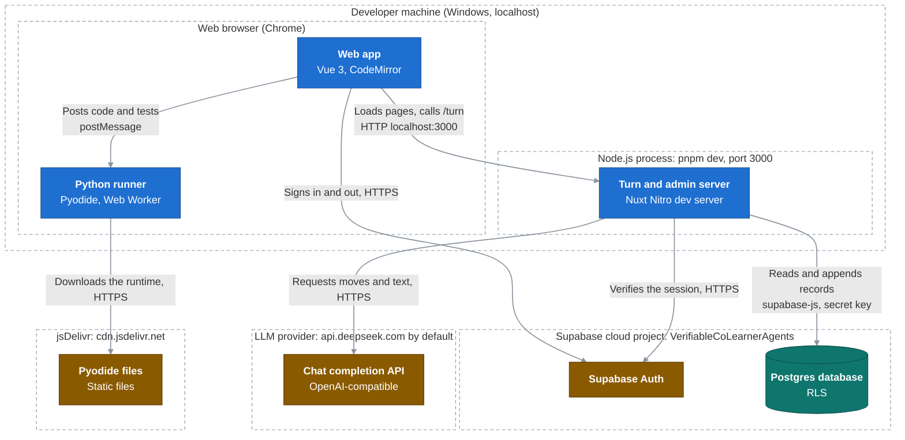

# C4 Deployment: current setup (localhost + Supabase cloud)

> [C4 index](README.md) / Deployment (supplementary)

This shows how the system runs today. AWS is the planned target but has no design yet, so it is
listed at the bottom as a placeholder and is not drawn.

Colours: blue is code in this repo, brown is an external service, teal is a database.

## Evidence for each node

| Node | Evidence in the repo |
|---|---|
| Developer machine, `pnpm dev` on port 3000 | `web/README.md` ("pnpm dev"), `web/playwright.config.ts` (`baseURL` `http://localhost:3000`, command `pnpm dev --port 3000`) |
| Supabase cloud project | `web/.env.example` points `NUXT_PUBLIC_SUPABASE_URL` at a `*.supabase.co` URL; `web/README.md` says to use the team's Supabase project `VerifiableCoLearnerAgents`; `.mcp.json` points at the same project |
| LLM provider | `nuxt.config.ts` default `modelBaseUrl: https://api.deepseek.com`; the administrator can change it on `/admin` |
| jsDelivr | `web/app/python/browser-worker.mjs` |

## GitHub Actions

Two workflows live in `.github/workflows/`. They run on GitHub after those files are on the default branch. Neither deploys the Nuxt server. The app still runs on a developer machine.

| Workflow | When | What it runs | Credentials |
|---|---|---|---|
| `check.yml` | every pull request, and every push to `main` | In `web/`: `pnpm typecheck`, and `pnpm test` with `CHECK_SKIP_LIVE_SUPABASE=1`. Also `supabase db push --dry-run` against project ref `nopyjjyimtmvuucsirxb`, which does not write | `SUPABASE_ACCESS_TOKEN` for the dry-run only |
| `schema-push.yml` | every push to `main`, queued, not cancelled mid-run | `supabase db push` for project ref `nopyjjyimtmvuucsirxb` (`VerifiableCoLearnerAgents`), without `--include-seed`. The CLI opens a temporary login role from the access token | `SUPABASE_ACCESS_TOKEN` |

`check.yml` skips the Vitest files that sign in to the shared project (`*boundary*.test.ts` and `conversation-storage.test.ts`). Those still run from `pnpm test` on a machine that has `web/.env`. Playwright rehearsal is not in either workflow. A red Check does not block a merge until someone with admin marks the `typecheck`, `test`, and `migrations` jobs as required status checks. See ADR 0007. The Vitest migration files replay SQL in PGlite from an empty database. The dry-run is the check against the migration history of the shared project.

## Not part of the current setup

- **Local Supabase stack.** `supabase/config.toml` exists (ports 54321 and so on), but no code or env file
  points at it. It looks like the default CLI template. Whether anyone runs it locally: not known.
- **Playwright rehearsal.** `pnpm rehearsal` starts its own dev server on :3000 with `NUXT_MODEL=fake`
  and resets demo accounts in the same cloud project using the secret key.

## Planned: AWS

Not designed. Open questions to settle before drawing it:

- Where the Nitro server runs (container service, VM, or serverless) and which Nitro preset is used.
  `nuxt.config.ts` sets none today.
- Whether Supabase stays as the managed cloud service or moves to AWS-hosted Postgres and auth.
  Moving off Supabase would change `web/server/storage/*`, `web/shared/student-id.ts`, the sign-in page
  and the RLS-based migrations, so it is a larger change than moving the server.
- Where the server secrets live (`NUXT_SUPABASE_SECRET_KEY`, `NUXT_MODEL_API_KEY`).
- Whether Pyodide stays on the public CDN or is self-hosted (matters for restricted networks).
