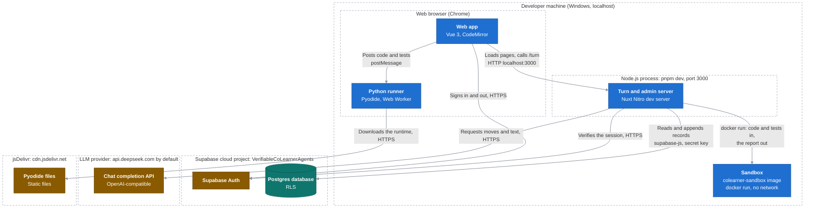
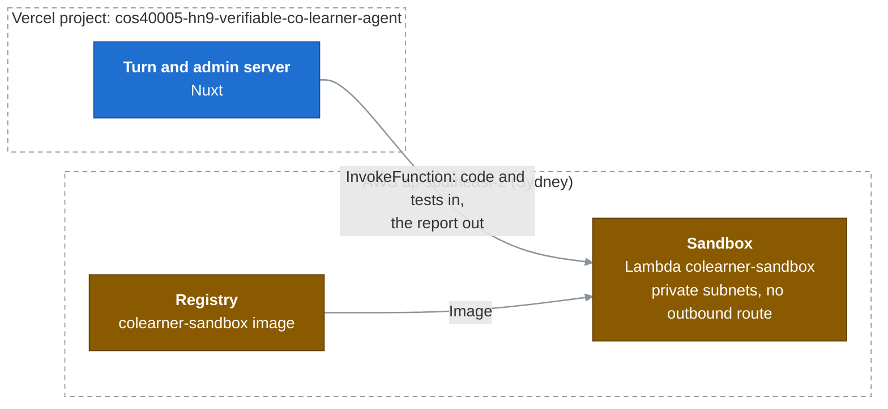

# C4 Deployment

> [C4 index](README.md) / Deployment (supplementary)

The public site is the Vercel project `cos40005-hn9-verifiable-co-learner-agent`
(`cos40005-hn9-verifiable-co-learner.vercel.app`). Vercel builds the Nuxt app on each push to `main`.
The deployed server checks a submission by invoking the sandbox Lambda function in Sydney
(`ap-southeast-2`). A developer machine with no function name still runs the same image locally.

## Developer machine

`NUXT_SANDBOX_FUNCTION` is blank, so this server runs the `colearner-sandbox` image with Docker.
That is the image the account owner pushes to the registry. Colours: blue is code in this repo,
brown is an external service, teal is a database.

## Evidence for each node

| Node | Evidence in the repo |
|---|---|
| Developer machine, `pnpm dev` on port 3000 | `web/README.md` ("pnpm dev"), `web/playwright.config.ts` (`baseURL` `http://localhost:3000`, command `pnpm dev --port 3000`) |
| Supabase cloud project | `web/.env.example` points `NUXT_PUBLIC_SUPABASE_URL` at a `*.supabase.co` URL; `web/README.md` says to use the team's Supabase project `VerifiableCoLearnerAgents`; `.mcp.json` points at the same project |
| LLM provider | `nuxt.config.ts` default `modelBaseUrl: https://api.deepseek.com`; the administrator can change the model on `/admin`. In production a saved address other than `https://api.deepseek.com` is refused |
| jsDelivr | `web/app/python/browser-worker.mjs` |
| Sandbox image | `sandbox/Dockerfile`, started by `web/server/sandbox/container.ts` as `colearner-sandbox` (`NUXT_SANDBOX_IMAGE` overrides the name). Build it with `docker build -t colearner-sandbox sandbox` |

## GitHub Actions

Two workflows live in `.github/workflows/`. Neither deploys the server. Vercel deploys the Nuxt app when `main` changes.

| Workflow | When | What it runs | Credentials |
|---|---|---|---|
| `check.yml` | every pull request, and every push to `main` | In `web/`: `pnpm typecheck`, and `pnpm test` with `CHECK_SKIP_LIVE_SUPABASE=1`. Also `supabase db push --dry-run` against project ref `nopyjjyimtmvuucsirxb`, which does not write | `SUPABASE_ACCESS_TOKEN` for the dry-run only |
| `schema-push.yml` | every push to `main`, queued, not cancelled mid-run | `supabase db push` for project ref `nopyjjyimtmvuucsirxb` (`VerifiableCoLearnerAgents`), without `--include-seed`. The CLI opens a temporary login role from the access token | `SUPABASE_ACCESS_TOKEN` |

`check.yml` skips the Vitest files that sign in to the shared project (`*boundary*.test.ts` and `conversation-storage.test.ts`). Those still run from `pnpm test` on a machine that has `web/.env`. Playwright rehearsal is not in either workflow. A red Check does not block a merge until someone with admin marks the `typecheck`, `test`, and `migrations` jobs as required status checks. See ADR 0007. The Vitest migration files replay SQL in PGlite from an empty database. The dry-run is the check against the migration history of the shared project.

## Not part of the current setup

- **Local Supabase stack.** `supabase/config.toml` records the local Auth rules: sign-up off, email confirmation on, an email change confirmed by both addresses, anonymous sign-in off, and manual linking off. No code or env file points the running app at this stack.
- **Playwright rehearsal.** `pnpm rehearsal` starts its own dev server on :3000 with `NUXT_MODEL=fake`
  and resets demo accounts in the same cloud project using the secret key.

## Deployed: the sandbox in Sydney

The Vercel project runs the Nuxt server. `createSubmissionSandbox` invokes the Lambda function
when `NUXT_SANDBOX_FUNCTION` is set (`web/.env.example`; Nuxt reads it as `sandboxFunction`)
and uses the payload as the sandbox result. The function runs the image in `sandbox/`, in private
subnets with no outbound route. Lambda runs it as an unprivileged user, so the image's chroot
jail applies under Docker and not here; the student process is denied new sockets, and the
handler removes AWS credential values from the report it returns. Its role can write its own log group (kept for seven days) and
the network interfaces Lambda needs to place it there. The server's access key is the IAM user
`colearner-server`, which can only invoke that function. At most five submissions run at once;
the sixth is told to try again in a moment and records no evidence. Terraform in `infra/sandbox`
describes this, with state in an S3 bucket in Sydney (`infra/terraform-state`) and a budget
alert at $50 a month. The account owner applies the plan. The registry keeps immutable tags, one
per commit, and the function's image URI names that commit. The server secrets
(`NUXT_SUPABASE_SECRET_KEY`, `NUXT_MODEL_API_KEY`, the sandbox access key) are environment
variables of the Vercel project, not files in the repo.

| Node | Evidence in the repo |
|---|---|
| Vercel project | Vercel project `cos40005-hn9-verifiable-co-learner-agent`, production host `cos40005-hn9-verifiable-co-learner.vercel.app` |
| Sandbox function in Sydney | `infra/sandbox` (`ap-southeast-2`, `colearner-sandbox`), `web/server/sandbox/lambda.ts`, `web/nuxt.config.ts` (`sandboxFunction`, `sandboxRegion`) |
| Registry | `infra/sandbox` `aws_ecr_repository.sandbox`, image built from `sandbox/Dockerfile` |

## Open questions that remain

- Whether Supabase stays as the managed cloud service or moves to AWS-hosted Postgres and auth.
  Moving off Supabase would change `web/server/storage/*`, `web/shared/student-id.ts`, the sign-in page
  and the RLS-based migrations, so it is a larger change than moving the server.
- Whether Pyodide stays on the public CDN or is self-hosted (matters for restricted networks).
