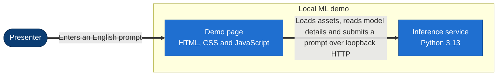
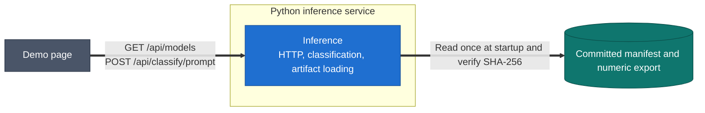

# C4 views for the local ML demo

> [C4 index](README.md) / Local ML demo

## Containers

One Python process serves the page and API on `127.0.0.1`. A browser loads the page from that origin and sends only an explicitly submitted prompt. The deployment is the presenter's machine. The process loads a local model export at startup and keeps the numeric parameters in memory.

## Components of the inference service

The Inference component lives in `AI/inference/`. Its files divide the work as follows.

| File | Responsibility |
|---|---|
| `server.py` | Binds to loopback, serves named assets and limits incoming JSON bodies. Returns structured errors. The demo stylesheet gets its color tokens from the repository's shared web palette. |
| `service.py` | Checks the declared language and prompt length. Applies the loaded threshold to the score and reports the model version. |
| `artifacts.py` | Uses the manifest to select and verify the expected archive. Reports the task unavailable if the artifact check fails. |

Inference uses the existing `AI/prompt_model.py` research scorer and its hashed character features, TF-IDF and logistic regression parameters.

The API tests run the server over loopback with the committed model or a temporary artifact directory. The browser test opens the demo and classifies a prompt through the same HTTP route. [Start and test the demo](../../AI/README.md).
