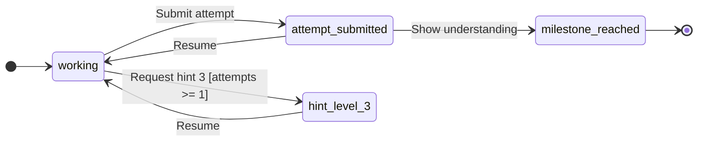

# Semi-formal notations for Pedagogical state models with Guards

Research for [#7](https://github.com/Bill2926/COS40005_HN9_Verifiable_Co-Learner_Agent/issues/7) (map [#1](https://github.com/Bill2926/COS40005_HN9_Verifiable_Co-Learner_Agent/issues/1)). Researched 2026-10-07. Every claim cites a source in [Sources](#sources); claims labelled **assessment** are this author's judgement, and **UNVERIFIED** marks anything not confirmed against a primary source. The final choice belongs to a later team decision.

## Answer summary

- **The "semi-formal but checked" tension goes away once you separate the diagram from the model.** Statecharts were introduced as "a visual formalism" [2]. UML defines a guard as a side-effect-free Constraint [3], and W3C SCXML gives statecharts a normative execution algorithm [1]. So the team can author a structured text document (YAML/JSON) with a restricted Guard grammar, run DFS and static checks on that document, and generate the readable diagram from it. The diagram is the semi-formal surface; the document is precise enough to check.
- **DFS over the diagram alone is not enough when Guards read data.** A guard-blind DFS reported a false violation ("hint level 3 reachable without an attempt") on our toy Assignment model. A bounded exploration that let the library evaluate the Guard proved the property holds (13 abstract states) [34]. Data Guards need either guard-aware bounded exploration or the data encoded into Pedagogical states.
- **Best fit for a Python team: python-statemachine 3.x's declarative YAML/JSON format** [12]. It follows SCXML semantics, publishes a JSON Schema, and has a secure-by-default Guard evaluator that rejects function calls at load time [12]. It exports Mermaid with the active state highlighted [13] and is MIT-licensed and actively released [14]. Caveats: it is young (3.0.0 shipped 2026-02-24 [14]); its built-in reachability, trap-state and final-reachability checks are **off** for loaded documents [12]; and this research found an unreported datamodel bug (see [Open uncertainties](#open-uncertainties)).
- **Best visual tooling: XState v5 + Stately** [4][5][6][7]. Guards are serialisable `{type, params}` objects, and `xstate/graph` runs guard-aware DFS path enumeration. But it is JavaScript/TypeScript only: the Python port was last pushed in 2021 [8], and Guard bodies are arbitrary TS functions [4].
- **Sismic** (YAML statecharts, contracts, property statecharts for runtime checks) has the strongest academic pedigree [17][18][19]. However, its Guards are raw Python run through `eval()` [17], so they stay declarative only by team discipline.
- **Mermaid and PlantUML are output formats, not sources of truth.** Guards are free-text edge labels with no semantics [21][23].
- **Petri nets give the strongest analysis but are the costliest to learn and license.** SNAKES and pm4py offer reachability/marking graphs and soundness checks [24][26]. But pm4py's reachability ignores data Guards by default and pm4py is AGPL-3.0 [26][14b].
- **AgentSpec-style trigger–check–enforce rules complement a state model; they don't replace it.** They have no state graph, so no reachability, and their predicates are opaque Python functions [28]. They fit reply Guards (checks on the Co-learner's output) better than Transition Guards.

## Resolving the team's "semi-formal vs formal" definitions

The team notes define semi-formal as "visual charts/flows, readable, but only contains the idea and cannot check correctness (UML)" and formal as "machine-verifiable using maths/logic … (OCL)" [33]. TOPIC.md asks for exclusively semi-formal methods, yet DFS state traversal and static constraint checking to "deterministically verify transition validity" [33]. The primary sources show the line is not between UML and maths but between *picture* and *structured model*:

- Harel's paper presenting statecharts is titled "Statecharts: a visual formalism for complex systems" [2]. The notation was designed to be both visual and precise.
- UML 2.5.1 makes a Transition's `guard` a `Constraint` and states: "Guards should be pure expressions without side effects. Guard expressions with side effects are ill formed." [3, Transition, PDF p.402]. UML leaves the guard language open: an OpaqueExpression may be "a textual statement in a language other than UML" [3, §8.3.3.3]. OCL is one option, not a requirement.
- SCXML pins down the run-time meaning. The `cond` attribute is a boolean expression; if it errors it MUST be treated as false; it SHOULD NOT have side effects; and every data model MUST support `In(stateId)` [1, §5.9.1]. Appendix D gives a normative interpretation algorithm [1].

**What keeps a model semi-formal yet checkable (assessment, built on the facts above):**

1. A closed vocabulary of Pedagogical states and Intents (events), written as structured text (YAML/JSON/SCXML), not drawn.
2. Guards written in a restricted, side-effect-free expression grammar (comparisons and boolean algebra over named variables), not arbitrary code. python-statemachine's secure mode enforces exactly this at load time [12]. CEL is a cross-language alternative that "evaluates in linear time, is mutation free, and not Turing-complete" [32].
3. Execution semantics borrowed from a published spec (SCXML) rather than invented.
4. Checks that are graph algorithms (DFS reachability, dead-end detection, path constraints, bounded exploration), not theorem proving. This stays within TOPIC's "semi-formal" methodology while being deterministic.
5. Diagrams (Mermaid, PlantUML, React Flow) generated *from* the model, so the readable view can never drift from what is checked.

## Comparison table

Learnability entries are **assessments**; the other columns are sourced. "Inspectable" means a checker can read the Guard as data rather than having to execute opaque code.

| Notation / tool | Learnability | How Guards are expressed | Guards inspectable? | DFS reachability & static checks | Python tooling | Progress Canvas rendering |
|---|---|---|---|---|---|---|
| **UML / Harel statecharts** (notation) | Medium: familiar boxes and arrows; `[guard]` on edges | `Constraint`; language open (OCL or opaque text) [3] | Only if the team fixes a guard language | Not by itself; needs a machine-readable serialisation | n/a (notation) | Any renderer below |
| **W3C SCXML** | Low–medium: verbose XML (Sismic's authors rejected it as "too verbose" [17]) | `cond` expression in the chosen data model; null data model allows only `In()` [1, §B.1]; ECMAScript model allows arbitrary JS [1, §B.2] | Yes with null model; partly with ECMAScript | Parse the XML to a graph and check; normative semantics [1, App. D] | Loaded by python-statemachine (secure evaluator, `<script>` rejected) [12] | Via converters (e.g. python-statemachine Mermaid/DOT) [13] |
| **XState v5 + Stately** | Medium: config is JS/TS; Stately editor is visual and no-code [7] | `guard: 'name'` or `{type, params}` objects; `and`/`or`/`not`/`stateIn` combinators; bodies are TS functions in `setup({guards})` [4] | Reference and params yes; body no | `getShortestPaths` (Dijkstra) and `getSimplePaths` (DFS) traverse states *and* context, evaluating guards; `stopWhen`/`limit` bound infinite context [5] | None maintained: `xstate-python` last pushed 2021-10-25 [8] | Best: Stately editor/simulator [7], Inspector live diagrams [6]; `toDirectedGraph` export [5] |
| **python-statemachine 3.x** (YAML/JSON/SCXML via `statemachine.io.load`) | Low–medium: YAML keys `states`/`transitions`/`cond`; JSON Schema gives editor autocomplete [12] | `cond`/`unless` expression strings over datamodel, event data and `In()`; secure mode rejects calls, builtins and dunders at load time [12] | Yes: expression text readable from the loaded class [34] | Class-defined machines: built-in unreachable, trap-state and final-reachability checks [11], **disabled for loaded documents** [12]; `enabled_events()` evaluates guards for exploration [10]; easy networkx export [34] | MIT; 3.2.1 on 2026-08-01; Python ≥3.10 [14] | `f"{sm:mermaid}"` with `classDef active` highlighting; DOT/SVG; Markdown table [13] |
| **pytransitions** (`transitions`) | Low: Python dicts/lists; widely used (6.6k GitHub stars [15b]) | `conditions`/`unless` = names of model methods/properties, or callables; dotted names are imported as module functions [15] | No: names point to arbitrary Python | Dict export via `MarkupMachine` [15]; no built-in reachability checks found; **`auto_transitions=True` by default adds `to_<state>()` from every state** [15] | MIT; 0.9.3 on 2025-07-02 [16] | Mermaid/Graphviz with `show_conditions` [15] |
| **Sismic** | Medium: YAML statecharts plus Python snippets | `guard: <Python expression>` run by `PythonEvaluator` via `eval()`/`exec()` [17] | Text yes, but it is arbitrary Python | Runtime: design-by-contract (pre/post/invariants) and property statecharts [17][18]; static graph checks: UNVERIFIED | LGPL-3.0; 1.6.14 on 2026-10-05 [20] | PlantUML export only [17] |
| **PlantUML state diagram** | Lowest: text arrows | Free-text edge label (`A --> B : [x > 1]`); `<<choice>>` stereotype [23] | No semantics | None: labels are not parsed as Guards | No parser used here (UNVERIFIED that any maintained one exists) | Server- or Java-rendered image (assessment) |
| **Mermaid state diagram** | Lowest: syntax "tries to be compliant with … plantUml" [21] | Free-text edge label; `<<choice>>` node with labelled branches [21] | No semantics | None from Mermaid itself | Generated by python-statemachine and transitions [13][15] | Browser-native: `mermaid.render()` returns SVG [22]; `classDef` styling [21]; MIT, v12.1.0 [9] |
| **Petri nets: SNAKES** | High: places, tokens, markings — a different mental model (assessment) | `Expression('<any Python expression>')` on transitions and arcs [24] | Text yes, arbitrary Python | `StateGraph` builds the marking (reachability) graph [24]; CTL* utility module present in repo [24] | LGPL; 0.9.33 on 2024-06-03; tutorial still uses Python 2 `print` syntax [24] | Drawing plugin (Graphviz) [24]; no web renderer |
| **Petri nets: pm4py** | High (assessment) | Data Petri nets: guard strings `eval()`'d after a regex filter [26] | Text yes | `construct_reachability_graph` (warns: never on unbounded nets); WOFLAN soundness = no deadlocks/livelocks, final marking always reachable [26]. **Uses classic semantics by default, ignoring data guards** [26] | **AGPL-3.0**; 2.7.23.8 on 2026-09-01 [14b] | Graphviz visualisations (assessment) |
| **AgentSpec rules** (Wang, Poskitt, Sun, ICSE 2026) | Low: grammar is `rule @id trigger <Event> check <Pred>* enforce <Enforce>+ end` [28] | Predicates are named Python functions, hand-written or LLM-generated; only `!` combines them; enforcement is `stop`, `user_inspection`, `llm_self_examine` or `invoke_action` [28] | Names yes, bodies no | **None.** No state graph. The authors list "lacks support for trajectory-based safety analysis" as a limitation [28, §6.3] | Research prototype on LangChain 0.3.13, ANTLR4 parser [28]; repo has no licence file [29] | n/a (no state model) |

## What DFS reachability over a guarded model actually needs

The ticket's example checks are: every Learning milestone reachable; no path to solution-reveal that skips attempt-submitted; no dead-end Pedagogical states. These split into two kinds:

- **Structure-only checks** (reachability from the initial state, dead ends, can-every-state-finish) run directly on the transition graph. With networkx these are `descendants`, `ancestors`, `out_degree` and `has_path`; networkx 3.7 ships the DFS family (`dfs_edges`, `dfs_preorder_nodes`, `dfs_tree`, …) [30]. python-statemachine has the same three checks built in for class-defined machines [11].
- **Ordering checks that depend on Guard data** (e.g. `reveal_hint_level_3 only if attempts >= 1`) give **false alarms** on the bare graph, because the guarded edge is still an edge. There are two deterministic options:
  1. **Guard-aware bounded exploration.** Explore (Pedagogical state × data) by replaying Intents and letting the library evaluate Guards. XState's `getSimplePaths` does this with DFS and needs `stopWhen`/`limit` when context is unbounded [5]. In python-statemachine, `enabled_events()` returns only the events whose Guards currently hold [10]. The guarantee only holds up to the bound, unless counters are abstracted into ranges such as `0` / `≥1` (assessment).
  2. **Encode the data into Pedagogical states** (e.g. `working_no_attempt` vs `working_has_attempt`). The property then becomes pure graph reachability, at the cost of more states (assessment).

**Prototype run (2026-10-07, python-statemachine 3.2.1 + networkx 3.7, Python 3.12) [34].** Script in the [Appendix](#appendix-reproducible-check-python-statemachine--networkx). Output, trimmed:

```text
working --request_hint_3--> hint_level_3   cond=['attempts >= 1']
unreachable states: set()
dead-end non-final states: []
states that cannot reach a final state: set()
guard-blind: path working->hint_level_3 avoiding attempt_submitted? True    <- false alarm
explored abstract states: 13
guard-aware: violations of 'no hint_level_3 before attempt_submitted': []  <- property holds (attempts <= 3)
runtime: request_hint_3 with attempts=0 -> ['working']
runtime: after one attempt -> ['hint_level_3'] attempts = 1
```

The same property checked with XState v5.33.2 `getSimplePaths(machine, { stopWhen: s => s.context.attempts > 3 })` explored 14 simple paths, and 0 reached `hint_level_3` without passing `attempt_submitted` [34].

## The same Assignment Guard in the top three notations

The Guard is "`reveal_hint_level_3` only if `attempts >= 1`". Intents become events (`submit_attempt`, `request_hint_3`). All three snippets were executed on 2026-10-07 and behaved identically: hint 3 is refused at 0 attempts and allowed after one [34].

### 1. python-statemachine 3.x native YAML (secure mode)

```yaml
name: AssignmentHints
datamodel:
  attempts: "0"
states:
  working:
    initial: true
    transitions:
      - event: submit_attempt
        target: attempt_submitted
        on:
          - assign: {location: attempts, expr: "attempts + 1"}
      - event: request_hint_3
        target: hint_level_3
        cond: "attempts >= 1"          # restricted expression; calls rejected at load time
  attempt_submitted:
    transitions:
      - {event: resume, target: working}
      - {event: show_understanding, target: milestone_reached}
  hint_level_3:
    transitions:
      - {event: resume, target: working}
  milestone_reached:
    final: true
```

Generated readable surface (`f"{Chart:mermaid}"`, state-label lines trimmed), ready for `mermaid.render()` on the Progress Canvas:



### 2. XState v5 (Guard reference is data; Guard body is TypeScript)

```ts
const machine = setup({
  guards: {
    minAttempts: ({ context }, params: { min: number }) => context.attempts >= params.min,
  },
}).createMachine({
  id: 'assignmentHints',
  initial: 'working',
  context: { attempts: 0 },
  states: {
    working: {
      on: {
        submit_attempt: {
          target: 'attempt_submitted',
          actions: assign({ attempts: ({ context }) => context.attempts + 1 }),
        },
        request_hint_3: {
          target: 'hint_level_3',
          guard: { type: 'minAttempts', params: { min: 1 } }, // serialisable
        },
      },
    },
    attempt_submitted: { on: { resume: 'working', show_understanding: 'milestone_reached' } },
    hint_level_3: { on: { resume: 'working' } },
    milestone_reached: { type: 'final' },
  },
});
```

### 3. Sismic YAML (Guard is a Python expression evaluated with `eval`)

```yaml
statechart:
  name: AssignmentHints
  preamble: attempts = 0
  root state:
    name: root
    initial: working
    states:
      - name: working
        transitions:
          - {target: attempt_submitted, event: submit_attempt, action: attempts += 1}
          - {target: hint_level_3, event: request_hint_3, guard: attempts >= 1}
      - name: attempt_submitted
        transitions:
          - {target: working, event: resume}
          - {target: milestone_reached, event: show_understanding}
      - name: hint_level_3
        transitions:
          - {target: working, event: resume}
      - name: milestone_reached
        type: final
```

For contrast, the same constraint as an AgentSpec-style rule. This is illustrative and written to the paper's grammar [28]; `has_attempted` would be a hand-written Python predicate. It enforces at run time but gives a checker no graph to traverse:

```text
rule @gate_hint_level_3
trigger request_hint_3
check !has_attempted
enforce stop
end
```

## Ranked shortlist

The ranking is for *authoring per-Activity Pedagogical state models with Guards*, given a Python-leaning team with limited formal-methods background. It is an **assessment** built on the sourced facts above.

1. **python-statemachine 3.x native YAML/JSON (SCXML semantics), plus a team-owned networkx checker and Mermaid output.**
   - *For:* Python and MIT [14]. Guards stay declarative under secure mode [12]. A JSON Schema covers authoring [12]. SCXML import is available if needed [12]. Guard text can be read from the loaded model [34]. `enabled_events()` supports guard-aware exploration [10]. Mermaid output with active-state highlighting covers the Progress Canvas [13]. Releases are very active (repo pushed 2026-10-06 [15b]).
   - *Against:* 3.x is about 8 months old [14]. The structural checks must be re-implemented for loaded documents [12] (about 20 lines, see Appendix). A bare-name Guard can still call a model method [12], so the team needs a lint rule banning that. The datamodel bug needs a workaround. There is no visual editor.
2. **XState v5 + Stately.**
   - *For:* The best visual authoring, simulation and live inspection [6][7]. Guard references are serialisable [4]. Guard-aware DFS and shortest-path utilities are first-party [5].
   - *Against:* JS/TS only, with no maintained Python interpreter [8]. A Python Verification middleware would mean running Node or maintaining two interpreters of one model. Guard bodies are arbitrary TS [4]. Team projects in Stately Studio are a premium feature [7].
3. **Sismic.**
   - *For:* A peer-reviewed method for testing and validating statecharts [18][19]. Contracts and property statecharts map naturally onto "Guard preservation" in the Benchmark harness [17]. Actively released [20].
   - *Against:* Guards and actions are arbitrary Python via `eval`/`exec` [17]. LGPL-3.0 [20]. Small community (169 GitHub stars [15b]). PlantUML-only visualisation [17].
4. **pytransitions.**
   - *For:* A mature, popular runtime [15][15b].
   - *Against:* Guards are method names or callables, so they aren't inspectable [15]. `auto_transitions` must be turned off or every state becomes reachable from every state [15]. Last release July 2025 [16].
5. **Petri nets (SNAKES / pm4py).**
   - *For:* The richest analysis: marking graphs, soundness, CTL* [24][26].
   - *Against:* The steepest learning curve (assessment). pm4py reachability ignores data Guards by default [26]. pm4py is AGPL-3.0 [14b]. SNAKES looks dated: last release June 2024, Python 2 tutorial [24]. Worth revisiting only if an Activity needs real concurrency (e.g. parallel sub-tasks).
6. **Mermaid / PlantUML as source notation.** Not recommended as the source of truth because Guards have no semantics [21][23]. Recommended as *generated* output.

**Complement, not ranked against the above: AgentSpec-style rules for reply Guards.** The trigger–check–enforce shape [28] fits the map's open "Output Guards" question (e.g. trigger before a reply, check `contains_full_solution`, enforce `stop` or regenerate). It needs a state model alongside it for Transition Guards and reachability. The code has no licence file, so reuse the idea rather than the code [29].

## Open uncertainties

- **python-statemachine 3.2.1 datamodel bug (found here, not reported upstream as of 2026-10-07).** For a class built by `statemachine.io.load`, `datamodel` variables are seeded only on the *first* instance. Later instances lack them, and an `assign` on a missing variable fails silently. This reproduces with the docs' own datamodel example [34]. A search of upstream issues for "datamodel" found only an unrelated feature request [34]. Workaround: pass a model object that already holds the variables (`Chart(model=Learner())`). This matters because the Verification middleware would create one machine per learner.
- **Secure-mode escape hatch.** In secure mode a bare-name Guard that matches a model *method* is still invoked [12]. Declarativeness therefore depends on a team lint rule, e.g. parsing each `cond` with Python's `ast` and allowing only names, constants, comparisons and boolean operators (assessment).
- **API stability of python-statemachine 3.x.** Three minor releases between 2026-02-24 and 2026-08-01 [14] suggest fast movement; long-term stability is UNVERIFIED.
- **Bounded exploration is only a guarantee up to the bound.** How to abstract counters (e.g. `attempts` → `0` / `≥1`) per Activity is undecided (assessment).
- **Learnability for this team is untested.** The learnability column is judgement, not measurement.
- **Sismic `Statechart.validate()`:** exactly which structural checks it runs is UNVERIFIED (docs say only that it "performs several checks" [17]).
- **SNAKES on modern Python 3:** not installed or tested; the tutorial uses Python 2 syntax; UNVERIFIED.
- **No converter found between Stately/XState JSON and python-statemachine's format** (UNVERIFIED that none exists). Picking XState for authoring and Python for the Verification middleware would need one.
- **Stately Inspector** opens `https://stately.ai/inspector` by default [6]. Its suitability as a learner-facing Progress Canvas, rather than a developer tool, is an assessment, not tested.
- **Mermaid live re-render performance** at Progress Canvas update rates is UNVERIFIED. python-statemachine notes a Mermaid crash (mermaid#4052) for transitions targeting or originating from a compound state inside a parallel region, which it works around [13].
- **pm4py AGPL-3.0** obligations for a hosted web app are a licensing question this note does not answer.
- **cel-python** (0.5.0 on PyPI [32b]) maturity as a cross-language Guard language is UNVERIFIED.

## Sources

Accessed 2026-10-07 unless noted.

1. W3C. *State Chart XML (SCXML): State Machine Notation for Control Abstraction*. W3C Recommendation, 1 September 2015. https://www.w3.org/TR/scxml/ (§5.9.1 Conditional Expressions; App. B.1 Null Data Model; App. B.2 ECMAScript Data Model; App. D Algorithm).
2. D. Harel. "Statecharts: a visual formalism for complex systems." *Science of Computer Programming* 8(3), 1987, pp. 231–274. https://doi.org/10.1016/0167-6423(87)90035-9 (metadata verified via Crossref; paper not re-read).
3. OMG. *Unified Modeling Language 2.5.1*, formal/2017-12-05. https://www.omg.org/spec/UML/2.5.1/PDF (Transition `guard`, PDF p.402; §8.3.3.3 Opaque Expressions).
4. Stately. *Guards* (XState v5 docs). https://stately.ai/docs/guards
5. Stately. *Graph & Paths* (XState v5 docs). https://stately.ai/docs/graph
6. Stately. *Inspector*. https://stately.ai/docs/inspector
7. Stately. *Stately Studio*. https://stately.ai/docs/studio
8. statelyai/xstate-python repository metadata (GitHub API: last push 2021-10-25). https://github.com/statelyai/xstate-python
9. npm registry: `xstate` 5.33.2, `@xstate/graph` 3.0.4 (deprecated in favour of `xstate/graph` [5]), `@xyflow/react` 12.12.0 (MIT), `mermaid` 12.1.0 (MIT). https://registry.npmjs.org/
10. python-statemachine docs, *Conditions*. https://python-statemachine.readthedocs.io/en/latest/guards.html
11. python-statemachine docs, *Validations*. https://python-statemachine.readthedocs.io/en/latest/validations.html
12. python-statemachine docs, *IO and formats*, *The declarative format*, *JSON Schema*, *Security: secure by default* (`docs/io/*.md`). https://github.com/fgmacedo/python-statemachine/tree/main/docs/io
13. python-statemachine docs, *Diagrams* (`docs/diagram.md`). https://github.com/fgmacedo/python-statemachine/blob/main/docs/diagram.md
14. PyPI, `python-statemachine` (3.2.1, MIT, Python ≥3.10; 3.0.0 uploaded 2026-02-24; 3.2.1 uploaded 2026-08-01). https://pypi.org/project/python-statemachine/ — 14b. PyPI JSON API for `pm4py` (2.7.23.8, AGPL-3.0-or-later), `sismic`, `snakes`, `transitions`, `networkx`. https://pypi.org/pypi/&lt;name&gt;/json
15. pytransitions/transitions README (Conditional transitions; Automatic transitions; Callable resolution; Diagrams) and `transitions/extensions/markup.py`. https://github.com/pytransitions/transitions — 15b. GitHub API repository metadata (stars, last push) for pytransitions/transitions, fgmacedo/python-statemachine, AlexandreDecan/sismic, statelyai/xstate, pm4py/pm4py-core, fpom/snakes.
16. PyPI, `transitions` 0.9.3 (uploaded 2025-07-02, MIT). https://pypi.org/project/transitions/
17. Sismic documentation: *Statecharts definition*, *Include code in statecharts*, *Statecharts visualization*, home page. https://sismic.readthedocs.io/en/latest/
18. T. Mens, A. Decan, N. Spanoudakis. "A method for testing and validating executable statechart models." *Software and Systems Modeling* 18(2), 2019 (online 2018-05-03), pp. 837–863. https://doi.org/10.1007/s10270-018-0676-3
19. A. Decan, T. Mens. "Sismic—A Python library for statechart execution and testing." *SoftwareX* 12, 2020, 100590. https://doi.org/10.1016/j.softx.2020.100590
20. PyPI, `sismic` 1.6.14 (uploaded 2026-10-05, LGPLv3). https://pypi.org/project/sismic/
21. Mermaid, *State diagrams* syntax (`packages/mermaid/src/docs/syntax/stateDiagram.md`). https://mermaid.js.org/syntax/stateDiagram.html
22. Mermaid, *Usage* / API (`mermaid.render`). https://mermaid.js.org/config/usage.html
23. PlantUML, *State Diagram*. https://plantuml.com/state-diagram
24. SNAKES homepage and tutorial (`doc/tutorial.txt`, repo `fpom/snakes`, incl. `snakes/utils/ctlstar`). https://snakes.ibisc.univ-evry.fr/ , https://github.com/fpom/snakes
25. F. Pommereau. "SNAKES: A Flexible High-Level Petri Nets Library (Tool Paper)." PETRI NETS 2015, LNCS 9115, pp. 254–265. https://doi.org/10.1007/978-3-319-19488-2_13
26. pm4py: `pm4py.analysis` API (check_soundness), and source `pm4py/objects/petri_net/utils/reachability_graph.py` (ClassicSemantics default) and `pm4py/objects/petri_net/data_petri_nets/semantics.py` (guard `eval`). https://processintelligence.solutions/pm4py/api/api/pm4py.analysis.html , https://github.com/pm4py/pm4py-core
27. T. Murata. "Petri nets: Properties, analysis and applications." *Proceedings of the IEEE* 77(4), April 1989, pp. 541–580. https://doi.org/10.1109/5.24143 (background; metadata verified only, not cited for specific claims).
28. H. Wang, C. M. Poskitt, J. Sun. "AgentSpec: Customizable Runtime Enforcement for Safe and Reliable LLM Agents." *ICSE 2026*, pp. 2938–2950. https://doi.org/10.1145/3744916.3764546 ; full text arXiv:2503.18666, https://arxiv.org/abs/2503.18666 (§3 grammar Fig. 3; §4 implementation; §6.3 limitations).
29. haoyuwang99/AgentSpec repository (GitHub API: no licence detected; last push 2026-01-15). https://github.com/haoyuwang99/AgentSpec
30. NetworkX 3.7, *Traversal* reference. https://networkx.org/documentation/stable/reference/algorithms/traversal.html
31. React Flow, *Layouting overview* (no built-in layout; dagre, d3-hierarchy, d3-force, elkjs). https://reactflow.dev/learn/layouting/layouting
32. google/cel-spec README. https://github.com/google/cel-spec — 32b. PyPI `cel-python` 0.5.0. https://pypi.org/project/cel-python/
33. Internal: `literature_review/TOPIC.md`, `CONTEXT.md`, and team literature notes (`group_review_notes.txt`).
34. Prototype runs by this research, 2026-10-07: python-statemachine 3.2.1, networkx 3.7, Sismic 1.6.14 and transitions 0.9.3 on Python 3.12.15; XState 5.33.2 on Node 26. Throwaway scripts; the core one is in the Appendix.

## Appendix: reproducible check (python-statemachine + networkx)

Save the YAML from [example 1](#1-python-statemachine-3x-native-yaml-secure-mode) as `assignment.yaml`, then `pip install "python-statemachine[io]==3.2.1" networkx==3.7`.

```python
from collections import deque

import networkx as nx
from statemachine.io import load

Chart = load("assignment.yaml", validate=True)  # secure mode (trusted=False)

G, initial, finals = nx.MultiDiGraph(), None, set()
for s in Chart.states:
    G.add_node(s.id)
    initial = s.id if s.initial else initial
    if s.final:
        finals.add(s.id)
    for t in s.transitions:
        G.add_edge(t.source.id, t.target.id, event=str(t.event), cond=[str(c) for c in t.cond])

print("unreachable:", set(G) - ({initial} | nx.descendants(G, initial)))
print("dead ends:", [n for n in G if n not in finals and G.out_degree(n) == 0])
print("cannot finish:", set(G) - set().union(*(nx.ancestors(G, f) | {f} for f in finals)))
H = G.copy(); H.remove_node("attempt_submitted")
print("guard-blind bypass path:", nx.has_path(H, "working", "hint_level_3"))


class Learner:
    # python-statemachine 3.2.1: a loaded class only seeds `datamodel` on its
    # first instance, so each instance gets a model that already holds it.
    def __init__(self):
        self.attempts = 0


def replay(events):
    sm = Chart(model=Learner())
    for e in events:
        sm.send(e)
    return sm


seen, violations, queue = set(), [], deque([((), False)])
while queue:
    path, submitted = queue.popleft()
    sm = replay(path)
    config = frozenset(sm.configuration_values)
    submitted = submitted or "attempt_submitted" in config
    if "hint_level_3" in config and not submitted:
        violations.append(path)
    key = (config, sm.model.attempts, submitted)
    if key in seen or sm.model.attempts > 3:
        continue
    seen.add(key)
    for ev in sm.enabled_events():  # only Intents whose Guards hold now
        queue.append((path + (ev.id,), submitted))
print("explored:", len(seen), "violations:", violations)
```
