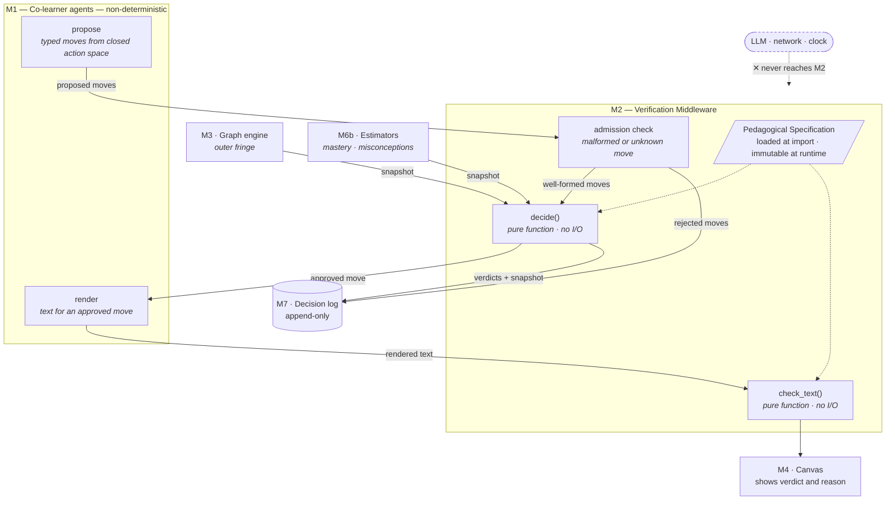

# M2: Verification Middleware

## What is the Verification Middleware?

The part of the system that decides what the agents are allowed to do. The
agents propose; M2 rules on the proposal. Every turn, without exception.

It exists so that the pedagogy does not depend on an LLM behaving well. The
agents are free to be creative about *what to suggest* and *how to phrase it*,
but the question *is this allowed right now* is taken away from them entirely
and answered here, by code, against rules a lecturer wrote.

M2 is the only place in the system that holds pedagogical authority. M3 runs
graph algorithms and knows no pedagogy. M6 counts evidence and judges nothing.
M1 proposes and phrases. If you want to know why the system behaved a certain
way, the answer is always in M2 and the spec it reads — there is nowhere else
to look.

M2 does two things:

| | When it runs | Answers |
|---|---|---|
| **`decide()`** | before the agent speaks | *May this move be made?* |
| **`check_text()`** | after the agent writes | *May this sentence be sent?* |

The first guards the action. The second guards the words. An approved move can
still be rendered into text that gives the answer away, so one check is not
enough.

Neither function calls an LLM. Neither reaches the network. Neither reads the
clock. This is what makes a decision replayable a month later.

---

## Architecture



Note what has no arrow. Nothing flows from M2 back into M1 except a verdict —
M2 never asks the agent to think again, never hands text back for rewriting.
And the facts from M3 and M6b arrive *before* the decision, frozen into a
snapshot, rather than being fetched while the rules run. That ordering is what
makes replay possible.

---

## The three verdicts

**Short definition**

Every proposed move comes back with exactly one of three answers.

| Verdict | Meaning |
|---|---|
| **allow** | the move may be made as proposed |
| **block** | the move may not be made; nothing is said in its place |
| **downgrade** | the move is replaced by a weaker one from the spec |

`downgrade` is the one that earns its keep. A VerifyShield that can only say no makes
the system useless at exactly the moments it matters most — the student asks
for the answer, the agent is silenced, the turn dies. Downgrade keeps the
conversation moving while still refusing the thing that was asked for.

The three are not an arbitrary choice. They are the classical taxonomy of
runtime enforcement mechanisms (Ligatti et al., *Edit Automata*): a monitor
that can only terminate, one that can also suppress individual actions, and one
that can substitute. M2 is the third kind, minus termination — it never ends a
session.

**Example use case**

An has attempted `for_loop` twice and asks outright for the solution. The
teacher agent proposes `reveal_answer`.

```
proposed : reveal_answer
rule     : reveal_requires_attempts
reason   : NOT_ENOUGH_ATTEMPTS  (2 attempts, spec requires 3)
verdict  : downgrade → hint_level_2
```

An does not get the answer. An does get a hint, and the canvas shows why the
answer was withheld. The spec said three attempts; the spec is also what said
`hint_level_2` is the right substitute.

---

## `decide()` — the decision function

**Short definition**

One function, called once per turn, that takes the proposed moves and returns a
verdict for each. It is pure: the same inputs always produce the same outputs,
today or in a year.

It runs in three steps.

Before any of this, a move must be well-formed: a proposal naming an unknown move
type, or a move the proposing role is not allowed, is rejected at the door without
reaching the guards. Rejections are logged like verdicts — a stream of malformed
proposals from M1 is a signal worth counting.

**Gather.** Ask M3 for the outer fringe of the student's knowledge state, ask M6b for the
mastery score and the active misconceptions, read the turn counters. Freeze all
of it into a snapshot that does not change for the rest of the decision.

**Evaluate.** Run the guards from the spec against the move and the snapshot.
Nothing is fetched here; everything the rules might need is already in hand.

**Resolve.** The first rule that denies wins. A denied move is looked up in the
spec's downgrade table. The turn budget is applied.

Three defaults hold throughout:

- **Deny by default** — a move matching no allow rule is blocked.
- **Fail closed** — if M3 or M6b cannot answer, the verdict is block, not allow.
- **No ambient input** — no network, no LLM, and no clock. A rule that reads
  the system time directly would break replay, so time enters through the
  snapshot like every other fact.

The snapshot is the part worth defending. Because the decision is a function of
the snapshot alone, replaying it is not a reconstruction exercise: take the
snapshot out of M7, run the function, and the verdict must come back identical.
Had the rules queried M6b while running, replay would require rebuilding the
whole ledger state at that instant — which is the sort of thing that is
promised in a report and never actually done.

**Example use case**

An asks to start `nested_loop`. The teacher agent proposes `advance_to_item`.

Gather:

```
move      : advance_to_item(nested_loop)
snapshot  : for_loop 0.34 · fringe: [function]
            attempts(for_loop)=4 · active: accumulator_reset
            moves_approved_this_turn = 0
```

Evaluate: the spec requires `for_loop` at 0.85 for `nested_loop` to open. An is
at 0.34.

```
verdict   : block
rule      : nested_loop_requires_for_loop
reason    : MASTERY_BELOW_THRESHOLD
```

Resolve: there is no downgrade for an advance request, so block stands. M4
draws the locked edge and shows the reason. M7 records the snapshot alongside
the verdict.

Bình, one module ahead, proposes the same move with `for_loop` at 0.89 and gets
`allow`. Same function, same rule, same spec — the only difference is the
snapshot.

---

## `check_text()` — the post-filter

**Short definition**

The second gate. The move was approved, M1 wrote a sentence for it, and this
checks the sentence before it reaches the student.

It is needed because move approval and text approval are different questions.
`hint_level_1` is a perfectly legal move; a hint that contains the finished
loop is not a legal hint. The agent is non-deterministic, so it will
occasionally write past the move it was given.

Like `decide()`, it is pure and reads its rules from the spec. Unlike
`decide()`, its input is a string rather than a typed move, and it fails in a
different way — content leaking rather than a forbidden move slipping through.
That is why it is a separate function with its own tests in M5.

**Example use case**

The move `hint_level_1` was approved for An, who is stuck resetting the
accumulator inside the loop. The deskmate renders:

```
Try moving your s = 0 above the for line — like this:

    s = 0
    for x in ds:
        s = s + x
```

The move was legal. The text is not: the spec's post-filter rules for this
module forbid a complete loop body in a level-one hint. `check_text()` returns
fail, nothing is sent, and M1 renders again under the same approved move.

---

## Where the pedagogical rules live

**Short definition**

Not in M2. In the spec.

M2 holds the machinery — how to read a rule, how to compare a score to a
threshold, which rule wins when two apply. Every pedagogical quantity and every
pedagogical choice sits in the Pedagogical Specification, loaded once at import
and never modified at runtime.

The test is simple: *to change this, would a lecturer need a programmer?* If
yes, it is in the wrong place.

Five kinds of rule, all of them spec data:

| Kind | Example |
|---|---|
| **Progression guard** | mastery ≥ 0.85 before `nested_loop` opens |
| **Move legality** | `reveal_answer` only after 3 attempts |
| **Role asymmetry** | the deskmate may not propose hint moves |
| **Downgrade map** | blocked `reveal_answer` becomes `hint_level_2` |
| **Turn protocol** | `max_moves_per_turn`, agent priority order |

Role asymmetry belongs here rather than being left implicit in how the agents
are wired. The deskmate having no hint ladder makes hint moves unlikely; a rule
in the spec makes them impossible, and only the second is something M5 can test.

A rule has four parts — a trigger, a condition, an enforcement, and a reason
code:

```
rule: reveal_requires_attempts
  when:   move.type == reveal_answer
  if:     snapshot.attempts < item.min_attempts
  then:   downgrade → hint_level_2
  reason: NOT_ENOUGH_ATTEMPTS
```

The reason code is not decoration. M4 needs it to tell the student why an edge
is locked, M7 needs it in the log, and M5 needs it to assert that the right
rule fired rather than merely that the right verdict came out.

**Example use case**

A lecturer finds that three attempts before a hint is too harsh for the first
week. They open the spec, change `min_attempts` from 3 to 2, and reimport. M3
rechecks the spec for consistency, and the next session behaves differently.

No code was touched, no redeployment happened, and the change is visible in
version control as a one-line diff that another lecturer can argue with. That
is the whole point of keeping the rules out of M2.

---

## What M2 does not do

Declared, not missing.

| M2 does not | Because |
|---|---|
| call an LLM | it would end determinism, and with it replay |
| generate text | that is M1's render step |
| write to the evidence ledger | only evidence producers may |
| estimate mastery | that is M6b |
| judge whether code is correct | that is the test runner |
| run graph algorithms itself | that is M3 |