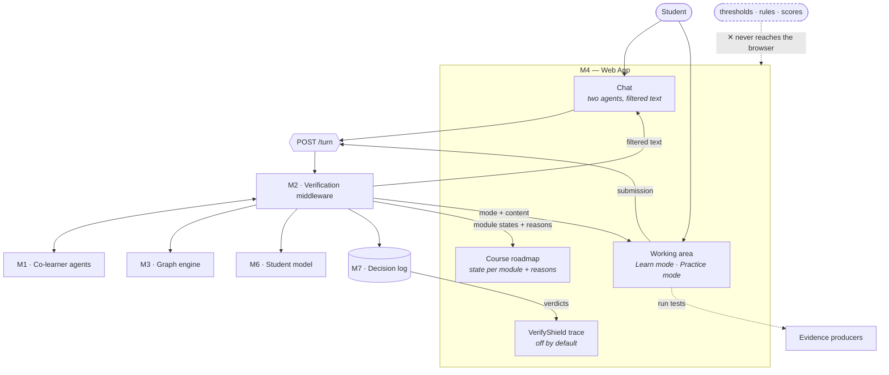

# M4: Web App and Canvas

## What is the Web App?

The surface the student actually uses: a conversation with two agents, a map of
the course, and a place to read and to write code.

It is also where the architecture stops being a claim on paper. A VerifyShield that
cannot be seen is indistinguishable from no VerifyShield at all. When a module is
closed, the student sees which module is closed and why; when the teaching
content appears, it is labelled with the module it came from. Every constraint
the system enforces has a corresponding thing on screen, and that correspondence
is the component's real job.

M4 shows three things:

| | Shows | Fed by |
|---|---|---|
| **Course roadmap** | every module and its state, with reasons for closed ones | M3 via M2 |
| **Chat** | the two agents and the student | M1 via M2's post-filter |
| **Working area** | the module's materials, or the exercise and its results | spec, evidence producers |

There is a fourth panel, off by default, that shows the raw verdict for each
turn. It is for demonstrating the system rather than for learning with it.

---

## The rule the whole component rests on

**M4 computes nothing.**

Everything it displays has already been decided by the time it arrives. The
browser is never told what a threshold is and never compares a score to one. The
server does not send `for_loop: 0.34` and leave the page to work out that this
means closed; it sends the state, the reason, and the missing prerequisites.

This is the same rule that keeps M3 free of pedagogy, applied to the view layer,
and it is load-bearing for the same reason. If the browser decided which modules
were open, then a pedagogical decision would be sitting in JavaScript — outside
the spec, outside M2, reviewed by nobody, and changeable by anyone with the
developer console open. The VerifyShield would have a way around it.

One endpoint carries a turn:

```
POST /turn  { message }
   →  { messages[], roadmap[], working_area, trace? }
```

One call returns everything needed to redraw. The client keeps no state of its
own and reconciles nothing. With a course of a few dozen modules, sending the
whole map every turn costs less than computing what changed.

---

## Architecture



Everything leaves through M2. No text, module state or content reaches the browser
without passing the VerifyShield, and the browser cannot call M1, the graph or the ledger
to fetch any of it — which is what makes VC2 a property of the deployed system
rather than of the diagram. The student's own message is relayed to both agents
unmediated, because reading a message decides nothing.

---

## Course roadmap

**Short definition**

The course as a picture, with each module in one of three states: mastered, open
to start now, or closed. Closed modules carry the reason they are closed.

The three states come straight from the components that own them. Mastered and open
are M2's reading of the student's knowledge state; open is M3's outer fringe.
The course roadmap displays the student's mastery on each module, so the student can
see the same number the system is deciding with.

The course roadmap is always on screen. This is deliberate: it is the part of the interface
that makes progression legible, and it is where the student watches a module open
when they pass one.

**Example use case**

An, four attempts into `for_loop`:

```
variable      mastered   0.91
if_else       mastered   0.88
for_loop      open       0.34
nested_loop   closed     —      needs for_loop ≥ 0.85
```

She can see exactly what is in her way and exactly how far off she is. When
`for_loop` crosses 0.85, `nested_loop` changes state on the course roadmap in the same turn.

Bình's map is drawn by the same code from different numbers, and `nested_loop` is
open for him. Nothing in the browser knows why.

---

## Chat

**Short definition**

The conversation, with the teacher agent and the deskmate agent distinguishable
from each other and from the student.

Every line shown here has passed M2's post-filter. Text that failed the filter
was never sent and leaves no gap in the conversation — the agent simply rendered
again under the same approved move.

Which agent speaks is not a separate decision made here or anywhere else. It
falls out of which move M2 approved, and the two agents have different move sets
available to them, so the division of labour between them is a property of the
spec rather than of the interface.

**Example use case**

An has just written a loop that resets the total on every pass.

```
Teacher    where does the total live?
An         inside the loop I think
Deskmate   mine printed 0 every time too
```

The deskmate's line is a `share_confusion` move, approved because M6b reports An
and the deskmate's scripted state share a misconception label. It is not an
explanation, and the deskmate has no hint ladder to draw one from — which is the
point of having a companion rather than a second tutor.

---

## Working area

**Short definition**

One panel with two modes. **Learn** shows the current module's materials.
**Practice** shows the exercise, the editor, and the test results.

The system sets the mode once, when a module opens: the panel starts in Learn.
After that the mode belongs to the student. A teaching move never takes the
editor away from someone who is writing code; it offers the material it refers
to, and the student opens Learn when they are ready. They can switch either way
at any time, because a module is not a corridor and nobody learns by reading once.

Learn mode is headed with the module name and states that the materials belong to
that module alone. That line is the item-local retrieval rule made visible: the
agents draw content from the current module's materials and from nowhere else in
the course, which is what stops a question from surfacing material that belongs
behind a closed module.

**Example use case**

An opens `for_loop`. The panel is in Learn:

```
for_loop · accumulating a total

A running total needs a variable that survives every pass
of the loop.

    s = 0
    for x in ds:
        s = s + x

materials attached to this module only
```

She starts the exercise and the panel switches to Practice. She submits, the
evidence producers run, and the result comes back as two separate facts:

```
3/3 tests passed      uses_loop ✓
```

Both are shown because both matter and they can disagree. A submission that
passes every test while breaking the one principle the exercise exists to
practise is a failure the student should see as a failure, not as a green tick.

---

## VerifyShield trace

**Short definition**

A panel, off by default, showing the raw verdict for each turn: which move was
proposed, which rule fired, what M2 decided.

It exists because the system has two audiences with opposite needs. A student
should not see that an agent tried to give them the answer and was stopped —
it breaks the conversation, and it turns the VerifyShield into something to probe
rather than something to learn behind. A supervisor must see exactly that, or
the architecture is only a diagram.

It costs almost nothing to build: the records are already in M7, written for
VC3. The panel reads them.

**Example use case**

With the trace on, An's request for the answer looks like this to an observer:

```
proposed   teacher   reveal_answer
rule       reveal_requires_attempts
verdict    downgrade → hint_level_2
```

And to An, it looks like a hint.

The same panel run twice, once normally and once with the VerifyShield disabled, is
the clearest demonstration the system has: identical input, one run hands over
the answer, the other hands over a hint.

---

## What M4 does not do

Declared, not missing.

| M4 does not | Because |
|---|---|
| know any threshold | M2 has already applied it |
| decide which module is open | M3 computed it, M2 sent it |
| decide which agent speaks | it falls out of the approved move |
| filter text | M2's post-filter ran before the text was sent |
| call M1, M3, or M6 directly | every path goes through M2 |