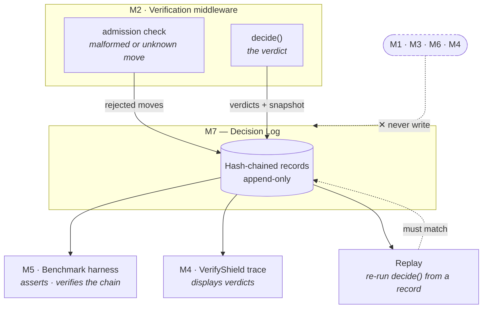

# M7: Decision Log

## What is the Decision Log?

The record of what the VerifyShield did. One entry for every verdict M2 reached, kept
in order, never edited.

It exists because a guarantee nobody can check afterwards is not a guarantee.
M2's decisions are deterministic, which means a decision taken months ago can be
reproduced exactly — but only if what went into it was written down. The log is
what makes that possible, and it is the whole of VM3.

It records the system, not the student. That distinction is the easiest thing
to get wrong here, because the project has two append-only stores and they look
superficially alike:

| | M6a · Evidence ledger | M7 · Decision log |
|---|---|---|
| Records | what the student did | what the system decided |
| Written by | evidence producers | M2 |
| Holds | objective facts: tests passed, principles broken | verdicts, the rule that fired, the inputs |
| Supports | VC4 — state rests on evidence | VC3 — decisions are replayable |

Separate stores, separate writers, separate purposes. A verdict is not a fact
about a student and does not belong in their ledger.

M7 is written by M2 alone and read by M5, which asserts against it, and by M4's
VerifyShield trace, which displays it.

---

## Architecture



Two write points inside M2, no write points anywhere else. The admission check
writes too: a stream of malformed proposals from M1 is a signal worth counting,
and M5 needs the number. Everything else in the system reads.

---

## What a record holds

**Short definition**

Enough to reproduce the decision without the rest of the system, plus enough to
detect the record having been altered.

```
seq          1041
turn_id      t-88
timestamp    2026-10-24T21:40:11Z
student      an
source       decide            # or: admission
proposed     [teacher:reveal_answer, deskmate:share_confusion]
snapshot     {for_loop: 0.34, attempts: 2, fringe: [function], ...}
verdict      downgrade → hint_level_2
rule_id      reveal_requires_attempts
reason_code  NOT_ENOUGH_ATTEMPTS
spec_hash    a3f91c...
prev_hash    7b2e04...
hash         c81d55...
```

Two fields carry more weight than they look.

**`snapshot`** is the frozen set of facts `decide()` ran against. Without it,
reproducing a decision would mean rebuilding M6's ledger state and M3's answers
as they stood at that moment — the kind of thing that is promised in a report
and never actually done. With it, replay is a function call.

**`spec_hash`** identifies which version of the specification was in force. A
lecturer lowering `min_attempts` from 3 to 2 silently changes what every past
verdict would be today. Without this field, a replay that disagrees with the log
is indistinguishable from a bug.

**Example use case**

An asks for the answer on her second attempt. The record above is written. Six
weeks later, during the demo, the record is replayed:

```
load record 1041
run decide(proposed, snapshot, spec@a3f91c)
  → downgrade → hint_level_2   ✓ matches
```

Nothing from the live system was consulted. The spec it ran against is the one
named in the record, not the one in use today.

---

## Append-only, and why that needs more than a promise

**Short definition**

Each record carries the hash of the record before it, so the entries form a
chain. Changing a record in the middle means recomputing every hash after it.

Calling a file append-only is a statement of intent; a file anyone can edit is
append-only only until someone edits it. Hash chaining is the cheap way to turn
the intent into something checkable, and it is the classic construction for
audit logs on machines that cannot themselves be trusted (Schneier & Kelsey).
The property it provides is **forward integrity**: records written before a
compromise cannot be altered afterwards without detection.

M5 verifies the chain on every run. That matters more than the chain itself —
tamper-evidence only means anything if somebody checks, and in this system the
benchmark harness is the somebody.

**Example use case**

A record is edited by hand to make a blocked move look approved:

```
verify chain
  seq 1041  hash mismatch  (recorded c81d55..., computed 4e9a71...)
  chain broken at 1041; 312 subsequent records unverifiable
```

The suite fails. Not because the edit was clever or clumsy, but because the
edit cannot be made without rewriting everything that followed it.

---

## What M7 does not do

Declared, not missing.

| M7 does not | Because |
|---|---|
| hold student evidence | that is M6a, written by the evidence producers |
| get written by M1, M3, M4, or M6 | M2 is the only writer |
| get read during a turn | it is for afterwards: audit, replay, the harness |
| store the student's code | submissions are referenced by hash, as in M6a |

Three limits worth stating.

**Tamper-evident is not tamper-proof.** Someone with the whole file and the will
to use it can recompute the entire chain and leave it consistent. Hash chaining
raises the cost of a silent single-record edit to the cost of rewriting the log;
it does not make forgery impossible. Stronger schemes exist — keyed MACs with
evolving keys, published chain heads, external timestamping — and all of them
need key management or a third party, which is out of scope here.

**Detection requires auditing.** A chain nobody verifies proves nothing, and the
literature has demonstrated successful tampering with logs that were nominally
tamper-evident precisely because auditing was skipped. Running M5 is what makes
the property real, so the chain check belongs in the suite rather than in a
maintenance script somebody remembers to run.

**Replay proves conformance, not correctness.** A record that replays identically
shows that the decision followed from its inputs and the spec in force. It does
not show that the decision was pedagogically right — that would need the spec
itself to be validated, which nothing in this system attempts.