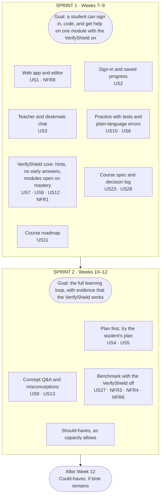

# Product Backlog — Verifiable Co-Learner Agent

**Updated at:** 11/11/2026

**Product vision:** a web-based co-learner for first-year students learning Python, where two AI agents (teacher and deskmate) help the student learn *deeper, not just faster*. A deterministic VerifyShield checks every agent move so the student cannot take shortcuts.

**Scope:** Capstone Project A, 6-week implementation. Student-focused, not a lecturer dashboard.

---

## 1. Stakeholders

| Stakeholder | Type | Main concern |
|---|---|---|
| Student (1st-year, no programming background) | Primary user | Can learn, is not left stuck, is not talked down to |
| Lecturer / course instructor | Secondary user | Students genuinely understand; content matches the curriculum; can tune the rules |
| Project supervisor / assessor | Evaluator | VerifyShield behaviour is verifiable, measurable and reproducible |

---

## 2. User stories (MoSCoW)

### Student

| ID | User story | MoSCoW |
|---|---|---|
| US1 | As a student, I want to start coding in the browser without installing anything, so that I am not blocked by setup. | Must |
| US2 | As a student, I want to sign in and have my progress saved between sessions, so that I can continue where I stopped. | Must |
| US3 | As a student, I want to chat with a teacher agent and a deskmate agent that are visibly different, so that I get both guidance and peer-like support. | Must |
| US4 | As a student, I want to agree on a plan in plain language before coding, so that I don't face a blank editor. | Must |
| US5 | As a student, I want my chosen approach to be tried even if it is wrong, so that I learn from the result instead of being corrected first. | Must |
| US6 | As a student, I want errors and test failures explained in plain language first, so that failure feels like information, not punishment. | Must |
| US7 | As a student, I want graduated hints instead of the full answer, so that I move forward while still doing the work. | Must |
| US8 | As a student, I want the agents to refuse to give me the answer before I have made enough attempts, so that I actually learn. | Must |
| US9 | As a student, I want to ask about a concept and get an explanation limited to my current module, so that I am not overwhelmed or spoiled by later material. | Must |
| US10 | As a student, I want per-module learning materials and practice exercises with automatic tests, so that I can study and check myself in one place. | Must |
| US11 | As a student, I want a course roadmap showing what I mastered, what I can start next, and what is closed (and why), so that I know where I stand. | Must |
| US12 | As a student, I want a new module to open only when I have shown enough mastery of the previous ones, so that I build a solid foundation. | Must |
| US13 | As a student, I want the agents to recognise my specific misconception (e.g. resetting a counter inside a loop) and respond to that exact mistake, so that I fix the cause, not just the symptom. | Must |
| US14 | As a student, I want the teacher to step in after repeated failed rounds, so that the deskmate and I don't stay lost. | Should |
| US15 | As a student, I want to debug through guiding questions, so that I learn a reusable debugging procedure. | Should |
| US16 | As a student, I want to see my progress over time (exercises done, attempts to pass), so that I stay motivated. | Should |
| US17 | As a student, I want the deskmate to ask the questions I'm shy to ask and admit when it is confused too, so that I feel I'm learning with a peer. | Should |
| US18 | As a student, I want feedback on how my code is built, not only whether tests pass, so that I don't pass with code that dodges the concept (e.g. `return sum(xs)` instead of a loop). | Should |
| US19 | As a student, I want short quizzes and a test at the end of each module, so that I can check my understanding. | Should |
| US20 | As a student, I want a suggested learning path to a chosen goal, so that I know what to study next. | Could |
| US21 | As a student, I want to see my code run step by step (code visualisation), so that I understand what each line does. | Could |
| US22 | As a student, I want a final course exam mode, so that I can test myself at the end. | Could |

### Lecturer

| ID | User story | MoSCoW |
|---|---|---|
| US23 | As a lecturer, I want the course graph and rules (prerequisites, thresholds, hint ladders) in one spec file that is checked on import, so that broken courses (cycles, unreachable modules) are caught before students see them. | Should |
| US24 | As a lecturer, I want to change thresholds (e.g. attempts before reveal, mastery needed, teacher-intervention N), so that the system matches my course. | Should |
| US25 | As a lecturer, I want to review and approve hints and misconception responses drafted by an LLM offline, so that students only see content I have checked. | Should |
| US26 | As a lecturer, I want to add exercises with test cases through a form, so that I can extend the bank without editing files. | Could |

### Supervisor / assessor

| ID | User story | MoSCoW |
|---|---|---|
| US27 | As an assessor, I want to run an offline benchmark against a baseline with the VerifyShield switched off, so that I can see the VerifyShield's effect (safety, utility, cost). | Must |
| US28 | As an assessor, I want every VerifyShield decision logged in a tamper-evident decision log, so that I can verify what the system did afterwards. | Must |
| US29 | As an assessor, I want to replay a logged decision and get the same verdict, so that I can confirm the system is deterministic. | Should |
| US30 | As an assessor, I want an optional VerifyShield trace panel (off by default), so that I can see when a move was blocked or downgraded. | Should |
| US31 | As an assessor, I want the system deployed on AWS and reachable through a public URL, so that I can try it without any local setup. | Could |

### Product owner

| ID | User story | MoSCoW |
|---|---|---|
| US32 | As a product owner, I want to choose a real language model or fake responses, so that I can point the app at an OpenAI-compatible model without editing the server and restarting. | Must |
| US33 | As a product owner, I want to read the newest VerifyShield decisions and switch the VerifyShield on or off, so that I can see what it decided and show the difference. | Must |

---

## 3. Core features

In one line: two AI agents help the student learn Python, and a deterministic VerifyShield checks every agent move so the student cannot take shortcuts.

- **Two co-learner agents:** a teacher (knows everything, steps in rarely) and a deskmate (student-level, may be wrong, asks peer questions). *US3, US14, US17*
- **Student-led learning:** agree on a plan in plain language first; the student's approach is run even if wrong, so they learn from the result. *US4, US5*
- **Help without shortcuts:** graduated hints, no answer before enough attempts, debugging by questions, errors explained in plain language. *US6, US7, US8, US15*
- **Learn and Practice workspace:** in-browser editor, per-module materials, concept Q&A limited to the current module, exercises with automatic tests, quizzes. *US1, US9, US10, US19*
- **Course roadmap:** shows each module as mastered, open, or closed (with the reason); a module opens only when the previous ones are mastered. *US11, US12, US20*
- **Student model:** estimates mastery from test results and code structure, and detects specific misconceptions. *US13, US18*
- **VerifyShield:** every agent move is checked by fixed rules before the student sees it (allow, block, or downgrade to a weaker move). *US8, US30*
- **Decision log and benchmark:** tamper-evident log of every decision, replay, and an offline benchmark against a baseline with the VerifyShield switched off. *US27, US28, US29*
- **Course spec for lecturers:** one spec file holds the course graph and rules, checked on import; thresholds can be tuned. *US23, US24, US25*
- **Accounts and progress:** sign-in, saved progress, progress view. *US2, US16*
- **Nice-to-have:** code visualisation, final exam mode, exercise form, deployment on AWS. *US21, US22, US26, US31*

---

## 4. Non-functional requirements

| ID · Attribute · MoSCoW | Source | Stimulus | Artifact | Response | Response measure |
|---|---|---|---|---|---|
| **NFR1** · Availability (fail closed) · Must | Internal fault | Graph engine or student model does not answer | VerifyShield (verification middleware) | Move is blocked, student gets a safe fallback message, session continues | 100% of such faults give a block verdict; 0 unapproved moves served; session never terminated |
| **NFR2** · Performance · Should | Student | Sends a message | VerifyShield decision path (before and after rendering) | Verdict and text check are returned | VerifyShield adds ≤ 10 ms per turn, excluding the LLM call |
| **NFR3** · Security (robustness to manipulation) · Must | Student | Sends an adversarial prompt to extract the answer or skip a module | VerifyShield + agents | Move is blocked or downgraded; answer is not revealed | 0 successes over the fixed adversarial set (vs. baseline without VerifyShield) |
| **NFR4** · Security (integrity) · Must | Anyone with access to the data | Edits or deletes a past decision-log record | Decision log | Tampering is detected | 100% of modifications detected by hash-chain check on every benchmark run |
| **NFR5** · Security (confidentiality) · Should | Anyone with access to the logs | Reads the decision log | Decision log + student data | Only system decisions and necessary student identifiers are visible | 0 personal fields beyond student ID in the log |
| **NFR6** · Testability (reproducibility) · Must | Assessor | Re-runs the benchmark or replays a logged decision | Benchmark harness + decision log | Same verdicts are produced | 100% identical results across runs; 100% of replayed decisions match the logged verdict |
| **NFR7** · Modifiability · Should | Lecturer | Changes a threshold, hint ladder or module | Pedagogical Specification | Change is validated and applied to new sessions without code changes | 0 code changes needed; 100% of invalid specs rejected on import |
| **NFR8** · Usability · Must | First-time student with no programming background | Opens the app to start coding | Web app | Runnable editor is shown, nothing to install | ≤ 3 clicks to a runnable editor; 0 software installs |

---

## 5. MoSCoW summary

- **Must (17 stories + 5 NFR):** US1–US13, US27, US28, US32, US33, NFR1, NFR3, NFR4, NFR6, NFR8 — the core loop (learn → practice → guided help), modules that open only on mastery, the evidence that the VerifyShield works, a product owner view of every verdict, and a product owner choice of language model.
- **Should (11 stories + 3 NFR):** US14–US19, US23–US25, US29, US30, NFR2, NFR5, NFR7 — important, but the product still works without them.
- **Could (5):** US20, US21, US22, US26, US31 — only if time remains.
- **Won't (this release):**
  - A lecturer dashboard
  - Multiple courses (only Intro to Python, 3–5 diagnosed modules)
  - LLM-simulated students or LLM judges in the benchmark
  - Capstone Project B

---

## 6. Roadmap

Two sprints, three weeks each, starting now (Week 7). Sprint 1 builds the foundation and the VerifyShield; Sprint 2 completes the learning loop and produces the evidence. Detailed sprint backlogs are planned at the start of each sprint.

TODO: push this into Jira

| Sprint | Weeks | What goes in |
|---|---|---|
| Sprint 1 | 7–9 | **Must:** US1, US2, US3, US6, US7, US8, US10, US11, US12, US28, US32, US33, NFR1, NFR8. **Should:** US23 (the spec is the base for all rules). |
| Sprint 2 | 10–12 | **Must:** US4, US5, US9, US13, US27, NFR3, NFR4, NFR6. **Should (by capacity):** US14–US19, US24, US25, US29, US30, NFR2, NFR5, NFR7. |
| Later | after 12 | **Could:** US20, US21, US22, US26, US31. |
