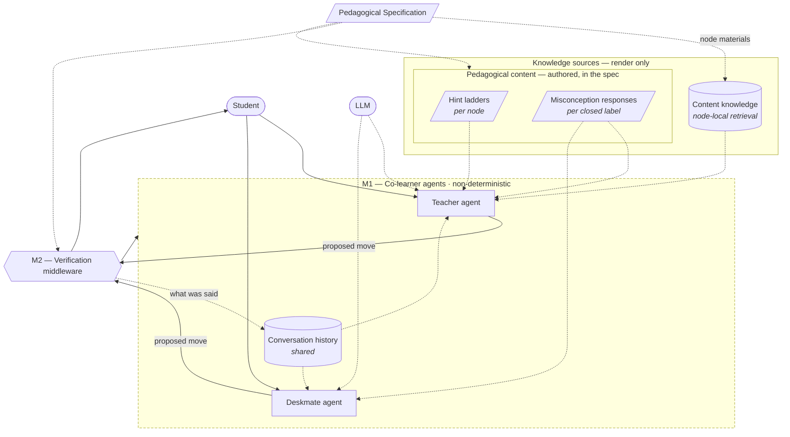

# Module 1: Co-learner Agents

## What are the Co-learner Agents?

The only part of the system that is not deterministic. Two agents sit with the
student — a teacher and a deskmate — and between them they carry the whole
conversation.

What it does not do is decide. Every move an agent wants to make is proposed to
M2 and takes effect only if M2 approves it, and every sentence an agent writes
passes back through M2 before the student sees it. The agents propose and
phrase; they never decide and never write state.

M1 holds two agents:

| | Role | Knows |
|---|---|---|
| **Teacher agent** | sets the work, explains, guides | the full content of the current topic |
| **Deskmate agent** | learns alongside, reacts, sympathises | deliberately little — roughly what the student knows |

The deskmate being weaker is the design, not a shortcoming. A companion that
knows everything is a second teacher, and the whole point of having one is that
the student is not the only one in the room still working things out.

## Architecture

Both agents hear the student directly, and both put their move to the same
middleware. Nothing reaches the student except through M2 — there is no second
path out.

## The three jobs

Each agent does the same three things every turn, and they are kept apart on
purpose.

| | Takes in | Gives back |
|---|---|---|
| **Perceive** | what the student wrote | one label from a fixed list of intents |
| **Propose** | that label, plus its own state | one move from a fixed list of moves |
| **Render** | a move M2 has approved | the words |

The gap between propose and render is where M2 sits. An agent never knows in
advance whether its move will come back, and it never writes a sentence for a
move that was not approved.

This is also why the agents cannot drift. Perceive cannot invent a new kind of
intent, propose cannot invent a new kind of move, and render only ever dresses
up something that has already been allowed.

**Example use case**

An writes: *"i dont get why my loop keeps giving 0"*.

Perceive returns `asking_for_help`. Both agents propose a move — the teacher
offers a hint, the deskmate offers to share that it hit the same thing. M2
approves what the spec allows at this point in the course, and only then does
an agent write anything.

Had the deskmate instead proposed moving on to the next topic, M2 would have
refused it, and the student would never have seen the suggestion.

## Agent state

Two things are tracked, and they are never mixed.

**Conversation state** — what has been said so far, so the next turn follows
from the last. Shared ground for both agents.

**Deskmate knowledge** — how much the deskmate itself has picked up. Held in
the spec rather than invented by the agent, so the deskmate's level is a
teaching decision someone made and can change, not an accident of whatever the
model felt like being that day.

What is *not* here is the student model. What the student knows lives in M6 and
is built from evidence. What the deskmate knows lives here and is written by
the lecturer. Letting those two touch would mean the system's picture of the
student could be shaped by an agent, which is exactly what the architecture
exists to prevent.

## Knowledge sources

An agent only reaches for content once a move has been approved, and only
within whatever that move covers. There are two kinds, and they are different
because of where they come from.

### Pedagogical content — authored

Written by hand and kept in the spec. Two parts:

**Hint ladders** sit on each topic and run from vague to specific. They are for
when the student is stuck but the system does not know *what* they have got
wrong — the first hint nudges, the next says more, the last comes close to
telling.

**Misconception responses** sit on each label in the closed set of
misconceptions. They are for when the system *does* know: the constraint
checker caught it, and there is something precise to say about that particular
mistake.

Neither can be looked up, which is why both are written out. Course slides
explain how a loop works; no slide anywhere says what to tell a student who
resets their running total on every pass. That kind of knowledge only exists
once somebody has thought about that specific mistake.

### Content knowledge — retrieved

The ordinary material of the course: syntax, concepts, worked examples. This
already exists in the lecture notes, so it is pulled from there rather than
rewritten — but only from the material attached to the topic the student is
currently on.

Keeping the search inside one topic is not an optimisation. A search across the
whole course could surface material from a topic the student has not unlocked,
which would walk straight around the gate the system exists to hold.

### Who gets what

The teacher reaches all three. The deskmate reaches only the misconception
responses.

Hints are guidance, and guidance is a teacher's job — hand them to the deskmate
and it stops being a deskmate. Misconception responses are the one thing a
classmate genuinely has: *I got that wrong too, and here is what tripped me up*.
That is the whole of what the deskmate is for, and giving it anything more
would quietly turn the three-way conversation back into a two-way one.