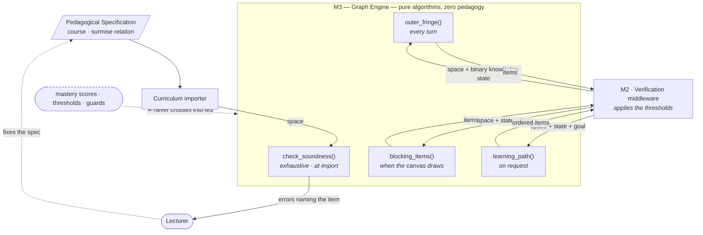

# M3: Graph Engine

## What is the Graph Engine?

Pure algorithms over the course structure, with zero pedagogy. It answers
questions about shape — what follows what, what is missing, what can never be
reached — and nothing about whether a student is ready for anything.

It is the only module that produces a mathematical guarantee. Its questions are
decidable, so when it reports that an item cannot be reached, that is a proof
over every path rather than a result from the paths that happened to be tried.
This is where the word "semi-formal" in the project description is earned.

It buys that guarantee by knowing nothing. **M2 applies the thresholds**, so what
crosses into M3 is a binary knowledge state — the set of items the student has
mastered. Never a score, never a threshold. Zero pedagogy is therefore enforced
by the interface rather than by discipline: M3 cannot make a pedagogical
decision because it is never given the data one would require, and a reviewer
can confirm that by reading four function signatures.

```
check_soundness(space)                → errors[]       # at import
outer_fringe(space, state)            → items          # every turn
blocking_items(space, state, item)    → items          # when the canvas draws
learning_path(space, state, goal)     → ordered items  # on request
```

The dependency runs one way only. M2 calls M3; M3 never calls back, holds no
state between calls, and does not know a student exists.

---

## Architecture



The blocked arrow is the module's whole design. A score entering M3 would mean a
pedagogical decision could be taken here, outside M2 and outside the spec.

---

## Vocabulary

Borrowed from Knowledge Space Theory, because the structure has been studied
formally since 1985 and there is no reason to invent names for it.

| Term | Means |
|---|---|
| **item** | one module |
| **surmise relation** | the prerequisite relation between items |
| **knowledge state** | the set of items a student has mastered |
| **knowledge space** | the family of states the map permits |
| **outer fringe** | what the student can start next |

---

## Soundness check, at import

**Short definition**

One exhaustive pass over the whole map, run by the curriculum importer before
any student interacts with the system. It either returns no errors or names the
items that are wrong.

This is the strong guarantee: it holds across *every* possible path, not merely
across the cases the author thought to try.

Four error classes:

| Error | Means |
|---|---|
| **Cycle** | no valid learning order exists |
| **Unreachable item** | no path to it from any entry item |
| **Dead end** | nothing opens after it |
| **Dangling reference** | a rule names an item the map does not contain |

The middle two matter most, because they fail quietly. The system runs normally,
the conformance suite passes, and a module simply never appears in front of any
student. Nothing at runtime can detect this — which is exactly why it has to be
caught before runtime.

Errors name the item, because the lecturer is the person who will fix the spec.

The idea is borrowed from workflow verification, where a process model is checked
for soundness — no deadlock, every task reachable — before deployment. The
exhaustive check is affordable because the graph is one course of a few dozen
items; state explosion does not arise at this scale.

**Example use case**

A map containing `loop → function → list → loop`:

```
cycle detected — no valid learning order exists
  loop → function → list → loop
```

A map containing `list_comprehension` with no incoming edge:

```
unreachable item: list_comprehension — will never open for any student
```

The second is the error that would otherwise have gone unnoticed for a semester.

---

## Outer fringe, every turn

**Short definition**

The items whose prerequisites are all satisfied and which the student has not yet
mastered. In other words: what they can start next.

This is the only M3 call on the hot path, and it is what M2 freezes into the
snapshot each turn. It is also exactly what M4's canvas needs in order to draw,
which is not a coincidence — in KST the Fringe Theorem states that a knowledge
state is fully determined by its inner and outer fringes.

There is empirical warrant for treating the outer fringe as real readiness:
across roughly 1.9 million learning occasions in ALEKS, the estimated median
probability that a student successfully learned an item from their own outer
fringe was about 0.93.

**Example use case**

An has mastered `variable` and `if_else`, and `for_loop` is the only item whose
prerequisites that satisfies:

```
state  : {variable, if_else}
fringe : [for_loop]
```

M3 is not told that An sits at 0.34 on `for_loop`, and does not need to be.
Whether 0.34 is enough is M2's question, asked against a threshold M3 has never
seen.

---

## Blocking items

**Short definition**

For a closed item, the prerequisites still missing. The reason an edge is locked.

It is a separate function from the fringe because it is asked at a different
time: the fringe is computed every turn, a reason only when something is drawn.

**Example use case**

The student clicks the locked `nested_loop` item:

```
blocking_items(space, {variable, if_else}, nested_loop) → [for_loop]
```

M3 supplies the item name. M2 supplies the rest of the sentence — 0.34 against a
threshold of 0.85 — because the number and the threshold are pedagogy.

---

## Learning path

**Short definition**

A topological ordering of the subgraph between the student's state and a goal
item. Nothing more elaborate.

The restraint is defensible rather than lazy. Optimal instructional sequencing
over prerequisite graphs is NP-hard in general, but with only hard prerequisites
and no soft preferences layered on top, any topological ordering is globally
optimal and computable in polynomial time. Adding search or a learned policy
would add machinery without adding a guarantee.

Path planning selects *which* items to study; the M2 guards still govern *how
deeply* each one is worked through. Breadth-wise shortcuts are legitimate
personalisation; depth-wise shortcuts remain blocked.

**Example use case**

```
learning_path(space, {variable, if_else}, nested_loop) → [for_loop, nested_loop]
```

Two items, in the only order the map permits.

---

## What M3 does not do

Declared, not missing.

| M3 does not | Because |
|---|---|
| know any threshold or score | M2 applies them; M3 receives a binary state |
| decide whether a student may advance | that is M2, against the spec's guards |
| hold student state between calls | every call is a pure function of its arguments |
| call M2, M6, or anything else | the dependency runs one way only |
| estimate mastery | that is M6b |