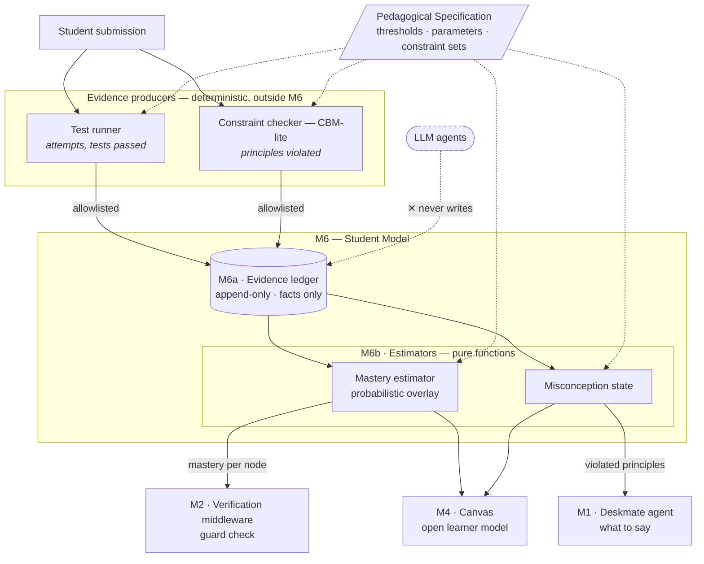

# Module 6: Student Model

## What is a Student Model?

The part of the system that records what *this particular student* currently
knows. The domain graph says what the course contains; the student model says
where the student stands on it.

It exists so the system can decide: unlock the next topic, or hold the student
here and keep practising. Nothing else in the system is allowed to answer that
question.

M6 has two halves:

| | What it holds | Answers |
|---|---|---|
| **Mastery estimator** | one mastery score per topic | *Has the student got it?* |
| **Misconception state** | which principles their code broke | *What are they getting wrong?* |

The first decides **whether to move on**. The second decides **what to say**.

Neither half measures anything itself. Both read the evidence ledger, which is
filled by the evidence producers that sit outside M6.

---

## Architecture



Data flows one way: submission → evidence producers → ledger → estimators →
M2 and M1. Nothing flows back, and no LLM appears anywhere before the final
step.

---

## M6a — Evidence ledger

**Short definition**

The record of what the student has actually done. One line per fact, never
edited, never deleted. If a correction is needed, a new line is added saying so.

Only the evidence producers are allowed to write to it — nothing else in the
system, and in particular no LLM agent. This single rule is what the rest of M6
stands on: if anything else could write here, the student's state would no
longer rest on objective evidence.

It stores facts, not code. The submission itself lives elsewhere and is
referenced, so that everything in the ledger is something that was measured
rather than something that needs interpreting.

**Example use case**

An submits a solution for the `print_basic` topic. Both evidence producers
append a line:

```
seq 88 | print_basic | test_runner        | 0 of 3 passed | syntax_error | attempt 1
seq 89 | print_basic | constraint_checker | syntax_invalid | unterminated_string
```

An fixes it two attempts later. The earlier lines stay exactly where they are —
the history of getting it wrong is part of the record, and it is what makes the
student's state reconstructible at any point in time.

---

## M6b — Estimators

Two functions that read the ledger and answer two different questions. Neither
talks to the other; both take their settings from the spec rather than holding
any of their own.

Both are pure: the same ledger always yields the same result. Run the ledger
through them again a month later and the numbers come back identical.

### Mastery estimator (probabilistic overlay)

**Short definition**

One copy of the course map per student, with a score from 0 to 1 on every
topic. The map is the same for everyone; only the scores differ — the scores
are the *overlay* laid over it. Each piece of evidence nudges a score up or
down, and a topic unlocks once its score passes the threshold set in the spec.

Scores move gradually rather than flipping on a single result, so one lucky
pass does not count as mastery and one careless slip does not erase it.

**Example use case**

An wants to start `nested_loop`. The spec says `nested_loop` requires
`for_loop` at 0.85 or above.

```
An's overlay:   variable 0.91 · if_else 0.88 · for_loop 0.34 · nested_loop 0.05
```

`for_loop` sits at 0.34, so M2 holds An on `for_loop` and the canvas shows the
locked edge with its reason.

Bình, same map, different scores:

```
Bình's overlay: variable 0.95 · if_else 0.93 · for_loop 0.89 · nested_loop 0.41
```

`for_loop` is at 0.89, so `nested_loop` opens.

Same course, same rule, different outcome — the only thing that changed is the
overlay.

### Misconception state

**Short definition**

What the student is stuck on *right now*. The ledger holds the whole history;
this reads it and reports which principles are still being broken and which
have been sorted out.

It exists because a mastery score alone cannot say *why* someone is stuck. A
student at 0.34 might not know the syntax, or might hold one specific
misunderstanding — the score looks identical either way.

Doing this inside M6 rather than letting the deskmate read the raw ledger keeps
the reasoning deterministic and testable. M1 receives a settled list and only
has to phrase it.

**Example use case**

An's ledger at the `for_loop` topic, across four attempts:

```
attempt 1 → broke: total reset inside the loop, returns inside the loop
attempt 2 → broke: total reset inside the loop, returns inside the loop
attempt 3 → broke: total reset inside the loop
attempt 4 → broke: total reset inside the loop
```

Mastery estimator → `for_loop: 0.41`, below the 0.85 the spec asks for, so M2
keeps An on this topic.

Misconception state → still stuck on the reset; the return has been sorted
since attempt 3.

The deskmate raises the reset and says nothing about the return — An fixed that
one already, and being told about it again would be the kind of noise that
makes a companion feel like a machine.

---

## Evidence producers

The two sources of fact. They sit outside M6, take a submission, and turn it
into ledger lines. They judge nothing and decide nothing — deciding is M2's job.

| | Looks at | Answers |
|---|---|---|
| **Test runner** | the code **running** | does it produce the right result? |
| **Constraint checker** | the code's **shape** | does it respect the principles? |

### Test runner

Executes the submission against fixed test cases and counts what passes. A
submission that will not run is still a fact, recorded with its reason rather
than left blank.

### Constraint checker (CBM-lite)

Reads the code's structure and checks it against a short list of principles
written for that exercise — does it use a loop, is the running total set up
before the loop, is the result returned after it.

Those lists are written by hand and only for the few topics that matter most,
which is what "lite" means here. They live in the spec alongside the
thresholds, so they can be read and argued with by someone who does not read
code — and so they are checked at import time like everything else in it.

**Example use case**

The exercise asks the student to total a list **using a loop**. Two submissions
pull the two producers in opposite directions.

```python
def tong(ds):
    return sum(ds)
```

Test runner: passes everything. Constraint checker: no loop — the one principle
the exercise exists to practise. Without the second producer this counts as a
clean success, and the student advances on a topic they never touched.

```python
def tong(ds):
    s = 0
    for x in ds:
        s = s + x
    return s + 1
```

Test runner: fails everything. Constraint checker: nothing broken — the shape
is right, one detail is wrong.

Two submissions, opposite verdicts from each producer. That is the case for
carrying both: either one alone gives a confident answer that is wrong.